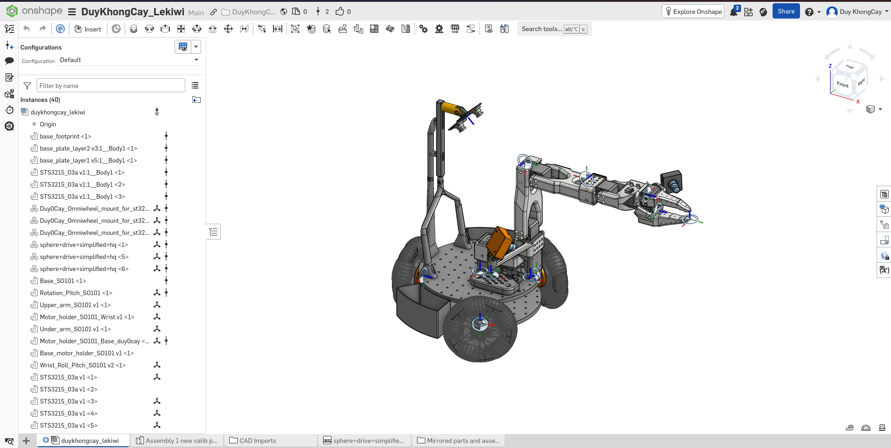
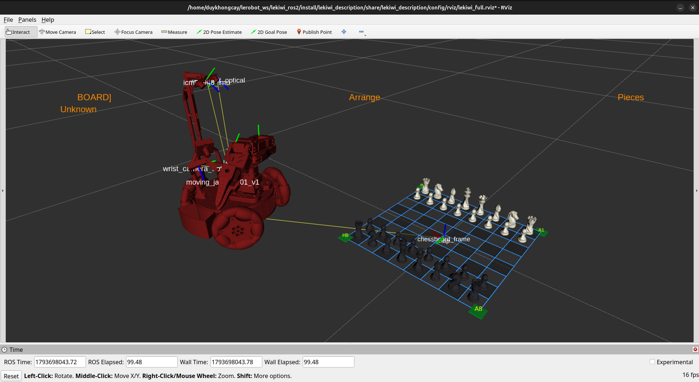
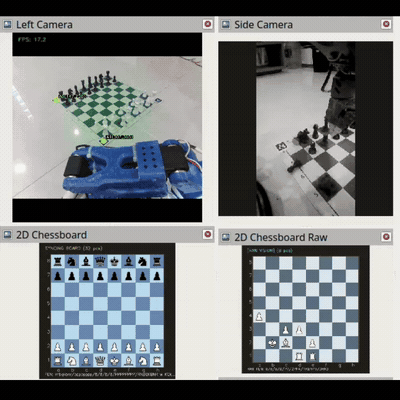
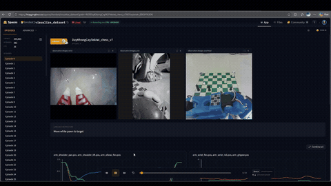
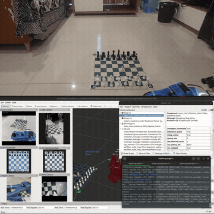
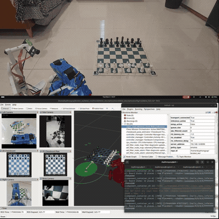

# LeKiwi ROS 2: Autonomous Mobile Manipulator & Physical-AI Platform

<div align="center">

[](README.md)
[](README.vi.md)
[](https://docs.ros.org/)
[](https://www.raspberrypi.com/)
[](https://hailo.ai/)
[](https://github.com/huggingface/lerobot)
[](https://huggingface.co/DuyKhongCay/lekiwi_chess_smolvla)
[](https://huggingface.co/datasets/DuyKhongCay/lekiwi_chess_v7)
[](notebooks/lerobot_smolvla_training_kaggle.ipynb)
[](https://zenoh.io/)
[](LICENSE)

**[English](README.md)** | **[Tiếng Việt](README.vi.md)**

<p align="center">
  <em>An open-source desktop autonomous mobile manipulator integrating holonomic omni-drive, 6-DoF precision manipulation, real-time edge AI perception, autonomous chess play, and state-of-the-art imitation learning.</em>
</p>

</div>

---

> [!IMPORTANT]
> ### 📚 Comprehensive Technical Documentation & Wiki Portal
> This README provides a high-level showcase, project vision, and quick-start entrypoints. For the complete engineering handbook — including **System Architecture deep-dives, 14 Active Packages catalog, custom ROS 2 Action/Service contracts, hardware pinout specs, calibration workflows, and distributed container setup** — visit our project Wiki:
> 
> 👉 **[Explore the LeKiwi Project GitHub Wiki](https://github.com/DuyKhongCay/lekiwi_ros2/wiki)**

> [!WARNING]
> ### ⚠️ Engineering Retrospective: Lessons Learned in Physical-AI & Low-Cost Hardware
> **Transparency in Robotics: Why Both Policy Inference and Budget Kinematics Stumbled**
> A core pillar of the LeKiwi project is open, transparent engineering—documenting empirical realities, failure modes, and architectural trade-offs so the robotics community can learn from real-world hardware deployments:
> 
> * ❌ **Lesson 1: End-to-End VLA (`lerobot_inference_rollout`) Was the Wrong Paradigm for Chess**:
>   The project's original North Star was evaluating whether modern Physical-AI policies (Hugging Face SmolVLA / ACT) could handle precision desktop manipulation. We collected demonstration datasets ([`DuyKhongCay/lekiwi_chess_v7`](https://huggingface.co/datasets/DuyKhongCay/lekiwi_chess_v7)) and fine-tuned SmolVLA models ([`DuyKhongCay/lekiwi_chess_smolvla`](https://huggingface.co/DuyKhongCay/lekiwi_chess_smolvla)). However, in physical rollout (`lerobot_inference_rollout.mp4`), treating discrete chess piece pick-and-place as an end-to-end continuous vision-language-action task proved to be an architectural mismatch. The $8 \times 8$ grid demands sub-centimeter precision ($47.5\text{ mm}$ square, piece base $\sim 25\text{ mm}$, gripper margin $< 5\text{ mm}$). Continuous neural policies suffer from stochastic trajectory jitter, cumulative spatial drift, lighting sensitivity, and lack of hard collision constraints. *(See the comprehensive post-mortem below: [The 12D Observation State Dilemma](#-architecture-post-mortem-the-12d-observation-state-dilemma))*.
> 
> * ⚠️ **Lesson 2: Classical Kinematics on Low-Cost Hardware Has Real-World Boundaries**:
>   While analytical kinematics (`lekiwi_pure_kinematics.mp4`) provides the mathematically correct closed-form solution, implementing open-loop kinematics on **budget desktop hardware** has severe physical limitations. Low-cost Feetech STS3215 bus servos exhibit gear backlash, and 3D-printed arm links flex under gravitational load. Across a 6-DoF serial chain, cumulative tolerance stacking caused repeated grasp misses without expensive closed-loop tactile feedback or sub-millimeter eye-in-hand visual servoing.
> 
> * 🎯 **The Strategic Decision to Freeze & Share**:
>   Because the primary objective was exploring Physical-AI policy serving rather than engineering an industrial-grade classical pick-and-place cell, perfecting open-loop kinematics on budget hardware diverged from the project's core research intent. Once the LeRobot policy approach proved unviable on this hardware tier, we decided **not to over-engineer a classical kinematics workaround, but rather freeze the project as an honest educational case study**. All code, CAD models, ROS 2 pipelines, datasets, and model checkpoints are published openly for researchers exploring the boundaries between classical control and Physical-AI.

---

## 🌟 Project Vision & Highlights

**LeKiwi** is an integrated autonomous mobile manipulation robotics platform designed to bridge physical robotics with modern **Physical-AI (Imitation Learning & VLA policies)** and **High-Performance Edge AI**. Built around a 3-wheel holonomic omnidirectional chassis and a 6-DoF serial arm, LeKiwi demonstrates complex real-world interaction through autonomous chess gameplay against human players.

```
       [ Dual CSI Cameras ]                 [ 9x Feetech STS3215 Servos ]
                │                                         │
                ▼                                         ▼
   ┌───────────────────────────┐             ┌───────────────────────────┐
   │    Hailo-8 M.2 NPU HAT    │             │   ros2_control Hardware   │
   │  Stereo Vision & 26 TOPS  │             │ 1 Mbps Async Serial Bus   │
   └─────────────┬─────────────┘             └─────────────▲─────────────┘
                 │                                         │
                 ▼                                         │
   ┌───────────────────────────────────────────────────────┴─────────────┐
   │            LeKiwi Autonomous Orchestrator & Mission FSM             │
   │      Stockfish 16 Engine  ◄──►  ZeroMQ LeRobot Policy Server        │
   └─────────────────────────────────────────────────────────────────────┘
```

### Core Capabilities
* **♟️ Autonomous Game Intelligence:** End-to-end autonomous chess playing powered by the Stockfish 16 chess engine, dynamic FSM mission orchestration, and visual board state verification.
* **⚡ Accelerated Edge Perception:** Real-time dual CSI stereo vision and YOLO neural inference running at 30+ FPS via the Raspberry Pi 5 Hailo-8 M.2 NPU HAT+.
* **🤖 Precision Manipulation & Control:** 6-DoF robotic arm driven by 9 smart Feetech STS3215 bus servos via an asynchronous `ros2_control` hardware abstraction layer at 1 Mbps.
* **🦾 Physical-AI Imitation Learning:** Native streaming bridge connecting LeRobot policy models (ACT, Diffusion Policy, SmolVLA) with ROS 2 via ZeroMQ binary transport.
* **🌐 Zero-Multicast Distributed Networking:** Clean edge deployment on Raspberry Pi 5 with Docker and Zenoh middleware (`rmw_zenoh_cpp`), enabling instant remote RViz2 monitoring without Wi-Fi multicast packet loss.

---

## 📸 Feature Showcase: LeKiwi in Action

Below are the primary operating scenarios of LeKiwi in real-world deployment, featuring physical robot hardware, high-throughput edge AI perception, autonomous chess orchestration, and imitation learning policy rollouts.

### 1. 🤖 Physical Robot & 3-Wheel Omni Chassis
The platform features an agile 3-wheel holonomic base capable of omnidirectional translation and in-place rotation, combined with an onboard Raspberry Pi 5 brain, integrated power management, and a 6-DoF serial arm.

| Robot Overview | Hardware Architecture |
| :---: | :---: |
| <br>**LeKiwi Autonomous Mobile Manipulator**<br>*(Physical robot standing on the arena with Raspberry Pi 5, Hailo-8 M.2 NPU HAT+, and dual CSI cameras)* | <br>**Chassis & 6-DoF Arm Assembly**<br>*(Holonomic 3-wheel omni base with 120° configuration and 6-DoF serial arm driven by Feetech STS3215 servos)* |

---

### 2. ♟️ Autonomous Chess Master & Manipulation Recording
LeKiwi detects chessboard squares, identifies opponent piece moves, calculates optimal counter-moves using Stockfish 16, and executes physical pick-and-place trajectories with workspace reachability validation.

| Visual Board Evaluation | Chess Manipulation Record |
| :---: | :---: |
| <br>**Visual Board Evaluation (Hailo YOLO)**<br>*(Real-time square localization and piece detection accelerated on Hailo-8 NPU for live FEN board tracking)* | <br>**Chess Manipulation Record**<br>*(Physical chess piece manipulation and demonstration episode recording via `chess_episode_recorder`)* |

---

### 3. 👁️ Edge Vision & Hailo-8 NPU Acceleration
Equipped with dual IMX CSI cameras and the 26 TOPS Hailo-8 NPU, LeKiwi processes stereo vision, board corner estimation, and object detection with minimal CPU utilization.

| Stereo Camera Pipeline | Hailo NPU Inference Stream |
| :---: | :---: |
| <br>**Stereo Camera Pipeline**<br>*(Hardware-synchronized dual IMX CSI video streams delivering optical rectification and spatial perception)* | <br>**Hailo NPU Inference Stream**<br>*(High-throughput YOLO neural inference executing at sustained 30+ FPS with <15% Raspberry Pi 5 CPU overhead)* |

---

### 4. 🦾 Pure Kinematics vs. Physical-AI Rollout: An Empirical Case Study
Execute smooth multi-axis trajectory motions via analytical kinematics alongside empirical policy rollouts from Hugging Face LeRobot, providing a side-by-side study in classical control on budget hardware vs. imitation learning limitations.

| 🦾 Analytical Kinematics (Hardware Tolerance Limits) | 🧠 LeRobot Policy Serving (Imitation Learning Drift) |
| :---: | :---: |
| <br>**6-DoF Analytical Kinematics**<br>*(Mathematically deterministic closed-form IK & $C^2$ quintic splines; smooth trajectories but subject to servo gear backlash and 3D-printed flex causing grasp misses without closed-loop visual servoing)* | <br>**LeRobot Policy Serving (SmolVLA)**<br>*(Closed-loop SmolVLA neural rollout demonstrating continuous multi-modal streaming, but suffering from spatial drift, chunking jitter, and lack of discrete spatial constraints on a precision grid)* |

> [!TIP]
> **Open Physical-AI Artifacts for Research & Benchmarking:**
> * 🧠 **Fine-Tuned Model Checkpoint**: [Hugging Face `DuyKhongCay/lekiwi_chess_smolvla`](https://huggingface.co/DuyKhongCay/lekiwi_chess_smolvla) — Vision-Language-Action weights trained on LeRobot v3.0 format.
> * 📦 **Demonstration Dataset**: [Hugging Face `datasets/DuyKhongCay/lekiwi_chess_v7`](https://huggingface.co/datasets/DuyKhongCay/lekiwi_chess_v7) — Multi-view MCAP demonstration episodes converted for imitation learning research.
> * 📓 **Cloud Training Notebook**: [`notebooks/lerobot_smolvla_training_kaggle.ipynb`](notebooks/lerobot_smolvla_training_kaggle.ipynb) — Reproducible distributed fine-tuning pipeline running on Kaggle (2x Tesla T4 GPUs) with custom `chess_goal_noise` physical state perturbation.

---

## 🔬 Architecture Post-Mortem: The 12D Observation State Dilemma

A cornerstone of rigorous robotics engineering is documenting not just what worked, but dissecting the precise mathematical and systemic reasons behind what failed. This section provides an architectural post-mortem on our Physical-AI pipeline across [chess_rosbag_to_lerobot](file:///home/duykhongcay/lerobot_ws/lekiwi_ros2/chess_rosbag_to_lerobot) and [lekiwi_inference](file:///home/duykhongcay/lerobot_ws/lekiwi_ros2/lekiwi_inference)—specifically why augmenting the standard 6D proprioceptive state into a **12D Dynamic Relative Delta** vector was fundamentally flawed.

### 1. Data Pipeline & Policy Lifecycle

The end-to-end training and inference loop operated through four interconnected stages:

```
[ ROS 2 Bags (MCAP) ] 
       │  (Multi-camera JPEG, 50 Hz /joint_states, dynamic /tf tree, FSM state)
       ▼
[ chess_rosbag_to_lerobot ]
       │  • Anti-Future-Leakage Causal As-Of Synchronizer (25 Hz reference clock)
       │  • Offline TF Replayer (Computes base_footprint -> gripperframe FK)
       │  • 12D Dynamic Relative Delta Assembly: [q_1..6, ee_xyz, delta_xyz]
       ▼
[ LeRobot Dataset v3.0 (Hugging Face) ]
       │  • Chunked Apache Parquet tables + Multi-view AV1/H.264 MP4 videos
       ▼
[ SmolVLA Policy Fine-Tuning ]
       │  • Modified input projection: W_state (R^12 -> R^Hidden)
       ▼
[ lekiwi_inference (Async ROS 2 Client) ]
       │  • ZeroMQ binary transport client (1 Mbps)
       │  • Soft deadband filter -> RTC Action Queue -> JointCommandSmoother
       ▼
[ 9x Feetech STS3215 Hardware Bus ]
```

1. **Demonstration Ingestion (`chess_episode_recorder`)**: Captured multi-view video streams (`usb_wrist` at 25 Hz, `usb_side` at 30 Hz, `overhead` at 25 Hz), 50 Hz joint states, and rigid-body transforms.
2. **Dataset Conversion (`chess_rosbag_to_lerobot`)**:
   - **Anti-Future-Leakage Synchronizer**: Enforced causal temporal alignment ($t_{\text{sample}} \le t_{\text{ref}}$) anchored on the wrist camera clock to prevent foresight contamination.
   - **Offline Forward Kinematics (`TfReplayer`)**: Reconstructed TCP pose $\mathbf{p}_{\text{ee}} = (x_{\text{ee}}, y_{\text{ee}}, z_{\text{ee}})^T$ relative to `base_footprint`.
   - **12D Feature Construction**: Synthesized the unified state vector combining 6 joint angles, 3D TCP position, and 3D delta to subtask target.
3. **Model Fine-Tuning**: Fine-tuned Hugging Face SmolVLA weights on [`DuyKhongCay/lekiwi_chess_v7`](https://huggingface.co/datasets/DuyKhongCay/lekiwi_chess_v7) using our cloud training notebook ([`lerobot_smolvla_training_kaggle.ipynb`](notebooks/lerobot_smolvla_training_kaggle.ipynb)) across 2x Tesla T4 GPUs with custom physical noise injection (`chess_goal_noise`).
4. **Closed-Loop Deployment (`lekiwi_inference`)**: The `AsyncRos2ClientNode` dynamically assembled the 12D state at runtime, sent payloads via ZeroMQ to the policy server, and smoothed returned action chunks through `JointCommandSmoother`.

---

### 2. The 6D vs. 12D State Representation

In standard robot manipulation policies (e.g., standard LeRobot SO-100 configurations, OpenVLA, ACT), the proprioceptive state vector is strictly **6-dimensional**:

$$\mathbf{s}_{\text{standard}} = \begin{bmatrix} q_1 & q_2 & q_3 & q_4 & q_5 & q_6 \end{bmatrix}^T \in \mathbb{R}^6$$

Under this paradigm, the model is a true **Vision-Language-Action (VLA)** policy: the visual encoder processes camera pixels to localize the piece and target, the language model interprets the goal (`"Move white pawn to e4"`), and cross-attention maps spatial tokens to joint action chunks.

To bypass spatial ambiguity on the tight $47.5\text{ mm}$ chess grid, we engineered a **12D Dynamic Relative Delta** state in `converter.py` and `async_ros2_client_node.py`:

$$\mathbf{s}_{\text{12D}} = \begin{bmatrix} \underbrace{q_1, \dots, q_6}_{\text{6-DoF Joint Angles}} & \underbrace{x_{\text{ee}}, y_{\text{ee}}, z_{\text{ee}}}_{\text{3D TCP Position (m)}} & \underbrace{\Delta x, \Delta y, \Delta z}_{\text{3D Delta to Goal (m)}} \end{bmatrix}^T \in \mathbb{R}^{12}$$

where $\boldsymbol{\Delta}_{\text{xyz}} = \mathbf{p}_{\text{goal}} - \mathbf{p}_{\text{ee}}$.

**The Developer's Motivation**: We intended to provide the neural policy with an explicit error vector, hypothesizing that "hinting" the distance-to-goal would accelerate convergence and turn the policy into an adaptive, closed-loop visual servoing controller driving $\boldsymbol{\Delta} \to \mathbf{0}$.

---

### 3. Five Fatal Failure Modes: Why 12D Was Conceptually Flawed

Injecting `ee_*` and `delta_*` introduced severe unintended systemic failure modes:

#### ❌ 1. Shortcut Learning & Visual Blindness (Cheating Network)
Deep neural networks optimize along the path of steepest gradient descent. Extracting spatial coordinates from three high-dimensional image streams ($384 \times 384 \times 3$) is an extremely complex visual task. Conversely, $\boldsymbol{\Delta}_{\text{xyz}}$ provides a direct, low-dimensional linear correlation with the desired action:
- If $\Delta x > 0 \implies$ command positive shoulder/elbow extension.
- If $\Delta z < 0 \implies$ lower the arm.

As a result, attention weights collapsed: **the network completely ignored camera images and language prompts**. The 800M+ parameter VLA effectively degenerated into a noisy, over-parameterized analytical inverse-kinematics approximator.

#### ❌ 2. Pretrained Weight Invalidation
SmolVLA was pretrained on millions of robotic manipulation trajectories where the state encoder projection matrix was sized for 6 dimensions ($W_{\text{state}} \in \mathbb{R}^{D \times 6}$). Expanding this layer to $\mathbb{R}^{D \times 12}$ broke weight dimensionality, requiring re-initialization of the state projection. This erased the rich proprioceptive representations learned during pretraining, forcing the model to learn state representations from scratch on our small, specialized chess dataset.

#### ❌ 3. Severe Covariate Shift & Limit-Cycle Hunting
* **In Training (Demonstrations)**: Trajectories were recorded from smooth, nominal kinodynamic profiles where $\boldsymbol{\Delta}_{\text{xyz}}$ smoothly decayed toward zero.
* **In Physical Deployment (Rollout)**: Due to low-cost Feetech STS3215 gear backlash, joint compliance, and 3D-printed link flex under gravity, Forward Kinematics yielded imprecise TCP poses. Even a $3\text{--}5\text{ mm}$ positioning error placed the tuple $(\mathbf{q}, \mathbf{p}_{\text{ee}}, \boldsymbol{\Delta})$ **Out-of-Distribution (OOD)**.
* **Consequence**: As the gripper approached the chess piece ($\boldsymbol{\Delta} \to \mathbf{0}$), the network began oscillating erratically—unable to decide whether to close or overshoot.
  > *Empirical Evidence in Code*: In [`async_ros2_client_node.py` L750-L754](file:///home/duykhongcay/lerobot_ws/lekiwi_ros2/lekiwi_inference/lekiwi_inference/async_ros2_client_node.py#L750-L754), we had to invent `apply_soft_deadband(delta_xyz, ...)` to suppress these limit-cycle oscillations near the target—treating a symptom of an underlying architectural anti-pattern.

#### ❌ 4. Step Discontinuities Across Subtask Phases
A complete chess move consists of sequential subtasks: `Approach` $\to$ `Grasp` $\to$ `Lift` $\to$ `Transit` $\to$ `Lower` $\to$ `Release`.
When the high-level FSM transitions from `Pick` to `Place`, the target point $\mathbf{p}_{\text{goal}}$ instantaneously jumps from the source square to the destination square. Consequently, $\boldsymbol{\Delta}_{\text{xyz}}$ experiences an **instantaneous step discontinuity** (jumping $15\text{--}25\text{ cm}$ within a single $40\text{ ms}$ control loop). Continuous neural policies cannot gracefully ingest discontinuous step inputs, resulting in abrupt joint torque spikes.
> *Empirical Evidence in Code*: In [`async_ros2_client_node.py` L744-L746](file:///home/duykhongcay/lerobot_ws/lekiwi_ros2/lekiwi_inference/lekiwi_inference/async_ros2_client_node.py#L744-L746), we were forced to implement emergency queue purges (`self.client.flush_action_queue(keep_steps=2)`) and `notify_phase_transition()` to prevent violent physical jerking during subtask handoffs.

#### ❌ 5. Scale & Unit Incommensurability
Packing inhomogeneous physical units into a single flat vector created numerical instability during normalization:
- First 6 dimensions: **Joint angles in radians** ($[-\pi, \pi]$).
- Middle 3 dimensions: **Absolute position in meters** ($[0.05, 0.35]\text{ m}$).
- Last 3 dimensions: **Delta error vectors in meters** ($[0.25 \to 0.00]\text{ m}$).
During dataset preprocessing, LeRobot normalizes features using global channel-wise mean and standard deviation (`stats.json`). As $\boldsymbol{\Delta} \to \mathbf{0}$, the vanishing variance in the delta channels caused small sensor noise and encoder quantization errors to be drastically magnified during inverse-variance scaling.

---

### 4. The Architectural Paradox

```
                  ┌──────────────────────────────────────────────┐
                  │       System Knows Both p_ee and p_goal      │
                  └──────────────────────┬───────────────────────┘
                                         │
                 ┌───────────────────────┴───────────────────────┐
                 ▼                                               ▼
   [ Classical Kinematics Route ]                 [ 12D VLA Policy Route ]
   • Analytical IK + C^2 Splines                  • 800M+ Parameter Transformer
   • Latency: < 0.1 ms                            • Latency: 50-100 ms via ZeroMQ
   • Repeatability: 100% deterministic            • Stochastic action drift & hunting
   • Compute: 0 W CPU overhead                    • Compute: Heavy GPU inference
```

The fundamental paradox of the 12D state architecture can be summarized as:
> **"Using an 800-million-parameter neural network to compute vector subtraction."**

If a robotics system already possesses reliable Forward Kinematics to calculate $\mathbf{p}_{\text{ee}}$ and calibrated vision/FSM models to locate $\mathbf{p}_{\text{goal}}$, closed-form analytical kinematics and $C^2$ quintic splines solve the motion trajectory in **$< 0.1\text{ ms}$ with zero hallucination and zero stochastic drift**.

By forcing an imitation learning policy to act on explicit Cartesian error deltas, we created an architecture that combined the **fragilities of both paradigms without the guarantees of either**:
1. It remained vulnerable to the physical inaccuracies of budget hardware (gear backlash, 3D print flex).
2. It inherited the high latency, chunking jitter, and stochastic drift of large neural policies.

This realization forms the bedrock of our decision to freeze policy development at this milestone—preserving LeKiwi as an authentic, fully transparent case study for the robotics and physical-AI communities.

---

## 🚀 Getting Started & Documentation Portal

> [!TIP]
> ### 🛠️ Ready to Build or Run LeKiwi?
> Complete step-by-step setup guides, toolchain installation, simulation setups, and distributed deployment walk-throughs have been organized on our **Project Wiki**:
> 
> * 🐳 **[Raspberry Pi 5 Docker Container Deployment](https://github.com/DuyKhongCay/lekiwi_ros2/wiki)** — Deploy the pre-packaged containerized stack with Hailo-8 and Zenoh drivers.
> * 💻 **[Native Host Build & Mock Simulation](https://github.com/DuyKhongCay/lekiwi_ros2/wiki)** — Set up `colcon` workspaces on Ubuntu 24.04/22.04 without physical hardware.
> * ♟️ **[Autonomous Chess Playing Mission Guide](https://github.com/DuyKhongCay/lekiwi_ros2/wiki)** — Launch the Stockfish FSM orchestrator and vision pipeline.
> * 🦾 **[LeRobot Physical-AI & Teleoperation Setup](https://github.com/DuyKhongCay/lekiwi_ros2/wiki)** — Stream imitation learning policies and record MCAP episodes.
> * 🌐 **[Distributed PC Monitoring via Zenoh](docs/how-to-guides/deployment/distributed-pi5-docker-and-pc-zenoh-setup.md)** — Connect your remote workstation to monitor topics and view 3D RViz2 displays.
> 
> 👉 **[Explore Full Installation Guides on GitHub Wiki](https://github.com/DuyKhongCay/lekiwi_ros2/wiki)**

---

## 🗺️ Project Roadmap & Milestones

The development of LeKiwi follows a staged progression from low-level hardware abstraction to autonomous manipulation and physical-AI intelligence:

- [x] **Phase 1: Hardware Abstraction & Omnidirectional Base**
  - [x] 3-wheel holonomic omnidirectional chassis kinematics and odometry.
  - [x] 9-DoF ICM-20948 IMU sensor integration over hardware I2C.
  - [x] Feetech STS3215 asynchronous serial bus driver operating at 1 Mbps with `ros2_control`.
  - [x] Dedicated persistent udev rules and hardware mapping.

- [x] **Phase 2: Edge Perception & Hardware Acceleration**
  - [x] Dual CSI stereo camera pipeline with dynamic GStreamer control.
  - [x] Raspberry Pi 5 Hailo-8 M.2 NPU HAT+ integration (26 TOPS).
  - [x] Real-time YOLO chessboard square & piece detection at 30+ FPS.
  - [x] Hand-Eye calibration and AprilTag bundle adjustment suite.

- [x] **Phase 3: Autonomous Chess Playing & Mission Orchestration**
  - [x] Stockfish 16 chess engine ROS 2 action server (`ComputeBestMove`).
  - [x] High-level Mission Orchestrator FSM with dynamic camera switching.
  - [x] 6-DoF Cartesian trajectory planning with workspace reachability validation.
  - [x] Complete autonomous human-robot chess game playing loop.

- [/] **Phase 4: Physical-AI & Imitation Learning (LeRobot)**
  - [x] ZeroMQ high-throughput streaming bridge between LeRobot policies and ROS 2.
  - [x] Gamepad and leader-arm MCAP episode recorder (`chess_episode_recorder`).
  - [x] Lossless dataset conversion into Hugging Face LeRobot v3.0 format.
  - [🟡] End-to-end evaluation of ACT, Diffusion Policy, and SmolVLA policies on real hardware.

- [ ] **Phase 5: Room-Scale Autonomous Navigation & Multi-Task VLA**
  - [ ] Nav2 integration with SLAM Toolbox and lidar/visual odometry for global navigation.
  - [ ] Voice-prompted mission dispatch and multi-task Vision-Language-Action (VLA) interaction.
  - [ ] Cloud-to-edge policy distribution and continuous demonstration learning.

---

## 🤝 Reference Projects & Acknowledgements

The LeKiwi ecosystem stands on the shoulders of remarkable open-source robotics, physical-AI, and edge-computing projects. We gratefully acknowledge the following reference repositories:

| Category | Reference Project | Role & Architectural Influence in LeKiwi |
| :--- | :--- | :--- |
| **1. Hardware & Base Design** | [`DuyKhongCay/lekiwi-robot`](https://github.com/DuyKhongCay/lekiwi-robot) | Physical CAD models, 3D printing STL files, mechanical bill of materials (BOM), and assembly specs. |
| | [`SIGRobotics-UIUC/LeKiwi`](https://github.com/SIGRobotics-UIUC/LeKiwi) | Foundational mechanical design and original concept of the LeKiwi omni-manipulator. |
| | [`legalaspro/feetech_ros2_driver`](https://github.com/legalaspro/feetech_ros2_driver) | Asynchronous serial bus communication driver for Feetech STS3215 smart servos. |
| | [`NTkot/icm20948_i2c`](https://github.com/NTkot/icm20948_i2c) | Low-level Linux I2C communication library for the ICM-20948 9-DoF IMU. |
| | [`MINT-SJTU/LeRobot-Anything-U-Arm`](https://github.com/MINT-SJTU/LeRobot-Anything-U-Arm) | Teleoperation leader arm communication protocol and joint remapping conventions. |
| **2. Physical-AI & Imitation Learning** | [`huggingface/lerobot`](https://github.com/huggingface/lerobot) | Core Physical-AI framework for training imitation learning policies (ACT, Diffusion, SmolVLA). |
| | [`legalaspro/so101-ros-physical-ai`](https://github.com/legalaspro/so101-ros-physical-ai) | Architectural pattern for high-performance ZeroMQ streaming bridges between ROS 2 and LeRobot. |
| | [`fiveages-sim/lerobot_ros2`](https://github.com/fiveages-sim/lerobot_ros2) | ROS 2 simulation integration and teleoperation workflow references. |
| **3. Edge Vision & Acceleration** | [`hailo-ai/hailo-apps`](https://github.com/hailo-ai/hailo-apps) | Hailo-8 M.2 hardware acceleration pipelines and GStreamer inference plugin architectures. |
| | [`ros-drivers/gscam`](https://github.com/ros-drivers/gscam) | GStreamer camera pipeline driver bridging v4l2/CSI video feeds into ROS 2 Image topics. |
| **4. Chess Logic & Game Intelligence** | [`Disservin/chess-library`](https://github.com/Disservin/chess-library) | High-performance header-only C++ chess library for board representation and move generation. |
| | [`wojciechc1/AI_Chess`](https://github.com/wojciechc1/AI_Chess) | Visual chessboard detection and computer vision state validation concepts. |
| **5. Engineering Skills & Tooling** | [`dbwls99706/ros2-engineering-skills`](https://github.com/dbwls99706/ros2-engineering-skills) | Production engineering guidelines, executor architectures, and ROS 2 lifecycle design patterns. |
| | [`github/awesome-copilot`](https://github.com/github/awesome-copilot) | Curated agent prompts, instructions, skills, and AI pair-programming workflows. |

> [!NOTE]
> **Community Gratitude:** In addition to the repositories listed above, LeKiwi builds upon countless academic publications, ROS 2 community contributions, Hugging Face open models, and Linux kernel drivers that cannot all be listed here. We extend our sincere thanks to the global robotics and open-source physical-AI communities!

---

> [!NOTE]
> ### 🤖 AI-Assisted Documentation Notice
> This repository documentation was authored and structured with the assistance of advanced AI engineering agents. While every section undergoes cross-verification against the codebase, automated documentation may occasionally contain discrepancies. If you spot any error, broken link, or outdated instruction, please [open a GitHub Issue](https://github.com/DuyKhongCay/lekiwi_ros2/issues) to help maintainers and contributors keep the project accurate!

---

## 📜 License & Maintainers

* **License:** Distributed under the [Apache-2.0 License](LICENSE).
* **Project Maintainer:** **DuyKhongCay** ([@DuyKhongCay](https://github.com/DuyKhongCay))
* **Wiki & Documentation:** [https://github.com/DuyKhongCay/lekiwi_ros2/wiki](https://github.com/DuyKhongCay/lekiwi_ros2/wiki)
