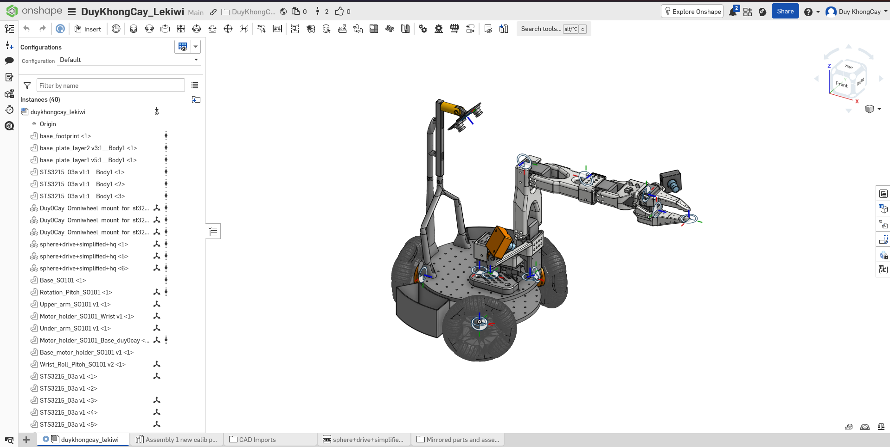
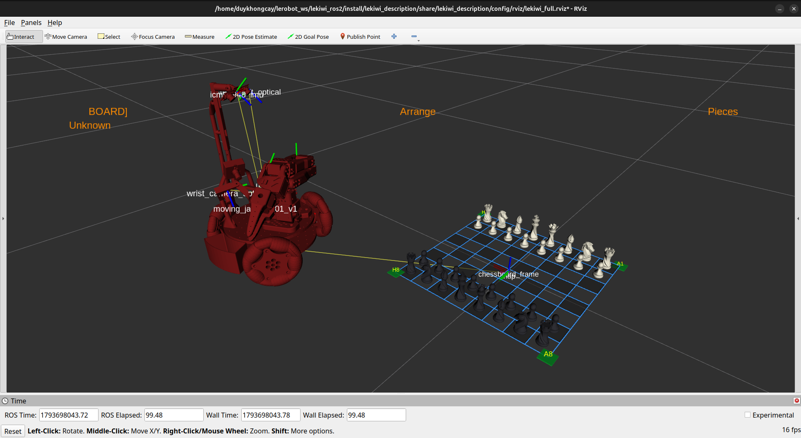

# LeKiwi ROS 2: Nền Tảng Robot Di Động Thao Tác & Trí Tuệ Nhân Tạo Vật Lý (Physical-AI)

<div align="center">

[](README.md)
[](README.vi.md)
[](https://docs.ros.org/)
[](https://www.raspberrypi.com/)
[](https://hailo.ai/)
[](https://github.com/huggingface/lerobot)
[](https://huggingface.co/DuyKhongCay/lekiwi_chess_smolvla)
[](https://huggingface.co/datasets/DuyKhongCay/lekiwi_chess_v7)
[](notebooks/lerobot_smolvla_training_kaggle.ipynb)
[](https://zenoh.io/)
[](LICENSE)

**[English](README.md)** | **[Tiếng Việt](README.vi.md)**

<p align="center">
  <em>Nền tảng robot di động thao tác để bàn mã nguồn mở tích hợp đế di chuyển đa hướng holonomic, cánh tay 6 bậc tự do (6-DoF), thị giác máy tính tăng tốc bằng NPU biên, chơi cờ vua tự động và học bắt chước hành vi Physical-AI hiện đại nhất.</em>
</p>

</div>

---

> [!IMPORTANT]
> ### 📚 Cổng Tài Liệu Kỹ Thuật Chuyên Sâu & GitHub Wiki
> Tệp README này đóng vai trò như trang giới thiệu tổng quan, tầm nhìn dự án và các bước làm quen nhanh. Để tra cứu toàn bộ sổ tay kỹ thuật chuyên sâu — bao gồm **phân tích chi tiết Kiến trúc hệ thống, danh mục 14 Packages hoạt động, chuẩn giao tiếp ROS 2 Action/Service, sơ đồ đấu dây phần cứng, quy trình hiệu chuẩn Hand-Eye và hướng dẫn triển khai Docker phân tán** — xin mời truy cập GitHub Wiki chính thức của dự án:
> 
> 👉 **[Khám phá GitHub Wiki Dự Án LeKiwi](https://github.com/DuyKhongCay/lekiwi_ros2/wiki)**

> [!WARNING]
> ### ⚠️ Nhìn Nhận Kỹ Thuật: Bài Học Rút Ra Về Physical-AI & Giới Hạn Phần Cứng Giá Rẻ
> **Sự Minh Bạch Trong Kỹ Thuật: Vì Sao Cả Suy Luận Mô Hình VLA Lẫn Động Học Trên Phần Cứng Tự Chế Đều Gặp Trở Ngại**
> Tinh thần cốt lõi của dự án LeKiwi là sự minh bạch kỹ thuật và học hỏi từ thực nghiệm—công khai cả những kết quả chưa trọn vẹn và các thỏa hiệp kiến trúc để cộng đồng nghiên cứu robotics cùng rút kinh nghiệm:
> 
> * ❌ **Bài học 1: Dùng End-to-End VLA (`lerobot_inference_rollout`) Là Sai Phương Pháp Cho Cờ Vua**:
>   Mục tiêu ban đầu của dự án là khảo sát xem các mô hình Physical-AI hiện đại (Hugging Face SmolVLA / ACT) có thể xử lý việc thao tác gắp nhặt chính xác trên bàn làm việc hay không. Chúng tôi đã thu thập dữ liệu ([`DuyKhongCay/lekiwi_chess_v7`](https://huggingface.co/datasets/DuyKhongCay/lekiwi_chess_v7)) và huấn luyện mô hình ([`DuyKhongCay/lekiwi_chess_smolvla`](https://huggingface.co/DuyKhongCay/lekiwi_chess_smolvla)). Tuy nhiên, khi đưa lên robot thật (`lerobot_inference_rollout.mp4`), việc biến bài toán gắp nhả quân cờ trên lưới rời rạc thành bài toán học bắt chước liên tục end-to-end từ hình ảnh sang lệnh khớp đã bộc lộ sai lầm về mặt kiến trúc. Lưới cờ $8 \times 8$ đòi hỏi độ chính xác tuyệt đối ở cấp độ milimet (ô cờ $47.5\text{ mm}$, đáy quân cờ $\sim 25\text{ mm}$, dung sai kẹp $< 5\text{ mm}$). Chính sách nơ-ron liên tục vốn dĩ chứa sai số tích lũy (drift), rung giật do chia chunk hành động, nhạy cảm với ánh sáng và thiếu các ràng buộc hình học cứng. *(Xem phân tích kỹ thuật chi tiết bên dưới: [Mổ Xẻ Kiến Trúc: Nghịch Lý Quan Sát 12D](#-mổ-xẻ-kiến-trúc-nghịch-lý-vector-quan-sát-observationstate-12d))*.
> 
> * ⚠️ **Bài học 2: Động Học Cổ Điển Trên Phần Cứng Giá Rẻ Vẫn Gặp Giới Hạn Vật Lý Khắc Nghiệt**:
>   Dù động học giải tích (`lekiwi_pure_kinematics.mp4`) là công cụ chuẩn xác về mặt toán học, việc chạy động học vòng hở (open-loop kinematics) trên **phần cứng giá rẻ** gặp phải những rào cản vật lý rất lớn. Động cơ servo Feetech STS3215 giá rẻ có độ rơ bánh răng (gear backlash), kết hợp với độ võng đàn hồi của các khớp tay in 3D nhựa PETG/PLA dưới trọng lực. Qua chuỗi động học nối tiếp 6 bậc tự do, sai số dung sai bị khuếch đại tích lũy (tolerance stacking) khiến tay robot thường xuyên bị gắp trượt nếu không có cảm biến lực vòng kín hoặc hệ thống bám hình ảnh mắt-trên-tay (eye-in-hand visual servoing) đắt tiền.
> 
> * 🎯 **Quyết Định Chiến Lược: Dừng Lại & Công Khai Bài Học**:
>   Bởi vì mục tiêu tối thượng ban đầu của dự án là khám phá tính khả thi của Physical-AI / LeRobot chứ không phải tối ưu hóa một cánh tay công nghiệp gắp nhặt truyền thống, việc tiếp tục dồn công sức tinh chỉnh động học cổ điển trên phần cứng giá rẻ sẽ đi chệch khỏi hướng nghiên cứu ban đầu. Khi nhận thấy hướng tiếp cận bằng LeRobot policy không còn khả thi trên nền tảng này, chúng tôi quyết định **không cố chấp phát triển thêm phần động học bù sai số, mà chủ động đóng băng dự án như một bài học thực tế quý giá**. Toàn bộ mã nguồn, file CAD, đường ống ROS 2, tập dữ liệu và checkpoint mô hình được mở hoàn toàn cho cộng đồng nghiên cứu ranh giới giữa điều khiển cổ điển và Physical-AI.

---

## 🌟 Tầm Nhìn Dự Án & Điểm Nhấn Công Nghệ

**LeKiwi** là nền tảng robot di động thao tác (Mobile Manipulator) tích hợp toàn diện, được thiết kế nhằm kết nối robot vật lý thực tế với **Trí tuệ nhân tạo vật lý (Physical-AI: Imitation Learning & mô hình VLA)** và **Trí tuệ nhân tạo tại biên (Edge AI)**. Với cấu trúc gồm đế 3 bánh omni đa hướng và cánh tay nối tiếp 6-DoF, LeKiwi minh chứng khả năng tương tác thế giới thực phức tạp thông qua bài toán chơi cờ vua tự động với con người.

```
       [ Cặp Camera Stereo CSI ]            [ 9x Động Cơ Servo Feetech STS3215 ]
                   │                                         │
                   ▼                                         ▼
   ┌───────────────────────────────┐         ┌───────────────────────────────┐
   │      NPU HAT Hailo-8 M.2      │         │   Phần Cứng ros2_control      │
   │    Thị Giác Stereo & 26 TOPS  │         │  Bus Nối Tiếp Bất Đồng Bộ 1M  │
   └───────────────┬───────────────┘         └───────────────▲───────────────┘
                   │                                         │
                   ▼                                         │
   ┌─────────────────────────────────────────────────────────┴───────────────┐
   │           Hệ Thống Điều Phối & FSM Nhiệm Vụ Tự Hành LeKiwi              │
   │        Engine Cờ Vua Stockfish 16  ◄──►  Server LeRobot ZeroMQ          │
   └─────────────────────────────────────────────────────────────────────────┘
```

### Các Năng Lực Cốt Lõi
* **♟️ Trí Tuệ Trò Chơi Tự Hành:** Chơi cờ vua tự động từ đầu đến cuối dựa trên engine Stockfish 16, FSM điều phối nhiệm vụ động và thị giác máy tính nhận diện nước cờ đối thủ.
* **⚡ Thị Giác Biên Tăng Tốc Phần Cứng:** Xử lý luồng ảnh stereo dual CSI và mạng nơ-ron YOLO đạt trên 30 FPS theo thời gian thực nhờ card NPU Hailo-8 (26 TOPS) trên Raspberry Pi 5.
* **🤖 Điều Khiển Thao Tác Chuẩn Xác:** Cánh tay 6-DoF được truyền động bởi 9 servo thông minh Feetech STS3215 thông qua lớp trừu tượng phần cứng `ros2_control` bất đồng bộ trên bus UART 1 Mbps.
* **🦾 Học Bắt Chước Hành Vi Physical-AI:** Cầu nối streaming nhị phân tốc độ cao kết nối các mô hình chính sách LeRobot (ACT, Diffusion Policy, SmolVLA) với ROS 2 qua giao thức ZeroMQ.
* **🌐 Mạng Phân Tán Triệt Tiêu Multicast:** Triển khai gọn gàng trên Raspberry Pi 5 bằng Docker và middleware Zenoh (`rmw_zenoh_cpp`), cho phép kết nối trạm PC giám sát RViz2 từ xa qua Wi-Fi mà không lo nghẽn mạng multicast.

---

## 📸 Hình Ảnh Hoạt Động Thực Tế (Showcase)

Dưới đây là các kịch bản hoạt động tiêu biểu của robot LeKiwi khi vận hành thực tế, thể hiện phần cứng hoàn thiện, thị giác AI biên tốc độ cao, điều phối cờ vua tự hành và thực thi chính sách học bắt chước hành vi.

### 1. 🤖 Robot Thật & Khung Gầm 3 Bánh Omni
Robot sở hữu đế holonomic 3 bánh omni linh hoạt có khả năng tịnh tiến đa hướng và xoay tròn tại chỗ, tích hợp bộ não máy tính Raspberry Pi 5, mạch quản lý nguồn pin và cánh tay 6-DoF.

| Toàn Cảnh Robot Thực Tế | Cấu Trúc Khung Gầm & Cánh Tay |
| :---: | :---: |
| <br>**Robot Di Động Thao Tác Tự Hành LeKiwi**<br>*(Robot thực tế hoàn thiện trên sàn thử nghiệm tích hợp Raspberry Pi 5, Hailo-8 M.2 NPU HAT+ và camera stereo dual CSI)* | <br>**Khung Gầm Omni & Cụm Cánh Tay 6-DoF**<br>*(Đế 3 bánh omni bố trí góc 120° kết hợp cánh tay 6 bậc tự do sử dụng động cơ servo thông minh Feetech STS3215)* |

---

### 2. ♟️ Đại Kiện Tướng Cờ Vua Tự Hành & Ghi Nhận Thao Tác
LeKiwi tự động phát hiện ô cờ, nhận diện nước đi của người chơi, tính toán nước cờ tối ưu bằng Stockfish 16, và thực hiện quỹ đạo gắp nhả quân cờ với cơ chế kiểm tra vùng vươn tới (reachability).

| Thị Giác Bàn Cờ & FEN | Ghi Nhận Thao Tác Cờ Vua |
| :---: | :---: |
| <video src="docs/images/showcase/hailo_yolo_detection.mp4" width="100%" controls playsinline></video><br>**Thị Giác Bàn Cờ (Hailo YOLO)**<br>*(Định vị ô cờ và nhận diện quân cờ thời gian thực tăng tốc bằng NPU Hailo-8 phục vụ cập nhật trạng thái FEN)* | <video src="docs/images/showcase/chess_manipulation_record.mp4" width="100%" controls playsinline></video><br>**Ghi Nhận Thao Tác Cờ Vua (Chess Manipulation Record)**<br>*(Thực thi gắp nhả quân cờ và ghi nhận tập dữ liệu thao tác mẫu thông qua `chess_episode_recorder`)* |

---

### 3. 👁️ Thị Giác Máy Tính & NPU Hailo-8 Tăng Tốc
Được trang bị 2 camera CSI IMX và card NPU Hailo-8 26 TOPS, LeKiwi xử lý tính toán ảnh stereo, bình sai bàn cờ và nhận diện đối tượng với mức tải CPU Pi 5 cực thấp.

| Luồng Xử Lý Camera Stereo | Nhận Diện Bằng NPU Hailo |
| :---: | :---: |
| <video src="docs/images/showcase/hailo_yolo_detection.mp4" width="100%" controls playsinline></video><br>**Luồng Xử Lý Camera Stereo**<br>*(Hai camera CSI đồng bộ phần cứng cung cấp luồng ảnh nắn thẳng quang học phục vụ cảm nhận không gian 3D)* | <video src="docs/images/showcase/hailo_yolo_detection.mp4" width="100%" controls playsinline></video><br>**Luồng Suy Luận NPU Hailo**<br>*(Mạng nơ-ron YOLO chạy ở tốc độ ổn định 30+ FPS với tải CPU Raspberry Pi 5 dưới 15%)* |

---

### 4. 🦾 Động Học Thuần Túy Đối Chiếu Triển Khai Physical-AI: Bài Học Thực Nghiệm
Thực thi quỹ đạo chuyển động mượt mà đa khớp thông qua mô hình động học giải tích đối chiếu với vòng lặp suy luận chính sách học máy thực nghiệm từ Hugging Face LeRobot, mang lại cái nhìn trực quan về giới hạn phần cứng giá rẻ của điều khiển cổ điển và sai lệch của mô hình học bắt chước.

| 🦾 Động Học Giải Tích (Giới Hạn Phần Cứng Giá Rẻ) | 🧠 Triển Khai Chính Sách LeRobot (Sai Lệch Chính Sách) |
| :---: | :---: |
| <video src="docs/images/showcase/lekiwi_pure_kinematics.mp4" width="100%" controls playsinline></video><br>**Điều Khiển Động Học Giải Tích 6-DoF**<br>*(Động học nghịch dạng đóng giải tích & đường cong quintic $C^2$; quỹ đạo mượt mà nhưng chịu ảnh hưởng bởi độ rơ bánh răng servo và độ võng nhựa in 3D gây gắp trượt nếu không có thị giác phản hồi)* | <video src="docs/images/showcase/lerobot_inference_rollout.mp4" width="100%" controls playsinline></video><br>**Triển Khai Chính Sách LeRobot (SmolVLA)**<br>*(Suy luận mạng nơ-ron SmolVLA vòng lặp kín thể hiện khả năng stream liên tục, nhưng bộc lộ trôi dạt không gian, rung lắc chia chunk và thiếu ràng buộc không gian cho bài toán lưới)* |

> [!TIP]
> **Tài Nguyên Physical-AI Mở Để Nghiên Cứu & Đối Chuẩn (Benchmarking):**
> * 🧠 **Checkpoint Trọng Số Mô Hình**: [Hugging Face `DuyKhongCay/lekiwi_chess_smolvla`](https://huggingface.co/DuyKhongCay/lekiwi_chess_smolvla) — Trọng số Vision-Language-Action huấn luyện theo chuẩn LeRobot v3.0.
> * 📦 **Tập Dữ Liệu Biểu Diễn Mẫu**: [Hugging Face `datasets/DuyKhongCay/lekiwi_chess_v7`](https://huggingface.co/datasets/DuyKhongCay/lekiwi_chess_v7) — Tập dữ liệu đa góc quay ghi từ rosbag MCAP phục vụ nghiên cứu Imitation Learning.
> * 📓 **Notebook Huấn Luyện Cloud**: [`notebooks/lerobot_smolvla_training_kaggle.ipynb`](notebooks/lerobot_smolvla_training_kaggle.ipynb) — Quy trình tinh chỉnh mô hình phân tán chạy trên Kaggle (2x Tesla T4 GPUs) tích hợp plugin bơm nhiễu vật lý `chess_goal_noise`.

---

## 🔬 Mổ Xẻ Kiến Trúc: Nghịch Lý Vector Quan Sát (observation.state) 12D

Một trong những giá trị cốt lõi của kỹ thuật chế tạo robot trung thực là không chỉ ghi nhận những gì chạy được, mà còn phân tích rành mạch các nguyên nhân toán học và cấu trúc dẫn đến thất bại. Phần này mổ xẻ toàn diện kiến trúc đường ống Physical-AI xuyên suốt qua [chess_rosbag_to_lerobot](file:///home/duykhongcay/lerobot_ws/lekiwi_ros2/chess_rosbag_to_lerobot) và [lekiwi_inference](file:///home/duykhongcay/lerobot_ws/lekiwi_ros2/lekiwi_inference)—đặc biệt làm rõ vì sao việc cưỡng ép mở rộng vector trạng thái bản thể từ 6D lên **12D Dynamic Relative Delta** lại là một sai lầm về mặt nguyên lý.

### 1. Đường Ống Dữ Liệu & Vòng Đời Chính Sách

Quy trình huấn luyện và suy luận thực nghiệm hoạt động qua 4 mắt xích liên kết chặt chẽ:

```
[ ROS 2 Bags (MCAP) ] 
       │  (Multi-camera JPEG, 50 Hz /joint_states, cây /tf động, trạng thái FSM)
       ▼
[ chess_rosbag_to_lerobot ]
       │  • Bộ đồng bộ nhân quả Anti-Future-Leakage As-Of (xung chuẩn 25 Hz)
       │  • Tái tạo TF ngoại tuyến (Tính toán FK base_footprint -> gripperframe)
       │  • Lắp ghép 12D Dynamic Relative Delta: [q_1..6, ee_xyz, delta_xyz]
       ▼
[ LeRobot Dataset v3.0 (Hugging Face) ]
       │  • Bảng Apache Parquet chia chunk + Video MP4 AV1/H.264 đa góc nhìn
       ▼
[ Huấn Luyện Tinh Chỉnh SmolVLA ]
       │  • Sửa lớp chiếu đầu vào: W_state (R^12 -> R^Hidden)
       ▼
[ lekiwi_inference (Async ROS 2 Client) ]
       │  • Client giao vận nhị phân ZeroMQ (1 Mbps)
       │  • Bộ lọc vùng chết mềm -> Hàng đợi RTC -> Làm mượt JointCommandSmoother
       ▼
[ Bus Phần Cứng 9x Feetech STS3215 ]
```

1. **Ghi Nhận Dữ Liệu Biểu Diễn (`chess_episode_recorder`)**: Thu thập luồng video đa góc nhìn (`usb_wrist` 25 Hz, `usb_side` 30 Hz, `overhead` 25 Hz), góc khớp 50 Hz và cây tọa độ `/tf`.
2. **Chuyển Đổi Tập Dữ Liệu (`chess_rosbag_to_lerobot`)**:
   - **Bộ đồng bộ Anti-Future-Leakage**: Khóa nhịp theo camera cổ tay ($t_{\text{sample}} \le t_{\text{ref}}$) nhằm ngăn chặn triệt để hiện tượng rò rỉ tương lai làm hỏng tính nhân quả.
   - **Tái tạo động học thuận (`TfReplayer`)**: Trích xuất tọa độ đầu gắp $\mathbf{p}_{\text{ee}} = (x_{\text{ee}}, y_{\text{ee}}, z_{\text{ee}})^T$ trong hệ quy chiếu `base_footprint`.
   - **Lắp ghép quan sát 12D**: Ghép 6 góc khớp, 3D tọa độ TCP và 3D vector độ lệch tới mục tiêu của pha nhiệm vụ thành một vector duy nhất.
3. **Huấn Luyện Mô Hình**: Tinh chỉnh trọng số SmolVLA trên tập dữ liệu [`DuyKhongCay/lekiwi_chess_v7`](https://huggingface.co/datasets/DuyKhongCay/lekiwi_chess_v7) thông qua notebook đám mây ([`lerobot_smolvla_training_kaggle.ipynb`](notebooks/lerobot_smolvla_training_kaggle.ipynb)) trên cụm 2x Tesla T4 GPUs với cơ chế bơm nhiễu vật lý tự tạo (`chess_goal_noise`).
4. **Vận Hành Vòng Kín Trên Robot Thật (`lekiwi_inference`)**: Node `AsyncRos2ClientNode` liên tục tính toán vector 12D tại thời gian thực, gửi qua ZeroMQ tới server mô hình và làm mượt góc khớp trả về bằng `JointCommandSmoother`.

---

### 2. Sự Khác Biệt: Trạng Thái 6D Gốc vs 12D Tự Chế

Trong các mô hình thao tác robot chuẩn mực (như cấu hình SO-100 mặc định của LeRobot, OpenVLA, ACT), vector trạng thái bản thể nghiêm ngặt chỉ có **6 chiều**:

$$\mathbf{s}_{\text{standard}} = \begin{bmatrix} q_1 & q_2 & q_3 & q_4 & q_5 & q_6 \end{bmatrix}^T \in \mathbb{R}^6$$

Dưới mô hình này, mạng nơ-ron hoạt động đúng nghĩa là một chính sách **Vision-Language-Action (VLA)**: bộ mã hóa thị giác phân tích điểm ảnh từ camera để xác định vị trí quân cờ và ô đích, mô hình ngôn ngữ hiểu câu lệnh (`"Move white pawn to e4"`), và cơ chế cross-attention tự ánh xạ đặc trưng không gian sang các góc quay khớp.

Để đối phó với sự mập mờ tọa độ trên lưới cờ chật hẹp ($47.5\text{ mm}$), chúng ta đã can thiệp tạo ra vector **12D Dynamic Relative Delta**:

$$\mathbf{s}_{\text{12D}} = \begin{bmatrix} \underbrace{q_1, \dots, q_6}_{\text{6 Góc Khớp Tay (rad)}} & \underbrace{x_{\text{ee}}, y_{\text{ee}}, z_{\text{ee}}}_{\text{Tọa Độ Đầu Gắp (m)}} & \underbrace{\Delta x, \Delta y, \Delta z}_{\text{Vector Lệch Đích (m)}} \end{bmatrix}^T \in \mathbb{R}^{12}$$

trong đó $\boldsymbol{\Delta}_{\text{xyz}} = \mathbf{p}_{\text{goal}} - \mathbf{p}_{\text{ee}}$.

**Ý đồ ban đầu**: Chúng ta muốn "mớm mồi" vector sai lệch cho mạng nơ-ron, kỳ vọng rằng việc chỉ rõ khoảng cách tới đích sẽ giúp mô hình hội tụ nhanh hơn và hoạt động giống như một bộ điều khiển bám sai số (visual-servoing / feedback controller) đưa $\boldsymbol{\Delta} \to \mathbf{0}$.

---

### 3. Năm Hậu Quả Chí Mạng: Vì Sao Kiến Trúc 12D Lại Sai?

Việc nhồi `ee_*` và `delta_*` vào vector trạng thái đã tạo ra những tác dụng phụ có tính phá hoại đối với mô hình học sâu:

#### ❌ 1. Hiện Tượng Shortcut Learning & Triệt Tiêu Thị Giác (Mạng "Ăn Gian")
Mạng nơ-ron luôn tối ưu theo con đường có gradient dốc nhất và dễ nhất. Việc giải mã tọa độ không gian 3D từ 3 luồng ảnh phân giải cao ($384 \times 384 \times 3$) là bài toán cực kỳ phức tạp. Trong khi đó, vector $\boldsymbol{\Delta}_{\text{xyz}}$ lại có mối tương quan tuyến tính trực tiếp với hành động:
- $\Delta x > 0 \implies$ duỗi khớp vai/khuỷu tới trước.
- $\Delta z < 0 \implies$ hạ cánh tay xuống.

Kết quả là trọng số attention sụp đổ: **mạng nơ-ron hoàn toàn bỏ qua hình ảnh camera và câu lệnh văn bản**. Mạng VLA hơn 800 triệu tham số bị suy biến thành một bộ tính động học nghịch (IK) xấp xỉ đầy nhiễu.

#### ❌ 2. Phá Hủy Trọng Số Pretrained Đã Học
SmolVLA được tiền huấn luyện trên hàng triệu quỹ đạo thao tác với lớp chiếu đầu vào được khớp kích thước 6D ($W_{\text{state}} \in \mathbb{R}^{D \times 6}$). Khi cưỡng ép mở rộng lên $\mathbb{R}^{D \times 12}$, hình dạng ma trận bị vỡ, bắt buộc phải khởi tạo lại ngẫu nhiên lớp này. Điều này xóa sạch toàn bộ hiểu biết về không gian khớp mà mô hình đã tích lũy hàng ngàn giờ GPU, buộc mạng phải học lại biểu diễn trạng thái từ đầu chỉ với tập dữ liệu vài chục episode cờ vua ít ỏi.

#### ❌ 3. Dịch Chuyển Phân Phối (Covariate Shift) & Dao Động Rung Giật (Hunting Loop)
* **Lúc Huấn Luyện (Biểu Diễn)**: Dữ liệu được ghi từ các quỹ đạo mượt mà lý tưởng, trong đó $\boldsymbol{\Delta}_{\text{xyz}}$ giảm đều đặn từ giá trị ban đầu về $0$.
* **Lúc Chạy Thực Tế Trên Robot Thật**: Động cơ servo STS3215 giá rẻ có độ rơ bánh răng, và các khớp in 3D bị võng đàn hồi dưới trọng lực. Forward Kinematics ước tính sai lệch tọa độ thực của đầu gắp. Chỉ cần cánh tay lệch $3\text{--}5\text{ mm}$, bộ số $(\mathbf{q}, \mathbf{p}_{\text{ee}}, \boldsymbol{\Delta})$ lập tức rơi vào vùng **ngoài phân phối (Out-of-Distribution - OOD)**.
* **Hệ quả**: Khi đầu gắp tiến sát quân cờ ($\boldsymbol{\Delta} \to \mathbf{0}$), mạng nơ-ron bắt đầu dự đoán chập chờn, rơi vào trạng thái dao động chu kỳ giới hạn (limit-cycle oscillation / hunting) quanh mục tiêu: vươn quá đà rồi giật lùi, cuối cùng kẹp trượt quân cờ.
  > *Minh chứng ngay trong mã nguồn*: Tại [`async_ros2_client_node.py` L750-L754](file:///home/duykhongcay/lerobot_ws/lekiwi_ros2/lekiwi_inference/lekiwi_inference/async_ros2_client_node.py#L750-L754), chúng ta đã phải chế tạo hàm `apply_soft_deadband(delta_xyz, ...)` để cố gắng dập tắt hiện tượng rung lắc quanh điểm đích này—một bản vá chữa triệu chứng cho một sai lầm ở cấp kiến trúc.

#### ❌ 4. Bước Nhảy Gián Đoạn (Step Discontinuity) Giữa Các Pha Nhiệm Vụ
Một nước đi cờ gồm nhiều pha nối tiếp: `Tiếp cận` $\to$ `Kẹp` $\to$ `Nhấc` $\to$ `Di chuyển` $\to$ `Hạ` $\to$ `Thả`.
Khi bộ điều phối FSM chuyển pha từ `Pick` sang `Place`, tọa độ mục tiêu $\mathbf{p}_{\text{goal}}$ lập tức nhảy từ ô xuất phát sang ô đích. Khi đó, vector $\boldsymbol{\Delta}_{\text{xyz}}$ bị **nhảy bậc tức thời** (từ $0$ nhảy vọt lên $15\text{--}25\text{ cm}$ chỉ trong đúng một chu kỳ $40\text{ ms}$). Mạng nơ-ron học chuyển động liên tục không thể tiếp nhận cú sốc gián đoạn này, dẫn đến hiện tượng văng giật khớp cực kỳ nguy hiểm cho phần cứng.
> *Minh chứng ngay trong mã nguồn*: Tại [`async_ros2_client_node.py` L744-L746](file:///home/duykhongcay/lerobot_ws/lekiwi_ros2/lekiwi_inference/lekiwi_inference/async_ros2_client_node.py#L744-L746), chúng ta đã buộc phải viết thêm lệnh cưỡng bức xóa sạch hàng đợi hành động (`self.client.flush_action_queue(keep_steps=2)`) và `notify_phase_transition()` để ngăn robot bị giật mạnh khi đổi pha.

#### ❌ 5. Xung Đột Thứ Nguyên & Chuẩn Hóa Dữ Liệu
Việc nhồi nhét các đại lượng vật lý hoàn toàn khác biệt vào chung một mảng phẳng gây ra bất ổn định số học khi chuẩn hóa:
- 6 chiều đầu: **Góc quay (Radian)**, phạm vi $[-\pi, \pi]$.
- 3 chiều giữa: **Tọa độ tuyệt đối (Mét)**, phạm vi $[0.05, 0.35]\text{ m}$.
- 3 chiều cuối: **Sai số mục tiêu (Mét)**, triệt tiêu dần $[0.25 \to 0.00]\text{ m}$.
Trong quá trình xử lý tập dữ liệu, LeRobot chuẩn hóa dữ liệu theo trung bình và độ lệch chuẩn từng kênh (`stats.json`). Khi $\boldsymbol{\Delta} \to \mathbf{0}$, phương sai của kênh delta triệt tiêu về gần 0; việc chia cho phương sai siêu nhỏ này khiến **nhiễu đo lường của encoder và rung lắc cơ khí bị khuếch đại lên hàng chục lần**, bơm thẳng vào các lớp nơ-ron đầu tiên.

---

### 4. Nghịch Lý Kiến Trúc & Kết Luận Rút Ra

```
                  ┌──────────────────────────────────────────────┐
                  │      Hệ Thống Đã Biết Cả p_ee Và p_goal      │
                  └──────────────────────┬───────────────────────┘
                                         │
                 ┌───────────────────────┴───────────────────────┐
                 ▼                                               ▼
   [ Hướng Động Học Cổ Điển ]                     [ Hướng Chính Sách VLA 12D ]
   • IK Giải Tích + Đường Cong Bậc 5 (C^2)        • Mạng Transformer Hơn 800M Tham Số
   • Độ trễ: < 0.1 ms                             • Độ trễ: 50-100 ms qua ZeroMQ
   • Độ lặp lại: Xác định 100%                    • Trôi dạt ngẫu nhiên & rung lắc hunting
   • Tải tính toán: 0 W CPU overhead              • Tải tính toán: Nặng nề trên GPU
```

Nghịch lý cốt lõi của kiến trúc quan sát 12D có thể tóm gọn lại bằng một câu:
> **"Dùng một mạng nơ-ron 800 triệu tham số chỉ để làm một phép tính trừ vector."**

Nếu một hệ thống robot đã có thể tính được $\mathbf{p}_{\text{ee}}$ (qua Forward Kinematics) và đã xác định chính xác $\mathbf{p}_{\text{goal}}$ (qua Stockfish và thị giác AprilTag), thì mô hình động học nghịch giải tích dạng đóng kết hợp đường cong bậc năm ($C^2$ quintic splines) giải quyết bài toán đưa đầu gắp tới đích trong **dưới $0.1\text{ ms}$, không có ảo giác và không có sai số trôi dạt ngẫu nhiên**.

Bằng việc ép một mô hình học bắt chước phải hành động dựa trên vector sai số không gian tường minh, chúng ta đã tạo ra một hệ thống mang **nhược điểm của cả hai thế giới**:
1. Vẫn bị ảnh hưởng nặng nề bởi sai số cơ khí, rơ bánh răng và độ võng nhựa của phần cứng giá rẻ.
2. Vừa phải gánh thêm độ trễ mạng, hiện tượng rung giật chunking và tính bất định ngẫu nhiên của mô hình nơ-ron khổng lồ.

Nhận thức sâu sắc này là nền tảng cho quyết định chủ động dừng phát triển chính sách tại cột mốc này—giữ nguyên LeKiwi như một bài học thực nghiệm trung thực, sâu sắc và đầy đủ tư liệu nhất cho cộng đồng Robotics và Physical-AI.

---

## 🚀 Cổng Hướng Dẫn Cài Đặt & Tài Liệu Kỹ Thuật

> [!TIP]
> ### 🛠️ Sẵn Sàng Build & Chạy Thử Nghiệm LeKiwi?
> Toàn bộ hướng dẫn từng bước chi tiết, cài đặt môi trường, chế độ mô phỏng và triển khai mạng phân tán hai máy đều được tổng hợp đầy đủ tại **GitHub Wiki của dự án**:
> 
> * 🐳 **[Triển Khai Container Docker Trên Raspberry Pi 5](https://github.com/DuyKhongCay/lekiwi_ros2/wiki)** — Chạy stack đóng gói sẵn kèm driver Hailo-8 NPU và Zenoh.
> * 💻 **[Build Mã Nguồn & Chạy Mô Phỏng Trên Máy Tính](https://github.com/DuyKhongCay/lekiwi_ros2/wiki)** — Thiết lập workspace `colcon` trên Ubuntu 24.04/22.04 mà không cần phần cứng thật.
> * ♟️ **[Hướng Dẫn Vận Hành Trận Đấu Cờ Vua Tự Hành](https://github.com/DuyKhongCay/lekiwi_ros2/wiki)** — Khởi động FSM điều phối nhiệm vụ và đường ống thị giác Stockfish.
> * 🦾 **[Thu Thập Dữ Liệu Physical-AI & Huấn Luyện LeRobot](https://github.com/DuyKhongCay/lekiwi_ros2/wiki)** — Ghi lại episode MCAP và chạy suy luận chính sách bắt chước hành vi.
> * 🌐 **[Giám Sát Từ Xa Qua PC Với Zenoh & RViz2](docs/how-to-guides/deployment/distributed-pi5-docker-and-pc-zenoh-setup.md)** — Kết nối máy tính trạm qua Wi-Fi để xem trực quan mô hình 3D và camera stereo.
> 
> 👉 **[Khám Phá Toàn Bộ Hướng Dẫn Cài Đặt Trên GitHub Wiki](https://github.com/DuyKhongCay/lekiwi_ros2/wiki)**

---

## 🗺️ Lộ Trình Phát Triển & Các Cột Mốc (Roadmap)

Quá trình phát triển robot LeKiwi được chia thành các giai đoạn chiến lược từ trừu tượng hóa phần cứng cơ sở tới trí tuệ nhân tạo vật lý tự hành hoàn chỉnh:

- [x] **Giai đoạn 1: Trừu Tượng Hóa Phần Cứng & Khung Gầm Đa Hướng**
  - [x] Động học và đo đạc hành trình (odometry) cho đế holonomic 3 bánh omni.
  - [x] Tích hợp cảm biến IMU 9-DoF ICM-20948 qua giao tiếp I2C phần cứng.
  - [x] Driver bus serial bất đồng bộ cho chuỗi servo Feetech STS3215 ở tốc độ 1 Mbps với `ros2_control`.
  - [x] Thiết lập hệ thống udev rules cố định cổng thiết bị phần cứng.

- [x] **Giai đoạn 2: Thị Giác Biên & Tăng Tốc Phần Cứng NPU**
  - [x] Pipeline camera stereo 2 mắt CSI điều khiển linh hoạt qua GStreamer.
  - [x] Tích hợp card NPU Hailo-8 M.2 HAT+ (26 TOPS) trên Raspberry Pi 5.
  - [x] Nhận diện ô bàn cờ và quân cờ thời gian thực bằng mạng YOLO ở tốc độ 30+ FPS.
  - [x] Bộ công cụ hiệu chuẩn Hand-Eye và bình sai góc bàn cờ AprilTag.

- [x] **Giai đoạn 3: Tự Hành Đánh Cờ Vua & Điều Phối Nhiệm Vụ**
  - [x] Tích hợp engine cờ vua Stockfish 16 qua ROS 2 action server (`ComputeBestMove`).
  - [x] Máy trạng thái FSM điều phối nhiệm vụ cấp cao và chuyển đổi chế độ camera động.
  - [x] Hoạch định quỹ đạo chuyển động Cartesian 6-DoF kèm kiểm tra vùng vươn tới (reachability).
  - [x] Khép kín chu trình thi đấu cờ vua tự động giữa người và robot.

- [/] **Giai đoạn 4: Trí Tuệ Nhân Tạo Vật Lý (Physical-AI LeRobot)**
  - [x] Cầu nối streaming ZeroMQ thông lượng cao giữa mô hình LeRobot và ROS 2.
  - [x] Ghi nhận episode mẫu định dạng MCAP qua gamepad và cánh tay leader (`chess_episode_recorder`).
  - [x] Pipeline chuyển đổi dữ liệu không suy hao sang chuẩn Hugging Face LeRobot v3.0.
  - [🟡] Thử nghiệm và đánh giá toàn diện các chính sách ACT, Diffusion Policy và SmolVLA trên robot thật.

- [ ] **Giai đoạn 5: Tự Hành Toàn Không Gian (Nav2) & Tương Tác VLA Đa Nhiệm**
  - [ ] Tích hợp Nav2 với SLAM Toolbox và odometry thị giác/lidar cho di chuyển tự do trong phòng.
  - [ ] Điều phối nhiệm vụ bằng giọng nói và mô hình thị giác-ngôn ngữ-hành động (VLA).
  - [ ] Đồng bộ chính sách liên tục giữa trạm huấn luyện đám mây và máy tính biên robot.

---

## 🤝 Các Dự Án Tham Khảo & Lời Tri Ân (Acknowledgements)

Hệ sinh thái LeKiwi được xây dựng dựa trên sự kế thừa và học hỏi từ các dự án mã nguồn mở xuất sắc trong lĩnh vực Robotics, Trí tuệ nhân tạo vật lý và Điện toán biên. Chúng tôi xin chân thành cảm ơn các dự án tham khảo tiêu biểu sau:

| Nhóm Lĩnh Vực | Dự Án Tham Khảo | Vai Trò & Đóng Góp Trong Hệ Thống LeKiwi |
| :--- | :--- | :--- |
| **1. Cơ Khí, Động Cơ & Khung Gầm** | [`DuyKhongCay/lekiwi-robot`](https://github.com/DuyKhongCay/lekiwi-robot) | Bản vẽ thiết kế cơ khí CAD, file in 3D STL, danh mục linh kiện BOM và hướng dẫn lắp ráp vật lý cho robot. |
| | [`SIGRobotics-UIUC/LeKiwi`](https://github.com/SIGRobotics-UIUC/LeKiwi) | Thiết kế cơ khí nền tảng và ý tưởng gốc của robot di động đa hướng LeKiwi. |
| | [`legalaspro/feetech_ros2_driver`](https://github.com/legalaspro/feetech_ros2_driver) | Driver giao tiếp serial bất đồng bộ cho chuỗi servo thông minh Feetech STS3215. |
| | [`NTkot/icm20948_i2c`](https://github.com/NTkot/icm20948_i2c) | Thư viện tầng thấp giao tiếp và trích xuất dữ liệu cảm biến IMU 9 trục ICM-20948 qua I2C. |
| | [`MINT-SJTU/LeRobot-Anything-U-Arm`](https://github.com/MINT-SJTU/LeRobot-Anything-U-Arm) | Giao thức giao tiếp và giải thuật ánh xạ khớp cho cánh tay điều khiển từ xa Leader U-Arm / Zhongli. |
| **2. Physical-AI & Học Bắt Chước** | [`huggingface/lerobot`](https://github.com/huggingface/lerobot) | Nền tảng Physical-AI cốt lõi để huấn luyện các chính sách mô phỏng hành vi (ACT, Diffusion, SmolVLA). |
| | [`legalaspro/so101-ros-physical-ai`](https://github.com/legalaspro/so101-ros-physical-ai) | Mô hình kiến trúc cầu nối ZeroMQ hiệu năng cao giữa ROS 2 và LeRobot policy server. |
| | [`fiveages-sim/lerobot_ros2`](https://github.com/fiveages-sim/lerobot_ros2) | Quy trình tích hợp LeRobot trong môi trường mô phỏng ROS 2 và thu thập teleop. |
| **3. Thị Giác Biên & NPU Tăng Tốc** | [`hailo-ai/hailo-apps`](https://github.com/hailo-ai/hailo-apps) | Kiến trúc đường ống tăng tốc phần cứng GStreamer và mô hình suy luận trên NPU Hailo-8 M.2. |
| | [`ros-drivers/gscam`](https://github.com/ros-drivers/gscam) | Driver chuẩn cầu nối giữa luồng camera GStreamer và ROS 2 Image topics. |
| **4. Thuật Toán Cờ Vua & Trí Tuệ** | [`Disservin/chess-library`](https://github.com/Disservin/chess-library) | Thư viện C++ header-only hiệu năng cao biểu diễn bàn cờ và sinh nước đi hợp lệ cho Stockfish. |
| | [`wojciechc1/AI_Chess`](https://github.com/wojciechc1/AI_Chess) | Giải pháp kết hợp thị giác máy tính nhận diện bàn cờ và trí tuệ nhân tạo cờ vua. |
| **5. Chuẩn Kỹ Thuật & Công Cụ AI** | [`dbwls99706/ros2-engineering-skills`](https://github.com/dbwls99706/ros2-engineering-skills) | Bộ quy chuẩn thực hành kỹ thuật phần mềm, cấu hình executor và vòng đời lifecycle ROS 2. |
| | [`github/awesome-copilot`](https://github.com/github/awesome-copilot) | Hệ sinh thái AI Agents, skills và các hướng dẫn lập trình tăng tốc cho dự án. |

> [!NOTE]
> **Tri Ân Cộng Đồng Mở Rộng:** Bên cạnh các repository nêu trên, LeKiwi còn kế thừa vô vàn bài báo khoa học, thảo luận kỹ thuật từ cộng đồng ROS 2, các checkpoint mô hình mở từ Hugging Face và các driver kernel Linux. Xin gửi lời cảm ơn sâu sắc nhất tới cộng đồng nghiên cứu Robotics và Physical-AI mã nguồn mở toàn cầu!

---

> [!NOTE]
> ### 🤖 Thông Báo Về Tài Liệu Do AI Hỗ Trợ Biên Soạn
> Bộ tài liệu dự án này được hỗ trợ biên soạn và cấu trúc hóa bởi các AI engineering agents chuyên sâu. Mặc dù mọi phần nội dung đều được đối soát chéo với mã nguồn thực tế, tài liệu tự động đôi khi vẫn có thể chứa sai lệch nhỏ hoặc thông số chưa kịp cập nhật. Nếu bạn phát hiện bất kỳ lỗi kỹ thuật hoặc liên kết hỏng nào, vui lòng [mở một GitHub Issue](https://github.com/DuyKhongCay/lekiwi_ros2/issues) để giúp các maintainers và contributors hoàn thiện dự án!

---

## 📜 Giấy Phép & Thông Tin Tác Giả

* **Giấy phép (License):** Phát hành theo điều khoản [Giấy phép Apache-2.0](LICENSE).
* **Tác giả & Quản trị dự án:** **DuyKhongCay** ([@DuyKhongCay](https://github.com/DuyKhongCay))
* **Cổng GitHub Wiki Kỹ Thuật:** [https://github.com/DuyKhongCay/lekiwi_ros2/wiki](https://github.com/DuyKhongCay/lekiwi_ros2/wiki)

