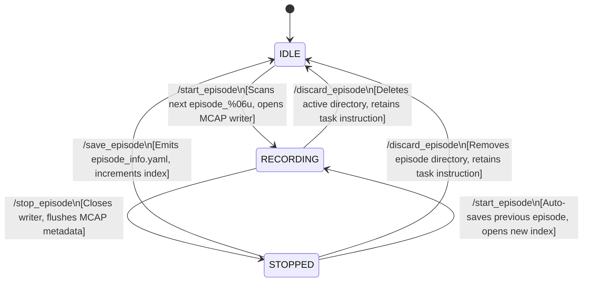
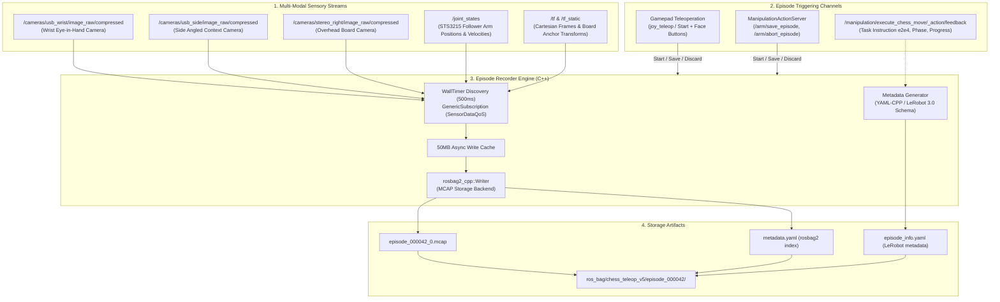
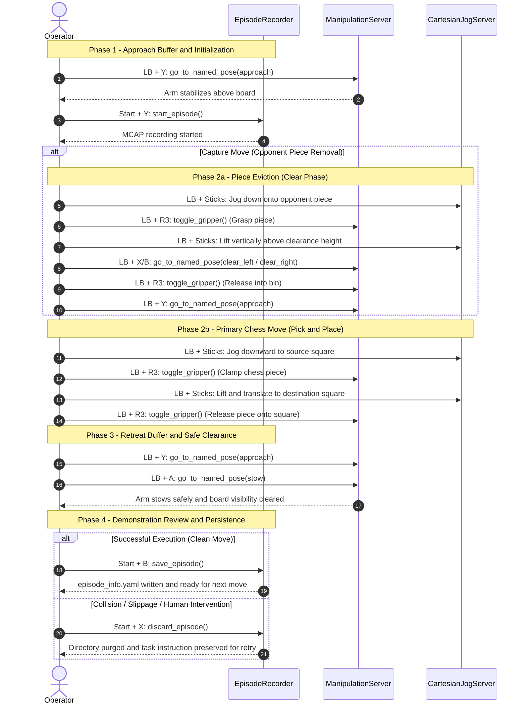

## Overview

The `chess_episode_recorder` package provides a deterministic, high-throughput demonstration recording engine designed for Physical-AI and Imitation Learning (ACT, Diffusion Policy, SmolVLA) on the **LeKiwi** mobile manipulator robot.

Built on top of `rosbag2_cpp` with an **MCAP** storage backend and asynchronous 50MB write-caching, the recorder captures synchronized multi-modal sensory observations—including three camera perspectives (wrist, side, overhead stereo), arm joint states, cartesian TF trees, and high-level manipulation action feedback—packaging each demonstration into an isolated directory structure paired with standardized `episode_info.yaml` metadata conforming to the **LeRobot Dataset 3.0** format.

### When to Use
- **Imitation Learning Data Collection**: Recording kinesthetic or gamepad-teleoperated demonstration episodes for policy training.
- **Move Verification & Failure Analysis**: Capturing raw execution streams of chess piece pick-and-place trajectories for offline debugging.
- **Multi-Modal Dataset Ingestion**: Generating self-contained MCAP episodes containing synchronized sensory observations and instruction metadata ready for conversion to Parquet / Hugging Face LeRobot format.

### When NOT to Use
- **General ROS 2 Topic Debugging**: For quick command-line logging or ad-hoc topic inspection, prefer standard CLI tools (`ros2 bag record` or Foxglove Studio).
- **Long-term Global Robot Telemetry**: For persistent fleet monitoring across multiple games, use cloud telemetry loggers rather than per-move episode recording.

---

## System Architecture and Dataflow

The package centers around `EpisodeRecorderNode`, a lifecycle-managed C++ ROS 2 node that orchestrates dynamic topic discovery, disk management, and active move instruction caching.

### 1. Finite State Machine (Episode Lifecycle)

Demonstration recording follows a strict 3-state Finite State Machine (FSM):



#### Key Lifecycle Invariants:
- **Index Auto-Increment**: The node scans `base_output_dir_` on startup and before each recording session using regex `episode_(\d{6})`, ensuring continuous sequence numbering without collision.
- **Auto-Save Protection**: If the operator begins a new demonstration (`/start_episode`) while the previous one is still in the `STOPPED` state, the node automatically invokes `save_episode()` before initializing the new directory, preventing data loss.
- **Retry Instruction Preservation**: When an episode is discarded (`/discard_episode`) due to a failed grasp or collision, the node purges the corrupted disk artifacts while explicitly preserving `current_instruction_` in memory. This enables immediate re-attempts of the same chess move without re-transmitting action goals.

---

### 2. Multi-Modal Dataflow Architecture

The recording engine acts as a unified sensory sink bridging physical actuators, cameras, and game arbitration:



---

## Hardware and Gamepad Teleoperation Guide

Data collection operates seamlessly via a physical game controller (Flydigi Vader / Xbox Controller) mapped inside [`gamepad_teleop.yaml`](file:///root/docker_ws/lekiwi_ros2/lekiwi_bringup/config/control/gamepad_teleop.yaml).

### 1. Gamepad Button Mapping Reference

| Control Domain | Button Combination | Interface / Topic / Service | Functionality |
| :--- | :--- | :--- | :--- |
| **Episode Recorder** | `Start + Y` (`[7, 3]` / D-Pad Up) | `/episode_recorder_node/start_episode` | **Start Episode**: Opens MCAP container, begins streaming. |
| | `Start + B` (`[7, 1]` / D-Pad Right) | `/arm/save_episode` | **Save Episode**: Flushes bag, writes `episode_info.yaml`, increments index. |
| | `Start + X` (`[7, 2]` / D-Pad Left) | `/episode_recorder_node/discard_episode` | **Discard Episode**: Deletes directory; preserves instruction for retry. |
| | `Start + A` (`[7, 0]` / D-Pad Down) | `/arm/abort_episode` | **Emergency Abort**: Halts arm motion immediately and purges episode. |
| **Arm Named Poses** | `LB + Y` (`[4, 3]`) | `/arm/go_to_named_pose` (`"approach"`) | Moves arm to hover over the board (initial observation vantage). |
| | `LB + A` (`[4, 0]`) | `/arm/go_to_named_pose` (`"stow"`) | Folds arm into compact stow posture (clearing camera line of sight). |
| | `LB + X` (`[4, 2]`) | `/arm/go_to_named_pose` (`"clear_left"`) | Moves captured piece to left discard container. |
| | `LB + B` (`[4, 1]`) | `/arm/go_to_named_pose` (`"clear_right"`) | Moves captured piece to right discard container. |
| **Cartesian Jogging** | `LB` (Deadman) + Left Stick | `/cartesian_jog_server_node/cmd_vel` | Translates end-effector smoothly in Cartesian $X$ (forward) and $Y$ (lateral). |
| | `LB` (Deadman) + Right Stick | `/cartesian_jog_server_node/cmd_vel` | Translates end-effector in Cartesian $Z$ (vertical plunge/lift). |
| | `LB` (Deadman) + D-Pad | `/cartesian_jog_server_node/cmd_vel` | Adjusts end-effector pitch and roll orientation. |
| **Gripper Actuation** | `LB + R3` (`[4, 10]`) | `/arm/toggle_gripper` | Toggles gripper clamp state between open and grasp. |

---

### 2. Standard Operating Procedure (SOP) for Move Recording

To guarantee high dataset distribution quality for policy learning, each chess demonstration must be executed following this 4-stage protocol:



> [!TIP]
> **Why Approach and Stow Buffers Matter:**  
> Placing deterministic `approach` and `stow` trajectories at the boundaries of every demonstration provides consistent initial/terminal image distributions for Vision-Language-Action (VLA) policies. Furthermore, stowing the arm at the end prevents visual occlusion when the overhead camera system validates board state changes.

---

## ROS 2 Node Reference

### Parameters (`config/episode_recorder_params.yaml`)

| Parameter Name | Data Type | Default Value | Description |
| :--- | :--- | :--- | :--- |
| `root_dir` | `string` | `"/root/docker_ws/lekiwi_ros2/ros_bag"` | Base directory where demonstration dataset runs are created. |
| `experiment_name` | `string` | `"chess_teleop_v5"` | Experiment subfolder appended to `root_dir` (e.g., `ros_bag/chess_teleop_v5/`). |
| `task` | `string` | `"chess_pick_and_place"` | Fallback task description used if no feedback instruction is available. |
| `storage_id` | `string` | `"mcap"` | Storage format plugin for `rosbag2` (`mcap` is required for LeRobot). |
| `feedback_topic` | `string` | `"/manipulation/execute_chess_move/_action/feedback"` | Action feedback topic sampled to extract active chess move instructions. |
| `topics` | `string[]` | *(See listing below)* | Complete list of ROS 2 topics recorded synchronously into each episode. |

#### Default Monitored Topics:
```yaml
topics:
  # Visual observations (Compressed JPEG from gscam nodes)
  - "/cameras/usb_wrist/image_raw/compressed"
  - "/cameras/usb_side/image_raw/compressed"
  - "/cameras/stereo_right/image_raw/compressed"

  # Follower Joint states & Controller state
  - "/joint_states"
  - "/arm_trajectory_controller/controller_state"

  # Spatial TF transforms (Mobile base & chessboard reference frames)
  - "/tf"
  - "/tf_static"
```

---

### Services Provided

| Service Name | Service Type | Description |
| :--- | :--- | :--- |
| `~/start_episode` | `std_srvs/srv/Trigger` | Prepares directory `episode_%06u`, opens the MCAP writer, and begins data logging. |
| `~/save_episode` | `std_srvs/srv/Trigger` | Flushes writer, computes duration, generates `episode_info.yaml`, and advances episode counter. |
| `~/discard_episode` | `std_srvs/srv/Trigger` | Stops recording (if active), deletes the active episode folder, and retains instruction for retry. |

---

### Subscriptions

| Topic Name | Message Type | QoS Profile | Purpose |
| :--- | :--- | :--- | :--- |
| Configured `topics` | Any (`GenericSubscription`) | `SensorDataQoS` (Best-effort/Volatile) | High-throughput streaming of sensory observations directly to disk cache. |
| `feedback_topic` | `ExecuteChessMove_FeedbackMessage` | `SystemDefaultsQoS` | Monitors active high-level move goals (e.g., `"Move e2 to e4"`) to embed in metadata. |

---

## Dataset Format and LeRobot 3.0 Compatibility

Each recorded demonstration produces an isolated episode directory structured as follows:

```text
ros_bag/chess_teleop_v5/
├── episode_000000/
│   ├── episode_000000_0.mcap     # Binary MCAP stream (images, joints, TF)
│   ├── metadata.yaml             # rosbag2 recording metadata index
│   └── episode_info.yaml         # Physical-AI LeRobot 3.0 episode manifest
├── episode_000001/
│   ├── episode_000001_0.mcap
│   ├── metadata.yaml
│   └── episode_info.yaml
```

### Manifest Schema (`episode_info.yaml`)
Generated automatically upon calling `/save_episode`:

```yaml
episode_id: 42
dataset_format: "lerobot_3.0"
experiment_name: "chess_teleop_v5"
task: "Move knight g1 to f3"
teleop_mode: "gamepad_manual"
success: true
duration_sec: 14.85
timestamp_start: 1729440621.14023
timestamp_end: 1729440635.99023
message_counts:
  /cameras/stereo_right/image_raw/compressed: 445
  /cameras/usb_side/image_raw/compressed: 446
  /cameras/usb_wrist/image_raw/compressed: 446
  /joint_states: 742
  /arm_trajectory_controller/controller_state: 742
  /tf: 1484
  /tf_static: 1
```

---

## Quickstart and Usage Examples

### 1. Launch with Robot Bringup
To launch the episode recorder alongside robot controllers, cameras, and motion servers:

```bash
ros2 launch chess_episode_recorder recorder.launch.py \
  recorder_params_file:=$(ros2 pkg prefix chess_episode_recorder)/share/chess_episode_recorder/config/episode_recorder_params.yaml
```

### 2. Manual CLI Service Triggering
You can test the recorder lifecycle directly using the ROS 2 CLI:

```bash
# 1. Start a new episode
ros2 service call /episode_recorder_node/start_episode std_srvs/srv/Trigger

# 2. Check recording progress (e.g. from ROS logs)
# [INFO] [episode_recorder_node]: ▶ [EPISODE RECORDER] Started Episode 000042 -> /root/docker_ws/lekiwi_ros2/ros_bag/chess_teleop_v5/episode_000042

# 3. Save demonstration upon completion
ros2 service call /episode_recorder_node/save_episode std_srvs/srv/Trigger

# OR: Discard failed attempt
ros2 service call /episode_recorder_node/discard_episode std_srvs/srv/Trigger
```

### 3. Inspecting Recorded MCAP Files
Use Foxglove CLI or standard rosbag2 tooling to verify bag health:

```bash
ros2 bag info /root/docker_ws/lekiwi_ros2/ros_bag/chess_teleop_v5/episode_000042
```

