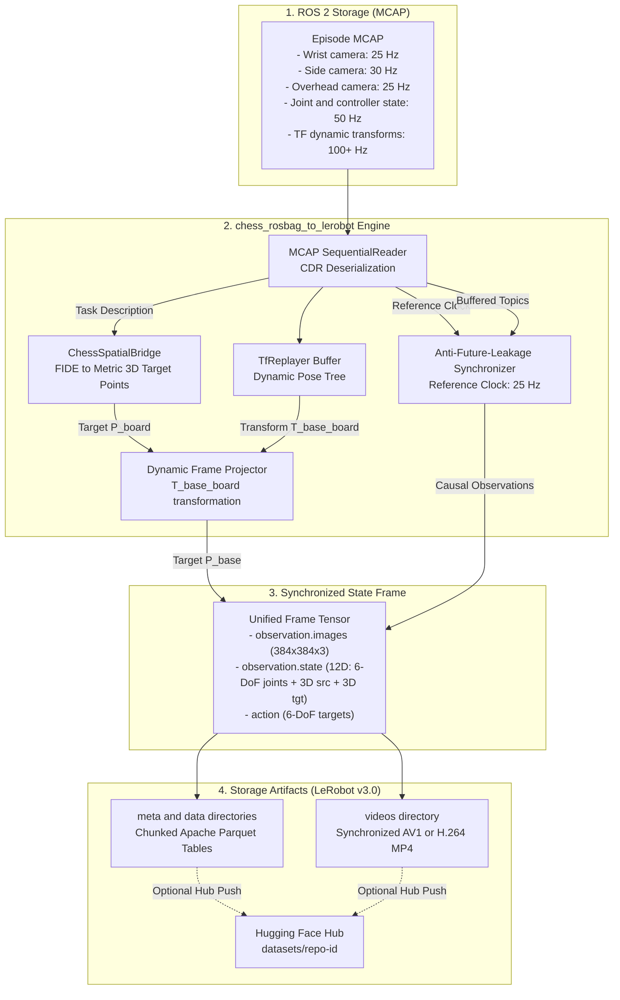

# chess_rosbag_to_lerobot

Deterministic, high-throughput offline data processing pipeline converting raw **ROS 2 MCAP** episode bags (generated by `chess_episode_recorder`) into **LeRobot Dataset v3.0** (`parquet` + `mp4`) format. Engineered specifically for training Physical-AI imitation learning policies (Action Chunking with Transformers [ACT], Diffusion Policy, SmolVLA) on the **LeKiwi** mobile manipulator robot.

---

## 1. Overview

Physical-AI models like ACT and Diffusion Policy require strictly synchronous, fixed-rate observation-action tensors. In contrast, physical robotics hardware communicates through asynchronous, multi-rate, jitter-prone publisher streams across distributed buses and IP cameras.

`chess_rosbag_to_lerobot` resolves this fundamental domain mismatch through four key capabilities:

* **Anti-Future-Leakage Temporal Synchronizer**: Drives the dataset clock from a high-priority visual reference stream (`/cameras/usb_wrist/image_raw/compressed` at 25 Hz) while sampling peripheral visual and proprioceptive streams using strict causal "As-Of" alignment ($t_{\text{sample}} \le t_{\text{ref}}$).
* **SmolVLA 12D Unified Observation State**: Directly packs 6-DoF joint positions with 3D source $(x, y, z)$ and 3D target $(x, y, z)$ coordinates into a single 12D `observation.state` tensor, eliminating auxiliary environment conditioning vectors for native SmolVLA training.
* **Deterministic Episode Sorting**: Automatically groups and sorts episodes by manipulation primitive (`MOVE` $\to$ `CLEAR` $\to$ `PICK` $\to$ `PLACE`), piece type, and piece color before dataset conversion, ensuring clean dataset chunking and curriculum training.
* **Direct Multi-Camera Decoding**: Decodes compressed JPEG frames from up to three camera perspectives (`usb_wrist`, `usb_side`, `stereo_right`) and encodes them directly into MP4 video chunks (`libsvtav1` / `libx264`).
* **Offline TF Replaying with Seeding & Pure-NumPy Fallback**: Reconstructs frame transformations offline even when `/tf_static` is omitted from rosbags (via configurable `map -> chessboard_frame` seeding) and provides an integrated pure-NumPy BFS transform graph that works with zero ROS 2 dependencies.
* **Pixi-First Host Workstation Integration**: Seamlessly pre-configured to execute on GPU training workstations via isolated `pixi` environments with zero host ROS 2 dependency pollution.

---

## 2. Core Architecture & Mathematical Foundations

### 2.1 End-to-End Pipeline Dataflow

The conversion architecture decouples raw deserialization, causal timestamp matching, rigid-body kinematic projection, and chunked storage:



---

### 2.2 Anti-Future-Leakage Mathematical Model

In imitation learning, passing future observation data ($t > t_{\text{ref}}$) into a causal policy during training introduces **foresight contamination (future leakage)**. The policy learns to predict actions by observing events that have not yet occurred, resulting in severe degradation during live closed-loop deployment.

`chess_rosbag_to_lerobot` implements a strict **causal As-Of buffer**:

1. **Reference Time Selection**: Let the $k$-th sample frame time be governed by the primary wrist camera message:
   $$t_{\text{ref}} = t_{\text{wrist}}^{(k)}$$

2. **Causal Neighbor Search**: For any auxiliary topic $S$ (e.g. `/joint_states`, `/cameras/usb_side`), the matched sample $m^*$ is chosen strictly from the past:
   $$m^* = \arg\max_{m \in S} \left\{ t_m \;\middle|\; t_m \le t_{\text{ref}} \right\}$$

3. **Freshness Gating**: The sample is rejected and the frame is dropped if the sample age exceeds the configured freshness window $\Delta t_{\text{max}}$:
   $$\Delta t = t_{\text{ref}} - t_{m^*} \le \Delta t_{\text{max}}$$
   If $\Delta t > \Delta t_{\text{max}}$ (or no prior sample exists), the frame is flagged as `stale` / `empty`, guaranteeing that temporal interpolation never hallucinates across recording gaps.

---

### 2.3 SmolVLA 12D State Construction & Natural Language Integration

SmolVLA policies consume a single unified `observation.state` vector rather than split environment conditioning vectors. The 12D state vector combines the robot's physical configuration with metric task endpoints in `base_footprint`:

$$\mathbf{s}_{\text{state}} = \begin{bmatrix} q_1 & q_2 & q_3 & q_4 & q_5 & q_6 & x_{\text{source}}^{\text{base}} & y_{\text{source}}^{\text{base}} & z_{\text{source}}^{\text{base}} & x_{\text{target}}^{\text{base}} & y_{\text{target}}^{\text{base}} & z_{\text{target}}^{\text{base}} \end{bmatrix}^T \in \mathbb{R}^{12}$$

1. **SmolVLA Instruction Parsing**:
   Instructions generated by `lekiwi_orchestrator`'s Single Source of Truth (SSOT) via `/manipulation/execute_chess_move/_action/feedback` are parsed to extract primitive, color, and piece type:
   - `"Move <color> <piece> to target"`: Chessboard source to chessboard target.
   - `"Clear <color> <piece> to <left|right> bin"`: Chessboard source to calibrated onboard discard bin (`clear_left` / `clear_right`).
   - `"Pick <color> <piece>"`: Chessboard source to calibrated `stow` landmark.
   - `"Place <color> <piece>"`: Calibrated `stow` landmark to chessboard target.
2. **Deterministic Episode Sorting**:
   To maximize training convergence and chunk consistency, `sort_episodes()` organizes episodes deterministically before parquet conversion:
   - **Task hierarchy**: `MOVE` ($0$) $\to$ `CLEAR` ($1$) $\to$ `PICK` ($2$) $\to$ `PLACE` ($3$).
   - **Piece hierarchy**: `pawn` ($0$) $\to$ `knight` ($1$) $\to$ `bishop` ($2$) $\to$ `rook` ($3$) $\to$ `queen` ($4$) $\to$ `king` ($5$).
   - **Color hierarchy**: `white` ($0$) $\to$ `black` ($1$).

---

## 3. Dataset Schema (LeRobot Dataset v3.0)

When converted, each episode produces a standardized schema compatible with PyTorch and LeRobot training pipelines:

| Feature Key | Shape | Dtype | Description |
| :--- | :--- | :--- | :--- |
| `observation.images.wrist` | `[384, 384, 3]` | `video` (AV1/MP4) | Wrist camera (eye-in-hand) egocentric view |
| `observation.images.side` | `[384, 384, 3]` | `video` (AV1/MP4) | Lateral side view monitoring arm elevation and depth |
| `observation.images.overhead` | `[384, 384, 3]` | `video` (AV1/MP4) | Overhead perspective (`stereo_right`) of board |
| `observation.state` | `[12]` | `float32` | 12D unified state: 6-DoF joint positions + 3D source $(x, y, z)$ + 3D target $(x, y, z)$ in meters |
| `action` | `[6]` | `float32` | Commanded/actual trajectory controller joint positions |

### Generated Directory Layout
```
~/.cache/huggingface/lerobot/<repo-id>/
├── meta/
│   ├── info.json              # Dataset metadata, fps, robot_type, total frames
│   ├── stats.json             # Normalization statistics (mean, std, min, max)
│   ├── episodes.jsonl         # Episode index, duration, task instructions
│   └── tasks.jsonl            # Discrete task descriptions mapping
├── data/
│   └── chunk-000/
│       └── episode_000000.parquet  # Observation & action numeric tables
└── videos/
    ├── observation.images.wrist/chunk-000/episode_000000.mp4
    ├── observation.images.side/chunk-000/episode_000000.mp4
    └── observation.images.overhead/chunk-000/episode_000000.mp4
```

---

## 4. Workstation Quick Start (Pixi Workflow)

All conversion and inspection operations are driven through the host `pixi` task runner in `lekiwi_ros2`. No system-level ROS 2 installation on your GPU host is needed.

### 4.1 Verify Environment & Acceleration

Inspect PyTorch CUDA capability and LeRobot version:
```bash
cd ~/lerobot_ws/lekiwi_ros2
pixi run -e lerobot lerobot-info
```

### 4.2 Run Dataset Conversion

#### Option A: Local Conversion Only (Offline)
Convert recorded bags into a local LeRobot dataset:
```bash
cd ~/lerobot_ws/lekiwi_ros2
pixi run -e lerobot convert -- \
  --input-dir ros_bag/chess_teleop_v5 \
  --config chess_rosbag_to_lerobot/config/lekiwi_chess.yaml \
  --repo-id local/lekiwi_chess_v5 \
  --task-types move clear pick place \
  --sync-p95 \
  --overwrite
```

#### Option B: Convert & Push Directly to Hugging Face Hub
To automatically upload the dataset to your Hugging Face Hub account right after conversion:

1. **Authenticate Hugging Face CLI** (if not already logged in with write access):
```bash
# Set HF_TOKEN environment variable or run huggingface-cli
export HF_TOKEN="hf_your_personal_access_token_here"
# Or interactive login via pixi environment:
pixi run -e lerobot python -m huggingface_hub.cli login
```

2. **Run conversion with `--push-hub` and your target Hub repo ID**:
```bash
cd ~/lerobot_ws/lekiwi_ros2
pixi run -e lerobot convert -- \
  --input-dir ros_bag/chess_teleop_v5 \
  --config chess_rosbag_to_lerobot/config/lekiwi_chess.yaml \
  --repo-id DuyKhongCay/lekiwi_chess_v5 \
  --task-types move clear pick place \
  --push-hub \
  --sync-p95 \
  --overwrite
```

#### Option C: Upload an Existing Converted Local Dataset to Hub
If you already converted the dataset locally (e.g. at `~/.cache/huggingface/lerobot/local/lekiwi_chess_v5` or custom `--output-dir`), you can push it to Hugging Face Hub using Python or the HF CLI without re-converting all rosbags:

**Using Python snippet in Pixi:**
```bash
pixi run -e lerobot python -c '
from huggingface_hub import HfApi
from pathlib import Path

repo_id = "DuyKhongCay/lekiwi_chess_v5"
dataset_dir = Path.home() / ".cache/huggingface/lerobot/local/lekiwi_chess_v5"

api = HfApi()
api.create_repo(repo_id=repo_id, repo_type="dataset", exist_ok=True)
api.upload_folder(
    folder_path=str(dataset_dir),
    repo_id=repo_id,
    repo_type="dataset",
    commit_message="Upload converted LeKiwi chess dataset v5 (multi-primitive)"
)
print(f"Successfully uploaded dataset to https://huggingface.co/datasets/{repo_id}")
'
```

**Or using Hugging Face CLI:**
```bash
pixi run -e lerobot hf upload DuyKhongCay/lekiwi_chess_v5 \
  ~/.cache/huggingface/lerobot/local/lekiwi_chess_v5 \
  . \
  --repo-type dataset --no-private
```

> [!IMPORTANT]
> **LeRobot v3.0 Tag Sync (`v3.0` vs `main`):**
> LeRobot v3.0 automatically resolves `--dataset.revision` to Git Tag `v3.0` if that tag exists on your Hugging Face repo. When uploading a newly converted dataset to `main`, you must update or recreate tag `v3.0` to point to the latest commit of `main`, otherwise `lerobot-train` will continue pulling the older snapshot pinned to tag `v3.0`:
> ```bash
> pixi run -e lerobot python -c '
> from huggingface_hub import HfApi
> api = HfApi()
> repo_id = "DuyKhongCay/lekiwi_chess_v5"
> api.delete_tag(repo_id=repo_id, tag="v3.0", repo_type="dataset")
> api.create_tag(repo_id=repo_id, tag="v3.0", revision="main", repo_type="dataset")
> print("Successfully synced tag v3.0 to main!")
> '
> ```
>
> On cloud training environments (e.g., Kaggle / Colab), ensure full cache invalidation by deleting:
> ```bash
> !rm -rf /root/.cache/huggingface/lerobot/hub/datasets--DuyKhongCay--lekiwi_chess_v5
> !rm -rf /root/.cache/huggingface/hub/datasets--DuyKhongCay--lekiwi_chess_v5
> !rm -rf /root/.cache/huggingface/lerobot/DuyKhongCay/lekiwi_chess_v5
> !rm -rf /kaggle/working/outputs/act_lekiwi_chess
> ```

#### Common CLI Arguments
* `--input-dir <path>`: Root directory containing episode sub-folders (`episode_000000/`, etc.).
* `--config <path>`: Path to conversion YAML configuration (default: `config/lekiwi_chess.yaml`).
* `--repo-id <id>`: Identifier for the dataset:
  * Local prefix: `local/lekiwi_chess_v5` (stored under `~/.cache/huggingface/lerobot/local/lekiwi_chess_v5`).
  * Hub format: `<hf_username>/<dataset_name>` (e.g. `DuyKhongCay/lekiwi_chess_v5`).
* `--task-types <types...>`: (Optional) Filter episodes by manipulation primitive (`move`, `clear`, `pick`, `place`). Omit or pass all 4 to convert complete multi-primitive datasets.
* `--output-dir <path>`: (Optional) Override local destination folder (default: `~/.cache/huggingface/lerobot/<repo-id>`).
* `--vcodec <codec>`: Video compression library (`libsvtav1` default, `libx264` for fast CPU encoding, `h264_nvenc` for NVIDIA hardware NVENC encoding).
* `--sync-p95`: Enable detailed 95th-percentile latency diagnostic profiling table.
* `--push-hub`: Automatically push to Hugging Face Hub (`dataset.push_to_hub()`) upon successful conversion completion.
* `--overwrite`: Overwrite destination folder if already present.

### 4.3 Inspect and Visualize Dataset

Launch the interactive Rerun visualizer to inspect multi-camera playback, joint positions, and 6D goal targets:
```bash
pixi run -e lerobot viz -- \
  --repo-id local/lekiwi_chess_v3 \
  --episode-index 0
```

---

## 5. Configuration Reference (`config/lekiwi_chess.yaml`)

The conversion pipeline is configured via declarative YAML matching SSOT geometry:

```yaml
robot_type: "lekiwi"
fps: 25

# Primary tick clock driving the dataset rate
reference_topic: "/cameras/usb_wrist/image_raw/compressed"

# Global fallback freshness threshold (40ms)
default_max_age_s: 0.04

task: "Chess pick and place move"

# Single Source of Truth matching chessboard_pose_estimator & lekiwi_motion
chessboard:
  board_frame: "chessboard_frame"
  base_frame: "base_footprint"
  square_size_m: 0.037        # Physical square pitch (37mm)
  grasp_clearance_z_m: 0.035  # Approach altitude above board plane
  origin_at_center: true      # (0,0) is board geometric center

joint_names: &arm_joints
  - arm_shoulder_pan
  - arm_shoulder_lift
  - arm_elbow_flex
  - arm_wrist_flex
  - arm_wrist_roll
  - arm_gripper

features:
  # Multi-perspective camera streams
  - key: "observation.images.wrist"
    topic: "/cameras/usb_wrist/image_raw/compressed"
    msg_type: "sensor_msgs/msg/CompressedImage"
    stamp_src: "bag"
    shape: [384, 384, 3]

  - key: "observation.images.side"
    topic: "/cameras/usb_side/image_raw/compressed"
    msg_type: "sensor_msgs/msg/CompressedImage"
    stamp_src: "bag"
    shape: [384, 384, 3]

  - key: "observation.images.overhead"
    topic: "/cameras/stereo_right/image_raw/compressed"
    msg_type: "sensor_msgs/msg/CompressedImage"
    stamp_src: "bag"
    shape: [384, 384, 3]

  # Proprioception + Spatial Endpoints (12D: 6 joint states + 3D source + 3D target)
  - key: "observation.state"
    topic: "/joint_states"
    msg_type: "sensor_msgs/msg/JointState"
    stamp_src: "bag"
    max_age_s: 0.04
    names: *arm_joints

  # Action supervisor (commanded / trajectory controller state)
  - key: "action"
    topic: "/arm_trajectory_controller/controller_state"
    msg_type: "control_msgs/msg/JointTrajectoryControllerState"
    stamp_src: "bag"
    max_age_s: 0.04
    names: *arm_joints
```

---

## 6. Synchronization Diagnostics & Latency Profiling

Passing the `--sync-p95` flag outputs detailed synchronization telemetry for each topic:

```
[INFO] Episode 000000 Synchronization Quality Report:
/joint_states                              | match=100.0% | dt_mean=  8.4ms | dt_p95= 14.2ms | dt_max= 18.9ms | miss(e/f/s)=0/0/0
/cameras/usb_side/image_raw/compressed     | match= 99.8% | dt_mean= 12.1ms | dt_p95= 24.8ms | dt_max= 31.4ms | miss(e/f/s)=0/0/2
/cameras/stereo_right/image_raw/compressed | match=100.0% | dt_mean=  6.3ms | dt_p95= 12.0ms | dt_max= 16.5ms | miss(e/f/s)=0/0/0
```

### Metrics Definition
* **`match`**: Percentage of reference clock ticks that found a valid causal match within $\Delta t_{\text{max}}$. Aim for $>98\%$.
* **`dt_mean` / `dt_p95`**: Mean and 95th-percentile temporal skew between the reference image capture and peripheral samples.
* **`miss(e/f/s)`**:
  * `e` (*empty*): Topic had published no data prior to this clock tick (common during bag start).
  * `f` (*future*): Prevented by design ($t_m > t_{\text{ref}}$ strictly forbidden).
  * `s` (*stale*): Sample was found in the past, but exceeded `max_age_s` (indicates publisher starvation or packet drop).

---

## 7. Troubleshooting & FAQ

### Q1: `AV1 encode failed` or conversion is slow
* **Cause**: Software AV1 encoding (`libsvtav1`) can be CPU-intensive on high-resolution streams.
* **Fix**: Use `--vcodec libx264` for faster CPU encoding, or `--vcodec h264_nvenc` if running with NVIDIA hardware acceleration.

### Q2: Frame drop rate is high (>5%)
* **Cause**: Camera frame rates are mismatched or `/joint_states` published intermittently.
* **Check**: Increase `default_max_age_s: 0.10` in YAML or verify USB bus bandwidth on the robot.

### Q3: `observation.state` source/target endpoints use default coordinates
* **Cause**: The episode metadata recorded task does not contain explicit board coordinates.
* **Fix**: Ensure `chess_episode_recorder` receives active move feedback from `ExecuteChessMove` action before starting an episode.

---

## 8. Verification & Quality Assurance

The package includes a comprehensive suite of unit tests validating buffers, timestamp arithmetic, decoders, SmolVLA parsing, and spatial transforms:

```bash
cd ~/lerobot_ws/lekiwi_ros2
PYTHONPATH=chess_rosbag_to_lerobot pytest chess_rosbag_to_lerobot/test
```

Expected result:
```
============================== 20 passed in 0.93s ==============================
```
