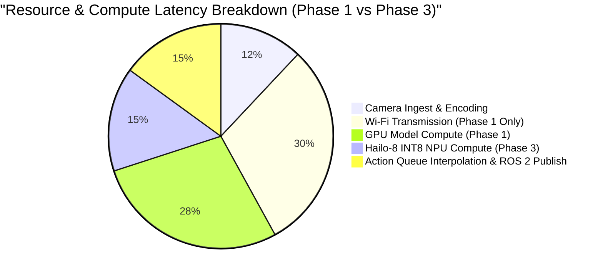
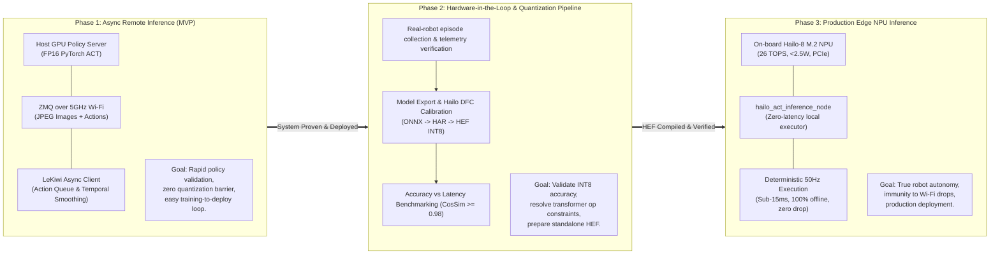

# ADR-001: Two-Stage Evolution from Remote Async Inference to On-Board Hailo-8 Edge Inference

## Status
Accepted

## Context
The LeKiwi physical AI robot requires running deep imitation learning policies (specifically ACT - Action Chunking with Transformers) to perform complex manipulation tasks such as chess piece picking, placing, and sorting.

We evaluated two deployment paths:
1. Running PyTorch ACT directly on the on-board compute (Raspberry Pi 5 CPU).
2. Remote GPU inference over ZeroMQ vs. on-board Hailo-8 M.2 NPU (26 TOPS INT8).

Benchmark findings:
- Raspberry Pi 5 quad-core Cortex-A76 running PyTorch ACT with dual ResNet18 visual backbones achieves only 3–5 Hz inference with 100% CPU saturation and severe thermal throttling.
- `so101_inference/lerobot_inference_node.py` uses direct PyTorch CPU/CUDA execution, which is unviable on-board Raspberry Pi 5 without hardware acceleration.
- Attempting to quantize ACT to Hailo-8 immediately introduces high debugging friction: model export (ONNX with dynamic vs. static shapes), cross-attention layer mapping in Hailo Dataflow Compiler (DFC), and INT8 quantization calibration.

## Decision
We adopt a disciplined, phased development lifecycle:

1. **Phase 1: Async Remote Policy Inference (`async_inference`)**:
   - Host GPU / Cloud workstation runs `lerobot_policy_server` (ZeroMQ binary protocol with msgpack + raw ndarray buffers).
   - LeKiwi robot runs `lekiwi_inference/async_ros2_client_node`.
   - Communication over 5GHz Wi-Fi using `sensor_msgs/CompressedImage` to conserve wireless bandwidth.
   - Deterministic 50Hz action publisher decoupled from network round-trip via a thread-safe sliding action queue with temporal moving-average aggregation (`weighted_average`).
   - Hardened with a Safety Watchdog that ramps down or holds position if network latency exceeds `max_age_s`.

2. **Phase 2: Validation, Telemetry & Dataset Grounding**:
   - Validate policy execution on physical LeKiwi robot with `arm_forward_controller` (`/arm_forward_controller/commands`).
   - Record evaluation episodes and calibration datasets for NPU quantization.

3. **Phase 3: Edge NPU Inference (`edge_inference`) on Hailo-8**:
   - Quantize the validated ACT policy to INT8 using Hailo DFC.
   - Build `hailo_act_inference_node` in `lekiwi_inference` using HailoRT (Python / C++ API).
   - Ingest intra-process camera frames directly from `lekiwi_perception`, achieving zero network dependency, deterministic < 15ms total latency, and fully untethered autonomous operation.

## Consequences
- **Positive**:
  - Immediate turnaround: LeRobot models trained on HuggingFace can be deployed and validated on the physical robot in Phase 1 within minutes without waiting for quantization compilation.
  - Fail-safe design: The action queue decouples the 50Hz motor loop from inference jitters.
  - Smooth migration: The ROS 2 control topic, joint conventions, and safety watchdog remain identical between Phase 1 and Phase 3.
- **Negative / Constraints**:
  - Phase 1 requires a dedicated 5GHz Wi-Fi router close to the workcell to prevent dropped frames.
  - Phase 3 requires careful ONNX export and INT8 calibration to avoid catastrophic accuracy loss on the Transformer regression head.

