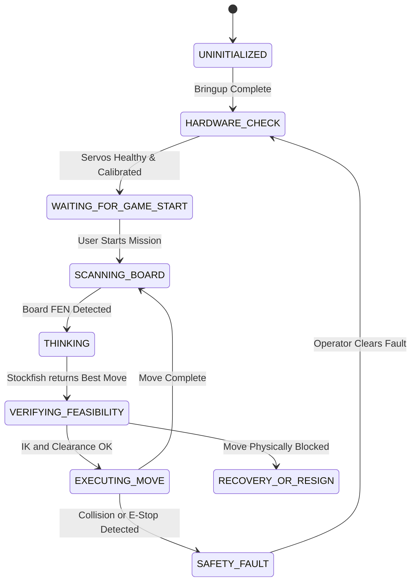

# Decision FSM & Stockfish Engine Integration

This article explains the decision lifecycle of the autonomous chess playing system coordinated by `lekiwi_orchestrator`.

---

## ♟️ Finite State Machine (FSM) Lifecycle

The autonomous chess mission is governed by a state machine that guards each physical move with readiness gates, visual confirmation, and kinematics verification:

---

## 🔒 Verification Gating Before Physical Actuation

To prevent collisions and broken pieces:

1. **Board Perception Gate**: The camera hub must detect all 64 squares with confidence score > 0.85.
2. **Move Feasibility Gate**: Before `ExecuteChessMove` begins, `lekiwi_motion` runs analytical inverse kinematics. If any waypoint violates joint limits or approaches the table collision plane within 5mm, the move is rejected.
3. **Capture Sequence Splitting**: If a move involves a capture, the orchestrator decomposes the mission into two discrete physical actions:
   - Action 1: Pick up opponent piece on target square and move it to the discard cemetery.
   - Action 2: Pick up player piece and place it on target square.

