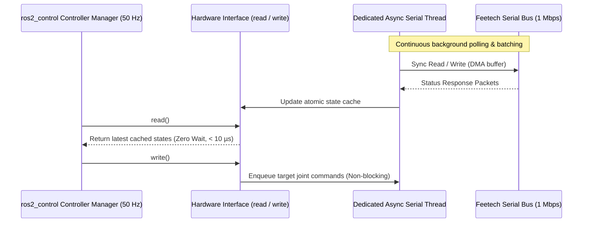

# Hardware Control Loop & STS3215 Serial Bus

This article explains how LeKiwi achieves real-time motor control over an asynchronous half-duplex serial bus using `ros2_control`.

---

## 🏎️ The Real-Time Dilemma on Half-Duplex UART

LeKiwi drives 9 Feetech STS3215 servos connected in a single daisy-chain bus running at 1,000,000 baud. 

- In a standard synchronous `read()` / `write()` architecture, querying 9 servos for position, velocity, current, and temperature requires sending 9 distinct request packets and waiting for 9 response packets.
- At 1 Mbps, turn-around delays and packet transmission require 8–15 ms per cycle.
- If executed synchronously inside the `ros2_control` update loop, a single delayed packet causes jitter and deadline misses in the controller manager.

---

## 🧵 The Solution: Asynchronous Thread Decoupling

`lekiwi_ftservo_hardware` implements an asynchronous dual-buffer architecture:

---

## 🛡️ Bus Reliability Features

1. **Atomic State Cache**: The `read()` call never blocks on UART I/O; it returns atomic copies of the most recent valid packet frame.
2. **Packet Checksum Validation**: Corrupted packets caused by motor EMF spikes are rejected without poisoning controller states.
3. **Automatic Bus Recovery**: If consecutive packet drops exceed threshold limits, the background worker invokes silent re-initialization without tearing down the controller manager.

