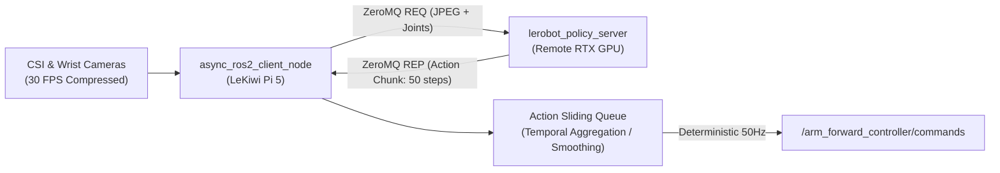
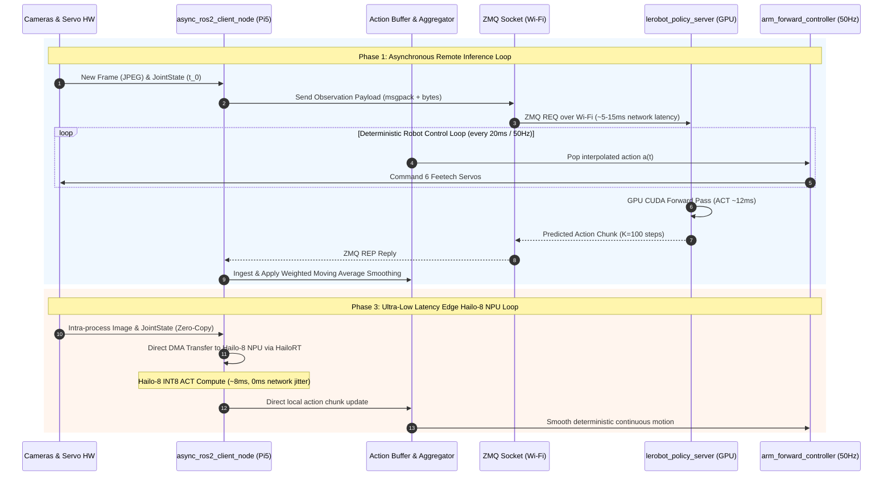

# Physical-AI Inference Strategy: Two-Stage Evolution

This article outlines the engineering rationale behind LeKiwi's phased inference strategy: transitioning from **Phase 1: Asynchronous Remote Policy Inference** to **Phase 3: Onboard Hailo-8 Edge NPU Acceleration**.

---

## 🎯 The Core Problem

Deploying modern Physical-AI models—specifically **ACT (Action Chunking with Transformers)** and **SmolVLA**—requires processing dual high-resolution image streams alongside joint state vectors to predict multi-step action trajectories:

- **Compute Bottleneck**: The Raspberry Pi 5 quad-core Cortex-A76 processor cannot run dual ResNet-18 visual encoders and Transformer decoder blocks at the required 30–50 Hz control rate. On-CPU inference results in 180–350 ms latency, creating dangerous lag and instability.
- **Quantization Friction**: Directly quantizing a freshly trained Transformer policy to INT8 Hailo Executable Format (HEF) introduces friction during initial hardware testing (ONNX operator export, dynamic attention shape mapping, and calibration dataset collection).

---

## ⚖️ Architectural Comparison

| Dimension | Phase 1: Async Remote GPU Inference | Phase 3: Onboard Edge NPU (Hailo-8) |
| :--- | :--- | :--- |
| **Inference Location** | Remote Workstation (NVIDIA RTX GPU / CUDA) | Onboard Hailo-8 M.2 Key M NPU (26 TOPS INT8) |
| **Transport** | ZeroMQ REQ/REP over 5GHz Wi-Fi LAN | Direct PCIe Gen 2/3 x1 DMA / HailoRT |
| **End-to-End Latency** | ~12ms GPU + 5–15ms Network = ~25ms | ~8–12ms NPU (0ms network) |
| **Network Dependency** | Requires active Wi-Fi and workstation | 100% Offline and untethered |
| **Safety Watchdog** | Network timeout watchdog required | Hardware watchdog only |
| **Deployment Barrier** | Zero (direct PyTorch checkpoint loading) | Medium (ONNX export & DFC quantization) |

---

## 🔄 Phase 1: Asynchronous Action Chunking Architecture

In Phase 1, `lekiwi_inference` decouples the 50Hz motor execution loop from variable network latency using a thread-safe sliding action queue:

### Key Safety Mechanisms:
1. **Temporal Aggregation**: Overlapping chunks from consecutive inference cycles are blended using exponentially weighted moving averages to prevent trajectory discontinuities.
2. **Heartbeat Watchdog**: If the network round-trip time exceeds `watchdog_timeout_sec` (default: 200 ms), the node gently halts joint velocities and notifies the orchestrator.

### Real-Time Execution Sequence (Phase 1 vs. Phase 3)

The following sequence diagram contrasts the decoupled, network-dependent loop of Phase 1 against the zero-copy, edge-accelerated pipeline of Phase 3:

---

## 🚀 Phase 3: Transition to Hailo-8 Edge NPU

Once a policy's behavior is verified on physical hardware, it is compiled for edge acceleration:

1. **ONNX Export**: Static input dimensions are frozen (`observation.images: [1, 3, 224, 224]`).
2. **Hailo Dataflow Compiler (DFC)**: The model is parsed and quantized to INT8 using evaluation episodes as the calibration dataset.
3. **HailoRT Direct Pipeline**: The compiled `.hef` model runs inside `lekiwi_inference` using HailoRT C++ runtime APIs, eliminating wireless latency completely.

For the formal decision record, see [ADR-001: Inference Evolution](adr/ADR-001-async-to-edge-inference-evolution.md).

