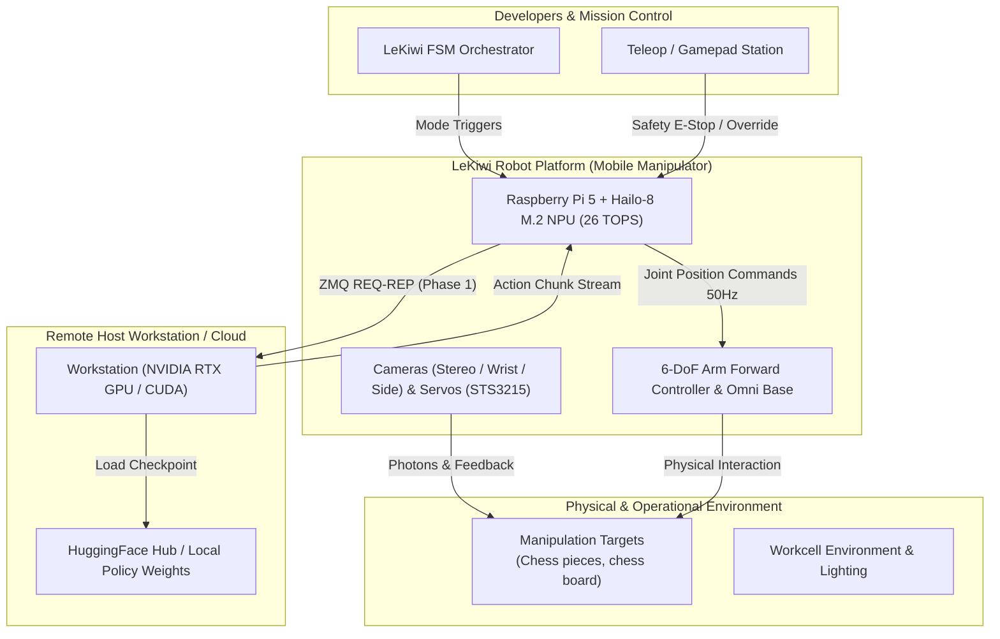
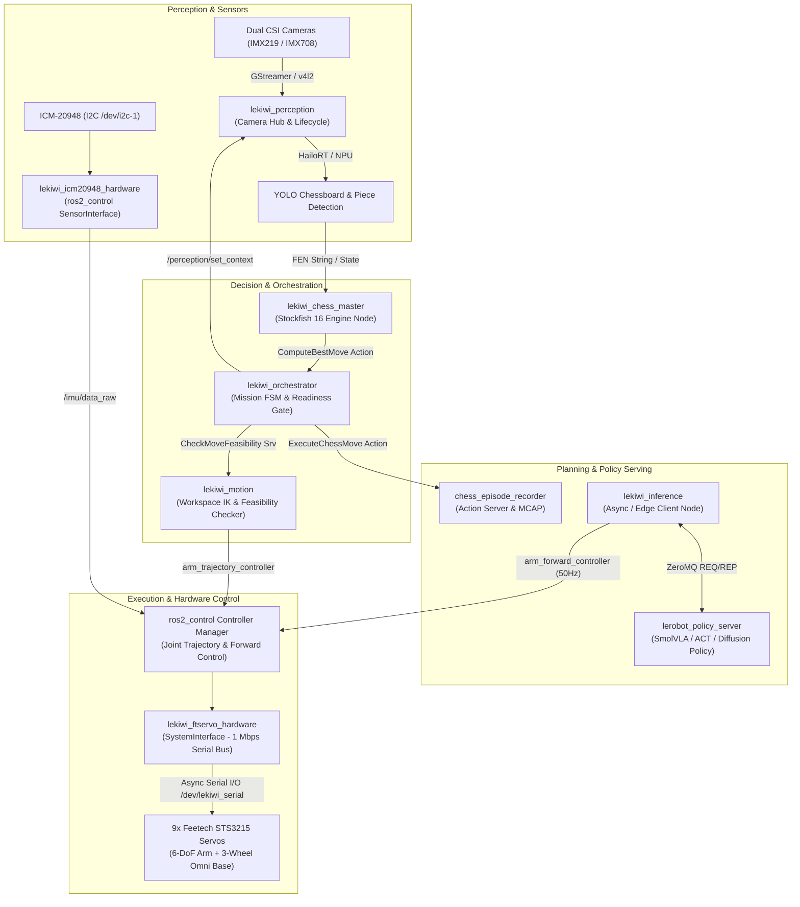
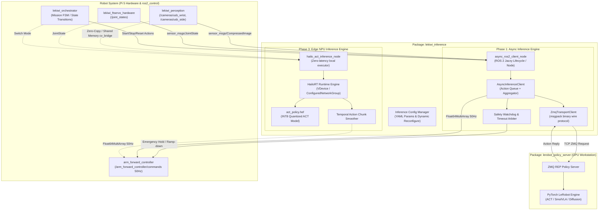

# System Architecture

This article describes the holistic system architecture of the LeKiwi autonomous mobile manipulation platform.

---

## 🌐 System Context (C4 Level 1)

The system context diagram illustrates LeKiwi operating within its physical workcell, interacting with physical manipulation objects, human operators, and remote compute infrastructure:

---

## 🧩 Component Decomposition (C4 Level 2)

LeKiwi's software architecture enforces clean boundaries between **Perception**, **Decision**, **Planning**, and **Hardware Abstraction**:

---

## 🔍 Inference Subsystem Components (C4 Level 3)

Zooming into the `lekiwi_inference` module demonstrates the dual-phase implementation isolating safety, transport, and hardware execution:

---

## 🔄 Inter-Process Communication Patterns

1. **Deterministic Real-Time Motor Loop (50 Hz)**:
   - Synchronized by `ros2_control` update cycle.
   - Decoupled from serial blocking delays via dedicated asynchronous worker threads in `lekiwi_ftservo_hardware`.
2. **High-Throughput Visual AI Pipeline**:
   - Camera images are captured via V4L2/GStreamer and processed through zero-copy HailoRT buffers for object detection.
   - For remote policy serving, frames are JPEG-compressed to preserve wireless bandwidth.
3. **Discrete Decision & Orchestration**:
   - Long-running engine analysis and trajectory executions use **ROS 2 Actions**, providing non-blocking execution, cancelability, and periodic progress feedback.

