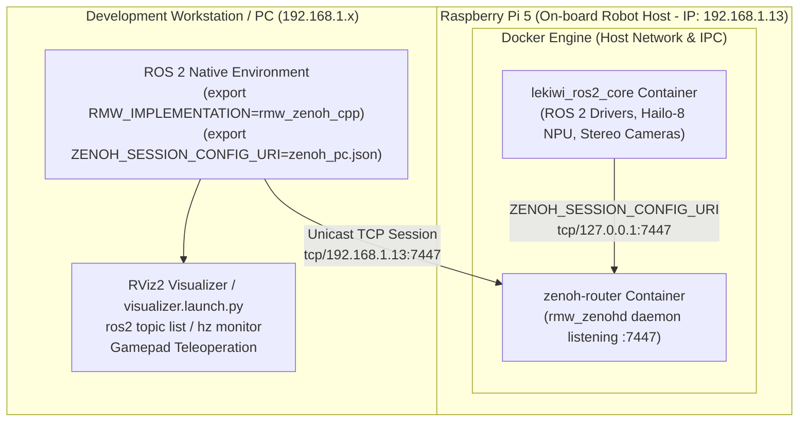

# How-To: Set Up Distributed Pi 5 Docker & PC Zenoh Environment

This guide walks you through configuring a production-grade distributed runtime for the LeKiwi robot: the complete hardware drivers, perception stack, and control loop run inside a **Docker container on the Raspberry Pi 5**, communicating seamlessly with a **remote PC workstation (running RViz2, monitoring tools, and teleoperation)** via the **Zenoh middleware (`rmw_zenoh_cpp`)**.

---

## 📌 Distributed Network Architecture

Traditional ROS 2 DDS implementations (such as FastDDS or CycloneDDS) frequently encounter multicast discovery packet loss over Wi-Fi networks and complex firewall traversal across subnets. LeKiwi standardizes on a **Zenoh Router & Client Architecture**:



### Key Technical Advantages
1. **Zero Multicast Traffic:** All cross-machine traffic between the PC and the robot uses unicast TCP, making it completely independent of Wi-Fi router IGMP Snooping capabilities.
2. **Optimized Stereo Throughput:** TCP socket send/receive buffers tuned to 256 KB – 512 KB deliver high-throughput, jitter-free stereo imagery and pointcloud streaming.
3. **Environment Isolation (Containerization):** Complex hardware-specific dependencies on the Pi 5 (HailoRT 4.23.0, TAPPAS 5.1.0, libcamera 0.7.2, patched GStreamer 1.24) remain cleanly sandboxed inside Docker without polluting the host operating system.

---

## ⚙️ Part 1: Raspberry Pi 5 Setup (Robot Docker Runtime)

### 1. Host Prerequisites
Before launching containers on the Raspberry Pi 5, verify the host kernel drivers and hardware permissions:

1. **Verify Hailo-8 M.2 NPU kernel module:**
   ```bash
   ls -la /dev/hailo0
   # Expected output: crw-rw---- 1 root video ... /dev/hailo0
   ```
2. **Grant video and serial bus access:**
   ```bash
   sudo usermod -aG video,dialout $USER
   ```
3. **Verify Docker and Docker Compose v2 installation:**
   ```bash
   docker --version && docker compose version
   ```

### 2. Configuration Files on the Pi 5
Located in the repository root (`lekiwi_ros2/`):

#### A. Local Zenoh Session Configuration (`zenoh_pi5.json`)
Directs all ROS 2 nodes inside the Pi 5 container to the local router daemon:
```json
{
    "mode": "client",
    "connect": {
        "endpoints": [
            "tcp/127.0.0.1:7447#so_sndbuf=262144;so_rcvbuf=262144"
        ]
    },
    "timestamping": {
        "enabled": true
    }
}
```

#### B. Container Orchestration (`docker-compose.yaml`)
Deploys two co-located services sharing host networking:
* **`zenoh-router`:** Runs `rmw_zenohd` listening on TCP port 7447.
* **`lekiwi-core` (`lekiwi_ros2_core`):** Runs the full ROS 2 robot stack with privileged access to `/dev/hailo0`, CSI cameras, and Feetech serial servos.

```yaml
services:
  zenoh-router:
    image: lekiwi-ros2:jazzy-hailort4.23-tappas5.1
    container_name: lekiwi_zenoh_router
    network_mode: host
    ipc: host
    restart: unless-stopped
    command: [ "bash", "-c", "source /opt/ros/jazzy/setup.bash && ros2 run rmw_zenoh_cpp rmw_zenohd" ]

  lekiwi-core:
    build:
      context: .
      dockerfile: Dockerfile
    image: lekiwi-ros2:jazzy-hailort4.23-tappas5.1
    container_name: lekiwi_ros2_core
    depends_on:
      - zenoh-router
    privileged: true
    devices:
      - /dev/hailo0:/dev/hailo0
    volumes:
      - .:/root/docker_ws/lekiwi_ros2
      - ${HOME:-/home/duykhongcay}/.agents:/root/.agents:ro
      - ${HOME:-/home/duykhongcay}/lerobot_ws:/root/lerobot_ws
      - /tmp/.X11-unix:/tmp/.X11-unix:rw
      - ~/.Xauthority:/root/.Xauthority:rw
      - /dev:/dev:rslave
      - /run/udev:/run/udev:ro
      - /proc/device-tree:/proc/device-tree:ro
      - /sys:/sys:ro
    environment:
      - DISPLAY=:0
      - XAUTHORITY=/root/.Xauthority
      - XDG_RUNTIME_DIR=/tmp/runtime-root
      - QT_X11_NO_MITSHM=1
      - QT_QPA_PLATFORM=xcb
      - LIBCAMERA_LOG_LEVELS=*:WARN
      - TZ=Asia/Ho_Chi_Minh
      - HAILORT_LOGGER_PATH=NONE
      - GST_SHARK_CTF_DISABLE=1
      - ZENOH_SESSION_CONFIG_URI=/root/docker_ws/lekiwi_ros2/zenoh_pi5.json
      - RMW_IMPLEMENTATION=rmw_zenoh_cpp
    working_dir: /root/docker_ws/lekiwi_ros2
    ipc: host
    network_mode: host
    stdin_open: true
    tty: true
    restart: unless-stopped
```

### 3. Launching Containers on the Pi 5
Navigate to the `lekiwi_ros2` workspace on the Pi 5:

```bash
# 1. Build the Docker image (required on first run or after Dockerfile edits)
docker compose build

# 2. Start services in detached mode
docker compose up -d

# 3. Confirm both containers are healthy and running
docker compose ps
```

### 4. Running the LeKiwi Robot Stack
Attach to the interactive shell and launch the robot:

```bash
# Enter the core container
docker exec -it lekiwi_ros2_core bash

# Bring up the complete LeKiwi hardware and control stack
ros2 launch lekiwi_bringup robot.launch.py
```

> [!TIP]
> The container prompt is styled in purple and blue (`root@lekiwi-pi5:~/docker_ws/lekiwi_ros2#`) and automatically sources `/opt/ros/jazzy/setup.bash` and `install/setup.bash`.

---

## 🖥️ Part 2: Monitoring Workstation Setup (Host PC & RViz2)

The workstation renders 3D models, visualizes stereo camera streams, inspects TF frames, and monitors topic health without placing computational load on the Raspberry Pi 5.

### 1. Workstation Prerequisites
* **Operating System**: Ubuntu 24.04 LTS (Noble) or Ubuntu 22.04 LTS (Jammy).
* **ROS 2 Distribution**: ROS 2 Jazzy Jalisco (or Humble Hawksbill).
* **Zenoh RMW Package**:
  ```bash
  sudo apt update
  sudo apt install -y ros-${ROS_DISTRO}-rmw-zenoh-cpp
  ```

### 2. Workstation Zenoh Configuration (`zenoh_pc.json`)
Create or edit `zenoh_pc.json` in your local workspace:

```json
{
  "mode": "client",
  "connect": {
    "endpoints": [
      "tcp/192.168.1.13:7447"
    ]
  },
  "timestamping": {
    "enabled": true
  },
  "queries_default_timeout": 5000,
  "transport": {
    "link": {
      "tx": {
        "lease": 2000,
        "keep_alive": 4
      }
    }
  }
}
```

> [!IMPORTANT]
> **Update the Pi 5 IP Address**: Replace `192.168.1.13` in the `endpoints` list with the actual IP address of your Raspberry Pi 5 on the local network (find it by running `hostname -I` on the Pi 5).

### 3. Export Environment Variables on the Workstation
Every terminal on the PC communicating with LeKiwi must configure these variables:

```bash
# 1. Source host ROS 2 installation
source /opt/ros/${ROS_DISTRO}/setup.bash

# 2. Source workstation LeKiwi workspace (if compiled locally for description/launch files)
source ~/lekiwi_ws/install/setup.bash

# 3. Select Zenoh as the active RMW implementation
export RMW_IMPLEMENTATION=rmw_zenoh_cpp

# 4. Point to the workstation Zenoh config file
export ZENOH_SESSION_CONFIG_URI=/path/to/lekiwi_ros2/zenoh_pc.json
```

*(Recommended: Save these export lines into a helper script such as `source ~/load_lekiwi_env.sh` for quick terminal activation).*

### 4. Verify Connection & Launch RViz2

#### Test remote Node and Topic discovery:
```bash
ros2 node list
ros2 topic list
```
When configured correctly, topics published by the Pi 5 appear immediately (e.g., `/joint_states`, `/tf`, `/camera/stereo/left/image_raw`).

#### Check Stereo Camera streaming rate:
```bash
ros2 topic hz /camera/stereo/left/image_raw
```
*Expected throughput over a 5 GHz Wi-Fi link: 15–30 Hz.*

#### Launch RViz2 with LeKiwi Displays:
Execute the pre-configured visualizer launch file from `lekiwi_description`:
```bash
ros2 launch lekiwi_description visualizer.launch.py
```
RViz2 opens with pre-loaded 3D robot models, TF coordinate frames, 3D chessboard markers, and live stereo camera overlays.

---

## 🔍 Part 3: Troubleshooting Matrix

| Issue | Likely Cause | Diagnosis & Resolution |
| :--- | :--- | :--- |
| **Workstation shows empty `ros2 topic list`** | 1. Incorrect IP in `zenoh_pc.json`.<br>2. UFW firewall on the Pi 5 blocks port 7447.<br>3. `RMW_IMPLEMENTATION` not set. | • Verify connectivity: `ping <PI5_IP>`.<br>• Verify port accessibility: `nc -zv <PI5_IP> 7447`.<br>• Allow port on the Pi 5: `sudo ufw allow 7447/tcp`.<br>• Ensure both machines output `rmw_zenoh_cpp` when running `echo $RMW_IMPLEMENTATION`. |
| **Pi 5 container errors with `device not found: /dev/hailo0`** | Hailo PCIe driver not loaded on host Pi 5. | • On host Pi 5, inspect `dmesg \| grep hailo`.<br>• Verify PCIe Gen 3 is enabled in `/boot/firmware/config.txt`. |
| **Camera video lag or dropped frames on workstation** | Wi-Fi socket buffer saturation under high image throughput. | Increase socket buffer in `zenoh_pc.json`: update endpoint to:<br>`"tcp/192.168.1.13:7447#so_rcvbuf=524288"` (512 KB). |
| **Error `Cannot open display :0` when opening GUI in container** | X11 display forwarding permissions not granted on host. | On host Pi 5 terminal, run `xhost +local:root` before launching GUI apps. |
| **Container fails with missing Zenoh config on startup** | `zenoh_pi5.json` missing or volume path incorrect. | Ensure `zenoh_pi5.json` is located in the root of `lekiwi_ros2/` and mounted to `/root/docker_ws/lekiwi_ros2/zenoh_pi5.json`. |
