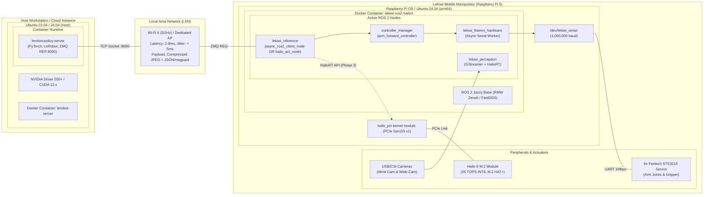

# How-To: Deploy ZeroMQ Policy Server

This guide shows how to deploy the high-performance ZeroMQ policy inference server on a workstation and connect the LeKiwi robot client over a local network.

---

## 🌐 Network & Deployment Topology

The physical deployment topology connects the GPU training/inference workstation with the Raspberry Pi 5 onboard computer via a low-latency 5GHz wireless access point:



---

## 1. Launch the Server on GPU Host

On your GPU workstation (NVIDIA RTX with CUDA):

```bash
cd ~/lekiwi_ws/src/lekiwi_ros2/lerobot_policy_server
python3 -m lerobot_policy_server \
    --host "0.0.0.0" \
    --port 8090 \
    --fps 30 \
    --device cuda
```

### Protocol Specifications:
- **Transport**: ZeroMQ REQ / REP (`tcp://0.0.0.0:8090`).
- **Serialization**: `msgpack` with binary ndarray buffers.
- **Payload**: Dual JPEG images (head + wrist) + 6-DoF joint state array → Returns 50-step predicted action chunk.

---

## 2. Launch Client on LeKiwi Robot

On the Raspberry Pi 5 onboard the robot:

```bash
source ~/lekiwi_ws/install/setup.bash
ros2 launch lekiwi_inference async_inference.launch.py \
    server_address:="192.168.1.50:8090"
```

---

## 3. Latency & Watchdog Diagnostics

Monitor round-trip inference latency:

```bash
ros2 topic echo /lekiwi_inference/diagnostics
```

**Key Metrics to Monitor:**
- `network_rtt_ms`: Target < 15 ms over 5GHz Wi-Fi.
- `gpu_inference_ms`: Target < 12 ms on RTX 4080/4090.
- `action_queue_depth`: Nominal: 25–45 actions queued.
