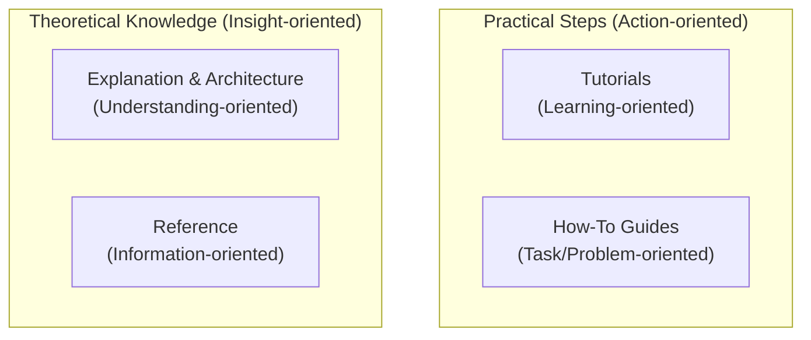
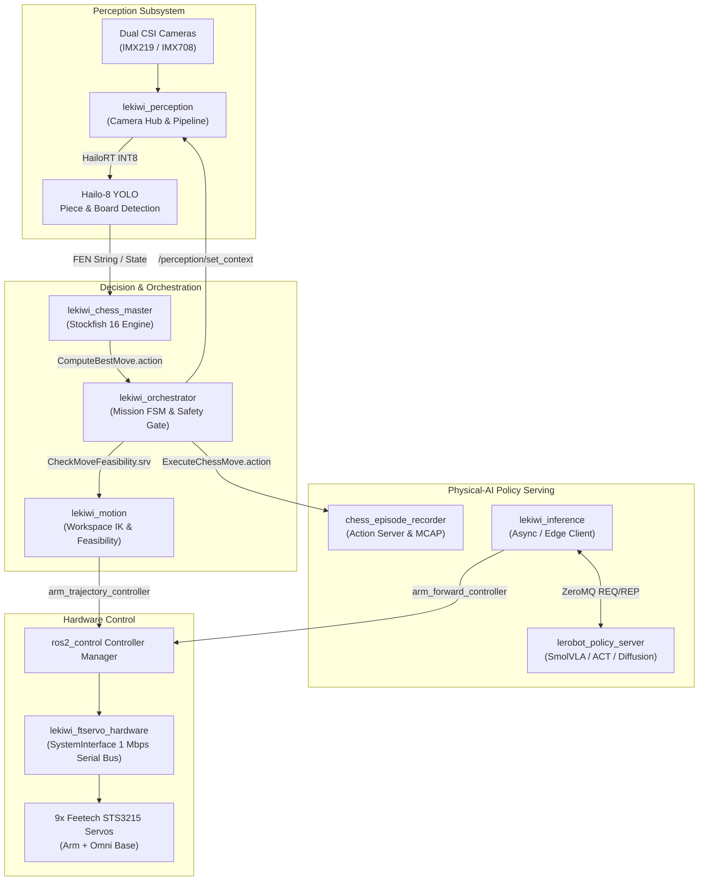

# LeKiwi ROS 2 Documentation

Welcome to the technical documentation suite for **LeKiwi**: an open-source, physical-AI mobile manipulator platform running on **ROS 2 Jazzy**.

LeKiwi unites a 3-wheel omnidirectional mobile base, a 6-DoF robotic arm powered by Feetech STS3215 bus servos, stereo vision accelerated by an onboard Hailo-8 M.2 NPU (26 TOPS), autonomous chess decision-making with Stockfish 16, and physical-AI manipulation policies powered by Hugging Face LeRobot.

---

## 🧭 Documentation System (Diátaxis Framework)

This documentation is structured using the [Diátaxis Framework](https://diataxis.fr/), separating content into four distinct modes to match your immediate objective:

-   :material-school:{ .lg .middle } **[Tutorials](tutorials/index.md)**

    ---

    Step-by-step, hands-on learning experiences designed to take newcomers from zero to running an autonomous robot system.
    
    [:octicons-arrow-right-24: Start learning](tutorials/index.md)

-   :material-wrench:{ .lg .middle } **[How-To Guides](how-to-guides/index.md)**

    ---

    Task-oriented, recipe-style guides addressing real-world operational challenges such as sensor calibration, bus recovery, and policy serving.

    [:octicons-arrow-right-24: Solve problems](how-to-guides/index.md)

-   :material-book-open-page-variant:{ .lg .middle } **[Reference](reference/index.md)**

    ---

    Accurate, authoritative technical specifications including ROS 2 Actions, Services, Topics, node parameters, package catalogs, and pinouts.

    [:octicons-arrow-right-24: Look up details](reference/index.md)

-   :material-lightbulb-on:{ .lg .middle } **[Architecture & Explanation](explanation/index.md)**

    ---

    In-depth discussions, C4 architecture diagrams, rationale behind design decisions, and Architecture Decision Records (ADRs).

    [:octicons-arrow-right-24: Understand architecture](explanation/index.md)

---

## 🏛️ High-Level System Architecture

LeKiwi is organized into modular subsystems coordinated through standard ROS 2 interfaces, lifecycle management, and ZeroMQ inter-process transports:

---

## ⚡ Quick Reference Matrix

| Attribute | Specification |
| :--- | :--- |
| **Compute Host** | Raspberry Pi 5 (8GB RAM, Ubuntu 24.04 ARM64) |
| **Edge AI Accelerator** | Hailo-8 M.2 Key M (26 TOPS INT8 via PCIe Gen 2/3 HAT+) |
| **ROS Distribution** | **ROS 2 Jazzy Jalisco** (RMW: Zenoh / FastDDS) |
| **Actuators** | 9x Feetech STS3215 Smart Servos (1,000,000 baud serial bus) |
| **Inertial Measurement** | TDK ICM-20948 9-DoF IMU (`/dev/i2c-1`) |
| **Visual Sensors** | Dual CSI-2 Stereo Cameras + USB Wrist Camera |
| **Physical-AI Models** | Hugging Face LeRobot (SmolVLA, ACT, Diffusion Policy) |
| **Decision Engine** | Stockfish 16 Chess Engine (`ComputeBestMove.action`) |

