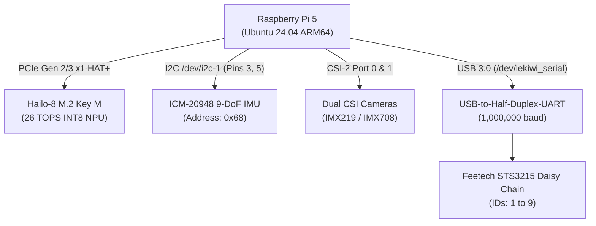

# Hardware Specifications & Wiring Pinout

This reference document outlines the physical wiring, bus topologies, and electrical parameters of the LeKiwi robot platform.

---

## ⚡ Power Distribution Architecture

| Subsystem | Input Voltage | Max Current | Source |
| :--- | :--- | :--- | :--- |
| **Compute Core (Pi 5 + Hailo-8)** | 5.1V DC | 5.0A | Dedicated Buck Converter (USB-C PD) |
| **Servo Bus (9x STS3215)** | 7.4V (2S LiPo / 8.4V Peak) | 12.0A Surge | Direct High-Current Battery Rail |
| **Cameras & Sensors** | 3.3V / 5.0V | 1.5A | Raspberry Pi 5 onboard regulators |

---

## 🚌 Bus & Port Mappings

### Servo Bus ID Allocation:
- **IDs 1–6**: 6-DoF Arm articulation (Base pan, Shoulder, Elbow, Wrist pitch, Wrist roll, Gripper clamp).
- **IDs 7–9**: 3-Wheel Omnidirectional drive base (Continuous rotation velocity control mode).

