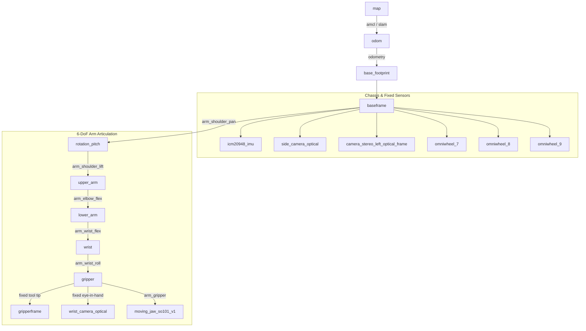

# Topics & Coordinate Frames (TF) Reference

This document catalogs the standard ROS 2 topics, controller joint identifiers, and kinematic coordinate frame hierarchies used across the LeKiwi platform.

---

## 📡 Sensor & State Topics

| Topic | Type | Rate | Description |
| :--- | :--- | :---: | :--- |
| `/joint_states` | `sensor_msgs/msg/JointState` | 50 Hz | Current position, velocity, and effort of all 9 joints. |
| `/imu/data_raw` | `sensor_msgs/msg/Imu` | 100 Hz | Linear acceleration and angular velocity from ICM-20948 (`/dev/i2c-1`). |
| `/cameras/stereo_left/image_raw` | `sensor_msgs/msg/Image` | 30 Hz | Left CSI camera uncompressed image stream. |
| `/cameras/stereo_left/image_raw/compressed` | `sensor_msgs/msg/CompressedImage` | 30 Hz | Left CSI camera JPEG compressed stream for wireless transport. |
| `/cameras/usb_wrist/image_raw/compressed` | `sensor_msgs/msg/CompressedImage` | 30 Hz | Wrist camera compressed image stream. |

---

## 🕹️ Actuation & Command Topics

| Topic | Type | Rate | Description |
| :--- | :--- | :---: | :--- |
| `/arm_trajectory_controller/joint_trajectory` | `trajectory_msgs/msg/JointTrajectory` | Dynamic | Trajectory spline commands targeting the 6 arm joints. |
| `/arm_forward_controller/commands` | `std_msgs/msg/Float64MultiArray` | 50 Hz | Real-time streaming target angles for ACT / SmolVLA policy chunks. |
| `/cmd_vel` | `geometry_msgs/msg/Twist` | 20 Hz | Holonomic omni-base velocity commands ($v_x, v_y, \omega_z$). |

### 🦾 Official Joint Identifiers:
- **Arm Joints (IDs 1–6)**:
  - `arm_shoulder_pan`: Base yaw rotation.
  - `arm_shoulder_lift`: Lower arm pitch elevation.
  - `arm_elbow_flex`: Elbow articulation.
  - `arm_wrist_flex`: Wrist pitch bend.
  - `arm_wrist_roll`: Wrist axial rotation.
  - `arm_gripper`: Gripper clamping jaw.
- **Omni Base Wheels (IDs 7–9)**:
  - `base_left_wheel`: Left omni-wheel (ID 7).
  - `base_back_wheel`: Rear omni-wheel (ID 8).
  - `base_right_wheel`: Right omni-wheel (ID 9).

---

## 🌲 Coordinate Frame Hierarchy (TF Tree)

The kinematic chain reflects the physical robot CAD model (`duykhongcay_lekiwi.urdf` and `lekiwi_robot.urdf.xacro`):

