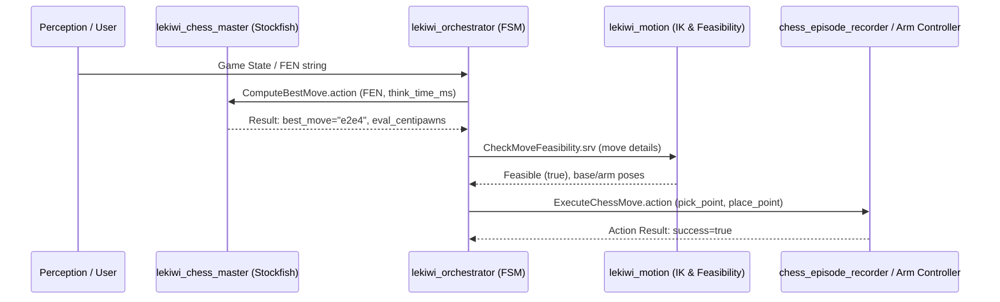

# Tutorial 3: Autonomous Chess Mission

This tutorial demonstrates the autonomous decision-and-execution loop: reading a chess position, running the Stockfish 16 engine node, and triggering the pick-and-place manipulation action.

---

## Architecture Overview



---

## Step 1: Launch the Chess Master Engine Stack

Start the chess master subsystem (launches `ChessGameStateTracker`, `ChessEngineAction`, and visualizer components):

```bash
source ~/lekiwi_ws/install/setup.bash
ros2 launch lekiwi_bringup chess_master.launch.py
```

In a separate terminal, launch the orchestrator FSM:

```bash
ros2 launch lekiwi_bringup orchestrator.launch.py
```

Verify that the Stockfish action server is running on `/chess/compute_best_move`:

```bash
ros2 action list | grep compute_best_move
```

---

## Step 2: Request an Engine Move via CLI

You can manually send a `ComputeBestMove` goal with a standard FEN starting position using the official field `think_time_ms`:

```bash
ros2 action send_goal /chess/compute_best_move lekiwi_interfaces/action/ComputeBestMove "{
  fen: 'rnbqkbnr/pppppppp/8/8/8/8/PPPPPPPP/RNBQKBNR w KQkq - 0 1',
  think_time_ms: 1000,
  depth: 0
}"
```

**Expected Action Result:**
```text
Goal accepted with ID: ...
Result:
    success: true
    best_move: 'e2e4'
    ponder_move: 'e7e5'
    eval_centipawns: 25
    is_mate: false
    mate_in_moves: 0
    message: 'Best move found by Stockfish'
```

---

## Step 3: Trigger the Orchestrator Mission Loop

Now simulate a full turn where the orchestrator receives a board update, computes the move, verifies kinematic feasibility, and sends joint commands:

```bash
ros2 topic pub --once /chess/board_state std_msgs/msg/String "{data: 'rnbqkbnr/pppppppp/8/8/4P3/8/PPPP1PPP/RNBQKBNR b KQkq e3 0 1'}"
```

Inspect the orchestrator lifecycle transitions:

```bash
ros2 topic echo /orchestrator/state
```

The node will transition through:
`IDLE` → `THINKING` → `VERIFYING_FEASIBILITY` → `EXECUTING_MOVE` → `WAITING_FOR_OPPONENT`.

---

## Summary
You have executed a complete autonomous chess decision cycle and observed how high-level game logic coordinates with low-level robot actions.

**Next Step:** Proceed to [Tutorial 4: LeRobot Imitation Learning](04-lerobot-imitation-learning.md) to explore physical-AI policy serving.
