# Tutorial 4: LeRobot Imitation Learning

This tutorial guides you through the complete physical-AI imitation learning workflow on LeKiwi: from teleoperating the robot to record demonstration episodes, to exporting to the Hugging Face LeRobot dataset format, and serving a trained policy in real-time.

---

## Overview of the Physical-AI Pipeline

```mermaid
flowchart LR
    TEACH["Zhongli Teleop Arm\n+ Gamepad"] -->|"MCAP Rosbag"| RECORDER["chess_episode_recorder"]
    RECORDER -->|"chess_convert"| EXPORT["chess_rosbag_to_lerobot\n(Dataset Converter)"]
    EXPORT -->|"Parquet Dataset"| TRAIN["Hugging Face LeRobot\n(Train ACT / SmolVLA)"]
    TRAIN -->|"Checkpoint Weights"| SERVE["lerobot_policy_server\n(ZeroMQ Inference Server)"]
    SERVE -->|"50Hz Action Stream"| ROBOT["LeKiwi Physical Robot\n(arm_forward_controller)"]
```



---

## Step 1: Launch Teleoperation and Episode Recorder

Start master robot bringup along with the D-Pad episode recorder node:

```bash
source ~/lekiwi_ws/install/setup.bash
ros2 launch chess_episode_recorder recorder.launch.py
```

### Gamepad Controls:
- **D-Pad UP**: Start recording a new episode (`EPISODE_START`).
- **D-Pad DOWN**: Save and mark the episode as a success (`EPISODE_SUCCESS`).
- **D-Pad LEFT / RIGHT**: Discard failed episode (`EPISODE_DISCARD`).

Record demonstration pick-and-place trials. The episodes will be stored under the configured directory in `ros_bag/`.

---

## Step 2: Convert MCAP Rosbag to LeRobot v3.0 Dataset

Use `chess_rosbag_to_lerobot` CLI `chess_convert` to extract camera images, joint states, and action trajectories into standard parquet datasets:

```bash
ros2 run chess_rosbag_to_lerobot chess_convert \
    --input-dir ~/lekiwi_ws/src/lekiwi_ros2/ros_bag \
    --config $(ros2 pkg prefix chess_rosbag_to_lerobot)/share/chess_rosbag_to_lerobot/config/lekiwi_chess.yaml \
    --repo-id "local/lekiwi_chess_v1" \
    --vcodec libsvtav1
```

Verify that the dataset output contains `meta/info.json`, `data/chunk-000/`, and normalized joint state tensors.

---

## Step 3: Launch the ZeroMQ Policy Server

Start `lerobot_policy_server` on a host workstation or GPU machine with your trained policy checkpoint:

```bash
python3 -m lerobot_policy_server \
    --host "0.0.0.0" \
    --port 8090 \
    --fps 30 \
    --device cuda
```

Verify the server is listening for inference queries on port 8090.

---

## Step 4: Run Policy Client on LeKiwi

On the LeKiwi robot, launch the asynchronous inference client to stream synchronized camera images and receive 50Hz action chunk arrays:

```bash
ros2 launch lekiwi_inference async_inference.launch.py \
    server_address:="192.168.1.100:8090"
```

The robot arm will now execute physical pick-and-place trajectories autonomously via `arm_forward_controller` based on vision predictions!

---

## Summary
You have mastered the full lifecycle of imitation learning on LeKiwi: from data collection to dataset preparation, server hosting, and live physical robot deployment.
