# Tutorial 4: LeRobot Imitation Learning

This tutorial guides you through the complete physical-AI imitation learning workflow on LeKiwi: from teleoperating the robot to record demonstration episodes, to exporting to the Hugging Face LeRobot dataset format, and serving a trained policy in real-time.

---

## Overview of the Physical-AI Pipeline

```mermaid
flowchart LR
    TEACH["Zhongli Teleop Arm\n+ Gamepad"] -->|"MCAP Rosbag"| RECORDER["chess_episode_recorder"]
    RECORDER -->|"chess_convert"| EXPORT["chess_rosbag_to_lerobot\n(Dataset Converter)"]
    EXPORT -->|"Parquet Dataset"| TRAIN["Hugging Face LeRobot\n(Train ACT / SmolVLA)"]
    TRAIN -->|"Checkpoint Weights"| SERVE["lerobot_policy_server\n(ZeroMQ Inference Server)"]
    SERVE -->|"50Hz Action Stream"| ROBOT["LeKiwi Physical Robot\n(arm_forward_controller)"]
```



---

## Step 1: Launch Teleoperation and Episode Recorder

Start master robot bringup along with the D-Pad episode recorder node:

```bash
source ~/lekiwi_ws/install/setup.bash
ros2 launch chess_episode_recorder recorder.launch.py
```

### Gamepad Controls:
- **D-Pad UP**: Start recording a new episode (`EPISODE_START`).
- **D-Pad DOWN**: Save and mark the episode as a success (`EPISODE_SUCCESS`).
- **D-Pad LEFT / RIGHT**: Discard failed episode (`EPISODE_DISCARD`).

Record demonstration pick-and-place trials. The episodes will be stored under the configured directory in `ros_bag/`.

---

## Step 2: Convert MCAP Rosbag to LeRobot v3.0 Dataset

Use `chess_rosbag_to_lerobot` CLI `chess_convert` to extract camera images, joint states, and action trajectories into standard parquet datasets:

```bash
ros2 run chess_rosbag_to_lerobot chess_convert \
    --input-dir ~/lekiwi_ws/src/lekiwi_ros2/ros_bag \
    --config $(ros2 pkg prefix chess_rosbag_to_lerobot)/share/chess_rosbag_to_lerobot/config/lekiwi_chess.yaml \
    --repo-id "local/lekiwi_chess_v1" \
    --vcodec libsvtav1
```

Verify that the dataset output contains `meta/info.json`, `data/chunk-000/`, and normalized joint state tensors.

---

## Step 3: Train Policy on Cloud GPU (Kaggle)

Fine-tune the vision-language-action policy using our preconfigured distributed training notebook:

1. Import [`notebooks/lerobot_smolvla_training_kaggle.ipynb`](../../notebooks/lerobot_smolvla_training_kaggle.ipynb) into a new [Kaggle Notebook](https://www.kaggle.com/code).
2. Configure **Accelerator** to `GPU T4 x2` and attach your `HF_TOKEN` secret (with write permissions).
3. Execute the notebook to launch multi-GPU training on [`DuyKhongCay/lekiwi_chess_v7`](https://huggingface.co/datasets/DuyKhongCay/lekiwi_chess_v7):
   - **Distributed Engine**: `accelerate launch --multi_gpu --num_processes=2`
   - **Effective Batch Size**: 16 (8 per GPU)
   - **Training Horizon**: 13,000 steps (~8.5 hours)
   - **Data Augmentation**: Custom `chess_goal_noise` physical state perturbation
4. The final weights are automatically pushed to the Hugging Face Hub: [`DuyKhongCay/lekiwi_chess_smolvla`](https://huggingface.co/DuyKhongCay/lekiwi_chess_smolvla).

> 👉 For full Kaggle environment configuration and hyperparameter reference, refer to the [Notebook Guide](../../notebooks/README.md).

---

## Step 4: Launch the ZeroMQ Policy Server

Start `lerobot_policy_server` on a host workstation or GPU machine with your trained policy checkpoint:

```bash
python3 -m lerobot_policy_server \
    --host "0.0.0.0" \
    --port 8090 \
    --fps 30 \
    --device cuda
```

Verify the server is listening for inference queries on port 8090.

---

## Step 5: Run Policy Client on LeKiwi

On the LeKiwi robot, launch master bringup with `manipulation:=policy` (or run the standalone inference client node) to stream synchronized camera images and receive 50Hz action chunk arrays:

```bash
# Option A: Launch with master robot bringup
ros2 launch lekiwi_bringup robot.launch.py \
    hardware_type:=real \
    manipulation:=policy

# Option B: Run standalone inference client node connecting to policy server
ros2 run lekiwi_inference async_ros2_client_node --ros-args \
    -p server_address:="192.168.1.100:8090"
```

The robot arm will now execute physical pick-and-place trajectories autonomously via `arm_forward_controller` based on vision predictions!

---

## Summary
You have mastered the full lifecycle of imitation learning on LeKiwi: from data collection to dataset preparation, server hosting, and live physical robot deployment.
