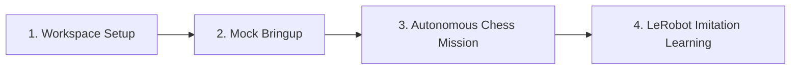

# Tutorials: Learning Path

Tutorials are **learning-oriented** guides that escort developers through hands-on steps to build practical competency with the LeKiwi platform.

> [!TIP]
> If you are an experienced developer needing to resolve a specific operational issue (e.g., repairing motor bus faults or calibrating cameras), refer instead to the [How-To Guides](../how-to-guides/index.md).

---

## 🗺️ Recommended Progression

Follow these tutorials in sequence to acquire a complete understanding of LeKiwi:

### 1. [Workspace Setup & Build](01-getting-started-workspace.md)
Set up your development environment (Docker or native Ubuntu 24.04), resolve ROS 2 dependencies, configure hardware device permissions, and compile the workspace with `colcon`.

### 2. [Robot Bringup & Mock Simulation](02-robot-bringup-simulation.md)
Launch the robot hardware abstraction layer in mock mode, visualize the kinematics in RViz2, verify TF trees, and command test joint positions without hardware risks.

### 3. [Autonomous Chess Mission](03-autonomous-chess-match.md)
Run the end-to-end autonomous chess player pipeline: simulate chessboard camera frames, compute optimal moves via the Stockfish engine, and execute pick-and-place trajectories.

### 4. [LeRobot Imitation Learning](04-lerobot-imitation-learning.md)
Record teleoperated manipulation episodes into MCAP bags, convert data to Hugging Face LeRobot v3.0 format, and run real-time policy rollouts over ZeroMQ.

