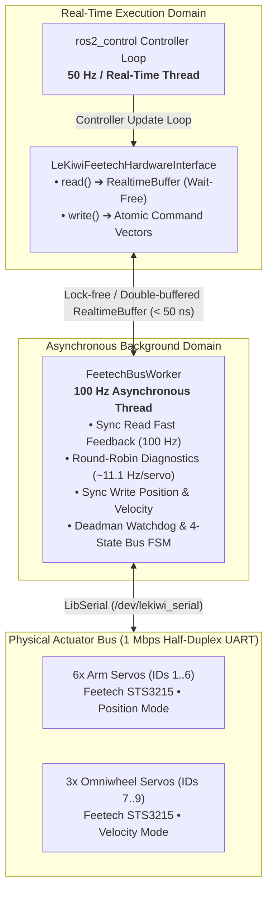

## Overview

The `lekiwi_ftservo_hardware` package provides a high-performance,
real-time `ros2_control` hardware interface plugin (`SystemInterface`)
designed for Feetech STS smart serial bus servos (specifically STS3215)
on the LeKiwi mobile manipulator robot.

The plugin drives 9 servos across a single half-duplex UART bus
(`/dev/lekiwi_serial`) at 1,000,000 baud with bounded latency
(< 50 ns wait-free controller loop access) and zero dynamic memory
allocation in the critical execution path.

---

## Architecture and Concurrency Model



### Key Technical Characteristics

- **Wait-Free Real-Time Execution**: The `read()` and `write()` methods
  interact strictly with `realtime_tools::RealtimeBuffer` and atomic storage
  (< 50 ns access time), completely isolating the 50 Hz controller loop
  from serial transaction latency.
- **Dual-Rate Bus Polling & Diagnostic Interleaving**:
  - **Fast Feedback (100 Hz)**: Queries 4-byte `SYNC_READ` payloads
    (`kPresentPosition`, `kPresentSpeed`) for deterministic low-latency joint telemetry.
  - **Round-Robin Single-Servo Diagnostics (~11.1 Hz per servo)**: Interleaves
    1 servo diagnostic query (15-byte telemetry payload) per 100 Hz cycle across all 9 servos,
    eliminating bus latency spikes (~0.29 ms constant bus overhead).
- **High-Reliability Bus FSM**: Monitors sliding Packet Error Rate (PER) and manages
  automatic exponential backoff reconnection without blocking controller execution.
- **Plugin Identifier**: Registered via `pluginlib` as
  `lekiwi_ftservo_hardware/LeKiwiFeetechHardwareInterface`.

---

## Hardware Interfaces and URDF Configuration

All servo parameters and communication interfaces are parsed directly
from the URDF `<ros2_control>` declaration, defined in
[ros2_control.xacro](../lekiwi_description/urdf/ros2_control.xacro).
Physical joint calibrations (offsets and range limits) are maintained in
[DuyKhongCay.json](../lekiwi_description/config/calibration/DuyKhongCay.json).

### Exported Interfaces

| Type | Interface Name | Joint Scope | Description |
| :--- | :--- | :--- | :--- |
| State | `<joint_name>/position` | All joints (1..9) | Present angle in radians (rad). |
| State | `<joint_name>/velocity` | All joints (1..9) | Present angular velocity in rad/s. |
| Command | `<joint_name>/position` | Arm joints (1..6) | Target angle in radians (rad). |
| Command | `<joint_name>/velocity` | Wheels (7..9) | Target angular velocity in rad/s. |
| Command | `<joint_name>/torque_enable` | All joints (1..9) | Mode switch: 1.0 enables torque, 0.0 disables for manual lead-through. |

### System Hardware Parameters

Parameters defined within the `<hardware>` block:

- `usb_port` *(string, required)*: Path to the serial TTY port
  (e.g., `/dev/lekiwi_serial` or `/dev/ttyUSB0`).
- `baud_rate` *(int, default: 1000000)*: Serial baud rate in bps.
- `timeout_ms` *(int, default: 20)*: Per-transaction read timeout in milliseconds.

### Joint Parameters

Parameters defined within each `<joint>` tag:

- `id` *(int, required, 1..253)*: Hardware ID of the Feetech servo.
- `acceleration` *(int, default: 0, range: 0..254)*: Hardware acceleration
  ramp limit register (50 for arms, 0 for continuous wheels).
- `velocity_radians_per_second_per_tick` *(double, velocity mode only, default: 0.00153398)*:
  Radian-per-second conversion scale per STS speed tick (nominally 0.732 RPM/tick).
- `velocity_direction` *(int, velocity mode only, default: 1)*: Direction
  polarity multiplier (1 or -1).
- `max_velocity_radians_per_second` *(double, velocity mode only, default: 5.0)*:
  Maximum allowable joint velocity ceiling in rad/s.

### Example URDF Definition

```xml
<ros2_control name="LeKiwiSystem" type="system">
  <hardware>
    <plugin>lekiwi_ftservo_hardware/LeKiwiFeetechHardwareInterface</plugin>
    <param name="usb_port">/dev/lekiwi_serial</param>
    <param name="baud_rate">1000000</param>
    <param name="timeout_ms">20</param>
  </hardware>

  <!-- Position-Controlled Arm Joint -->
  <joint name="arm_shoulder_pan">
    <param name="id">1</param>
    <param name="acceleration">50</param>
    <command_interface name="position"/>
    <command_interface name="torque_enable"/>
    <state_interface name="position"/>
    <state_interface name="velocity"/>
  </joint>

  <!-- Velocity-Controlled Omniwheel Joint -->
  <joint name="base_left_wheel">
    <param name="id">7</param>
    <param name="acceleration">0</param>
    <param name="velocity_radians_per_second_per_tick">0.0015339807878856412</param>
    <param name="velocity_direction">-1</param>
    <param name="max_velocity_radians_per_second">5.0</param>
    <command_interface name="velocity"/>
    <command_interface name="torque_enable"/>
    <state_interface name="position"/>
    <state_interface name="velocity"/>
  </joint>
</ros2_control>
```

---

## Safety Mechanisms and Fault Handling

The driver incorporates three multi-layered safety mechanisms:

1. **Deadman Watchdog (100 ms)**:
   - If velocity command updates stop arriving for more than 100 ms
     (e.g., controller crash or network transport disconnect), all continuous
     velocity joints are automatically commanded to 0 rad/s.
2. **Anti-Jerk and Lead-Through Synchronization**:
   - While a joint has `torque_enable` set to 0.0, the driver continuously
     updates internal command setpoints with physical joint feedback.
   - When torque is re-enabled (0.0 to 1.0), the initial command matches the
     present position, completely eliminating dangerous snapping toward stale trajectory targets.
3. **3-Tier Fault Escalation & High-Reliability Bus FSM**:
   - **Tier 1 (Single read error)**: Flushes serial input FIFO buffer to clear corrupted frames.
   - **Tier 2 (5 consecutive errors / 50 ms)**: Flags telemetry snapshot as invalid, clamping velocities to 0 rad/s to signal upstream nodes.
   - **Tier 3 (10 consecutive errors / 100 ms or device disconnected)**: Drops Bus FSM to `DISCONNECTED`. Closes port, executes exponential backoff (200 ms initial up to 2000 ms max), re-verifies character device node in `/dev`, re-opens port, re-arms servo operating registers, and resynchronizes anti-jerk seed positions before transitioning back to `OPERATIONAL`.
   - **Bus FSM States**:
     - `DISCONNECTED`: Port closed, character device missing, or broken pipe.
     - `STANDBY`: Serial bus configured, waiting for controller activation.
     - `OPERATIONAL`: Deterministic 100 Hz cyclic read/write loop.
     - `DEGRADED`: High Packet Error Rate (PER >= 15.0%, auto-recovers when PER <= 5.0%).

---

## Diagnostics and Health Telemetry

Telemetry is evaluated by `FeetechDiagnostics` and published to `/diagnostics`
via `diagnostic_updater` under hardware ID `lekiwi_feetech_servos`:

| Metric | Normal Range | Warning (WARN) | Critical (ERROR) |
| :--- | :--- | :--- | :--- |
| Bus FSM State | OPERATIONAL, STANDBY | DEGRADED (PER >= 15%) | DISCONNECTED |
| Active DTC | DTC 0 (Normal) | DTC 106 (High PER) | DTC 101..105, 107 |
| Sliding PER (1s) | <= 5.0 % | >= 15.0 % | Link offline |
| Telemetry Freshness | <= 200 ms | - | > 200 ms (Stale Bus) |
| Servo Temperature | < 60 °C | 60 °C to 69 °C | >= 70 °C (Overheat) |
| Bus Voltage | 9.0 V to 13.5 V | < 9.0 V or > 13.5 V | Serial offline |
| Hardware Status | 0x00 | - | Non-zero error bitmask |

### Standardized Diagnostic Trouble Codes (DTC)

| DTC | Identifier | Description / Suggested Action |
| :--- | :--- | :--- |
| 101 | `kDtcDeviceNodeMissing` | Device node missing in `/dev` (check USB cable connection) |
| 102 | `kDtcPortOpenError` | Serial port open/configuration failed (permissions/termios) |
| 103 | `kDtcServoConfigFailed` | Failed to write Mode/Acceleration operational registers |
| 104 | `kDtcAntiJerkResyncFailed` | Anti-Jerk position resynchronization failed |
| 105 | `kDtcBusUnresponsive` | Bus unresponsive (no servos replying, check 12V bus power) |
| 106 | `kDtcHighPacketErrorRate` | High packet error rate (>15% PER, check cable shielding/EMI) |
| 107 | `kDtcServoHardwareError` | Servo reported hardware safety error (overheat/overload/voltage) |

---

## Build and Testing

### Prerequisites

Install the required system dependency for serial bus communication:

```bash
sudo apt-get update && sudo apt-get install -y libserial-dev
```

### Compilation

Build the package using `colcon`:

```bash
colcon build --packages-select lekiwi_ftservo_hardware --symlink-install
```

### Unit Tests (5 Suites, 36 Tests Total, 100% Pass)

| Test Suite Target | Source File | Description |
| :--- | :--- | :--- |
| `test_velocity_codec` | `test/test_velocity_codec.cpp` | Validates STS tick-to-rad/s conversion, direction polarity, and velocity clamping (3 tests). |
| `test_sts_protocol` | `test/test_sts_protocol.cpp` | Validates packet framing, checksums, preamble hunting, and frame resynchronization (9 tests). |
| `test_joint_config_parser` | `test/test_joint_config_parser.cpp` | Validates URDF `<ros2_control>` parsing, ID uniqueness, and default parameter fallbacks (7 tests). |
| `test_feetech_diagnostics` | `test/test_feetech_diagnostics.cpp` | Validates diagnostic statuses, FSM states, DTC codes, and sliding PER warnings (8 tests). |
| `test_feetech_bus_worker` | `test/test_feetech_bus_worker.cpp` | Validates FSM lifecycle (`DISCONNECTED` -> `OPERATIONAL`), backoff timings, deadman watchdog, and anti-jerk seed logic (9 tests). |

Execute the unit tests:

```bash
colcon test --packages-select lekiwi_ftservo_hardware --event-handlers console_direct+
colcon test-result --verbose
```
