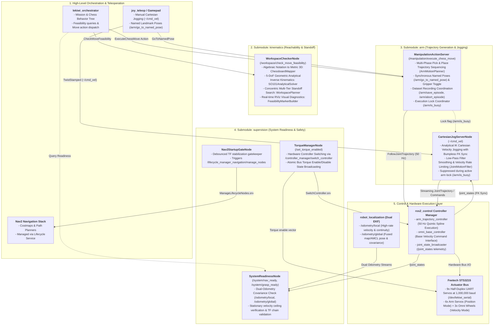

## Overview

The `lekiwi_motion` package provides high-performance motion coordination, analytical kinematics, workspace reachability validation, deterministic quintic trajectory generation, hardware safety supervision, and system-level gating for the **LeKiwi** mobile manipulator robot. Operating between high-level orchestration/Physical-AI (such as `lekiwi_orchestrator` / `lekiwi_manipulation`) and low-level actuators (`ros2_control` and STS3215 bus servos), `lekiwi_motion` guarantees that end-effector motions and mobile base re-positioning remain kinematically feasible, collision-free, deterministic, and safe.

### Key Capabilities

- **Modular Monolith Organization**: Structured into 3 clear semantic sub-modules (`kinematics`, `arm`, `supervision`) within a single performant ROS 2 package, eliminating package sprawl while preserving strict separation of concerns.
- **Closed-Form 5-DoF Analytical IK Solver**: Deterministic microsecond-scale inverse kinematics for the SO-101 manipulator arm, leveraging geometric wrist decoupling and pitch alignment.
- **Multi-Tier Mobile Standoff Planner**: Autonomous search across concentric perimeters (Zero-Nav, Single-Base, Dual-Base, Capture Triple-Base) to resolve end-effector targets outside current arm reach.
- **Unified Arm Manipulation Action & Named Pose Service**: Composable C++ node `ManipulationActionServer` supporting multi-phase pick-and-place chess moves, vertical ascension `RETRACT`, capture clear sequences, synchronous exclusive named pose transitions (`approach`, `stow`, `clear_left`, `clear_right`), and episode recording lifecycle management.
- **Dual-Tier System Readiness Supervisor**: Independent monitoring of Dual Odometry (`/odometry/local` and `/odometry/global`), Hardware Joint States (`joint_state_broadcaster`), and TF chains (`odom -> base_footprint -> arm_base_link`) to gate autonomous navigation and manipulation.
- **Nav2 Lifecycle Gatekeeper**: Deterministic startup sequencing that validates TF tree readiness before transitioning Nav2 lifecycle nodes (`nav2_bringup`), preventing costmap and AMCL crashes during robot initialization.
- **Hardware Torque Orchestrator**: Atomic switching of `ros2_control` controllers and broadcast bus-level torque enable/disable commands with verification callbacks.
- **Rich 3D RViz Telemetry**: Real-time visualization of standoff footprints, reachability rings, approach vectors, capture trajectories, and HUD billboard diagnostic overlays.

---

## Architecture: Modular Monolith (Option B)

`lekiwi_motion` adopts a **Modular Monolith** architecture. While maintained as a single colcon package to streamline builds and eliminate package sprawl, its internals are cleanly decoupled into 3 semantic sub-modules:

```
lekiwi_motion/
├── include/lekiwi_motion/
│   ├── kinematics/                     # [Submodule 1: Kinematics & Workspace]
│   │   ├── workspace_kinematics.hpp
│   │   ├── workspace_planner.hpp
│   │   ├── chessboard_mapper.hpp
│   │   ├── feasibility_marker_builder.hpp
│   │   └── workspace_checker_node.hpp
│   ├── arm/                            # [Submodule 2: Arm Motion & Manipulation]
│   │   ├── arm_motion_planner.hpp
│   │   ├── manipulation_action_server.hpp
│   │   ├── cartesian_jogger.hpp
│   │   ├── cartesian_jog_server_node.hpp
│   │   └── joint_motion_filter.hpp
│   ├── supervision/                    # [Submodule 3: System Supervision & Gating]
│   │   ├── system_readiness_state.hpp
│   │   ├── system_readiness_node.hpp
│   │   ├── torque_manager_node.hpp
│   │   └── nav2_startup_gate_node.hpp
├── src/
│   ├── kinematics/                     # Workspace model & checker implementation
│   ├── arm/                            # Arm planner, executor, action servers & jogger
│   └── supervision/                    # Readiness, torque manager & Nav2 gatekeeper
└── test/
    ├── kinematics/                     # Kinematics & workspace gtests
    ├── arm/                            # Planner, executor, action servers & jogger gtests
    └── supervision/                    # Readiness state, torque & gate gtests
```



---

## Sub-Module Details

### 1. `kinematics`
- **`workspace_kinematics.hpp` / `workspace_kinematics.cpp`**: Single-source-of-truth closed-form 5-DoF analytical IK solver and forward kinematics based on URDF parameters. Features singularity prevention margins (`kMaxCosElbow = 0.985`) and microsecond-level deterministic calculation.
- **`workspace_planner.hpp` / `workspace_planner.cpp`**: Multi-tier standoff search (Tier 0 Zero-Nav, Tier 1 Single-Base, Tier 2 Dual-Base, Tier 3 Capture Triple-Base).
- **`chessboard_mapper.hpp` / `chessboard_mapper.cpp`**: Algebraic notation to 3D spatial coordinate mapper with board center offsets and piece height planes.
- **`feasibility_marker_builder.hpp` / `feasibility_marker_builder.cpp`**: Telemetry marker array generator for RViz2.
- **`workspace_checker_node.hpp` / `workspace_checker_node.cpp`**: Composable node implementing `/workspace/check_move_feasibility`.

### 2. `arm`
- **`arm_motion_planner.hpp` / `arm_motion_planner.cpp`**: Unified arm motion planning combining discrete phase sequencing, gripper modeling, strongly typed landmark poses (`NamedPosesConfig`), and smooth $C^2$-continuous 5th-order polynomial trajectory interpolation at configurable sampling rate (default 50 Hz). Supports atomic 5-phase `PICK` (concluding in transit `stow`), atomic 5-phase `PLACE` (starting from transit `stow`), monolithic 8-phase `PICK_AND_PLACE` (direct transit without mid-stow), and 7-phase capture moves (`DROP_CLEAR` to `CLEAR_LEFT` / `CLEAR_RIGHT`).
- **`cartesian_jogger.hpp` / `cartesian_jogger.cpp`**: Pure POCO domain controller for Cartesian jogging with bumpless transfer, orientation holding, and joint velocity damping.
- **`cartesian_jog_server_node.hpp` / `cartesian_jog_server_node.cpp`**: Standalone ROS 2 node executing analytical IK Cartesian velocity jogging with bumpless transfer, joint velocity rate limiting (`max_joint_vel_rad_s`), and execution lock suppression via `/arm/is_busy`.
- **`manipulation_action_server.hpp` / `manipulation_action_server.cpp`**: Unified composable ROS 2 node executing multi-phase chess manipulation trajectories (`ExecuteChessMove`) with live JIT inverse kinematics (`SO101AnalyticalSolver`), pure vertical Cartesian descent, capture bin sorting, synchronous exclusive named pose transitions (`/arm/go_to_named_pose` service via `lekiwi_interfaces/srv/GoToNamedPose`), gripper toggle service (`/arm/toggle_gripper`), episode recording lifecycle management (`/arm/save_episode`, `/arm/abort_episode`), and `/arm/is_busy` coordination publishing. Directly owns controller trajectory client and joint state telemetry.

### 3. `supervision`
- **`system_readiness_state.hpp` / `system_readiness_state.cpp`**: Pure C++ state evaluator gating navigation and manipulation actions based on dual-odometry covariance and joint velocities.
- **`system_readiness_node.hpp` / `system_readiness_node.cpp`**: Composable node publishing latched `/system/nav_ready` and `/system/grasp_ready`.
- **`torque_manager_node.hpp` / `torque_manager_node.cpp`**: Composable node safely turning torque on/off and stopping/starting `ros2_control` controllers.
- **`nav2_startup_gate_node.hpp` / `nav2_startup_gate_node.cpp`**: Debounced TF-tree gatekeeper activating Nav2 lifecycle nodes once frames are fully stable.

---

## ROS 2 Interface Specifications

### 1. Actions

| Action Name | Action Type | Server Node | Description |
| :--- | :--- | :--- | :--- |
| `~/execute_chess_move` | `lekiwi_interfaces/action/ExecuteChessMove` | `ManipulationActionServer` | Executes multi-phase pick-and-place chess move with trajectory feedback and cancellation. |

### 2. Services

| Service Name | Service Type | Server Node | Description |
| :--- | :--- | :--- | :--- |
| `/arm/go_to_named_pose` | `lekiwi_interfaces/srv/GoToNamedPose` | `ManipulationActionServer` | Synchronously executes landmark joint trajectories (`approach`, `stow`, `clear_left`, `clear_right`) with exclusive execution locking. |
| `/arm/toggle_gripper` | `std_srvs/srv/Trigger` | `ManipulationActionServer` | Safely toggles gripper open/closed state with active trajectory locking. |
| `/arm/save_episode` | `std_srvs/srv/Trigger` | `ManipulationActionServer` | Triggers `/episode_recorder_node/save_episode` upon successful manipulation. |
| `/arm/abort_episode` | `std_srvs/srv/Trigger` | `ManipulationActionServer` | Triggers `/episode_recorder_node/discard_episode` upon canceled/failed manipulation. |
| `/workspace/check_move_feasibility` | `lekiwi_interfaces/srv/CheckMoveFeasibility` | `WorkspaceCheckerNode` | Evaluates inverse kinematics, reachability, and mobile standoff tiers for piece actions. |
| `/set_torque_enabled` | `lekiwi_interfaces/srv/SetTorqueEnabled` | `TorqueManagerNode` | Atomically transitions servo bus torque and toggles joint trajectory controllers. |
| `/system/query_nav_ready` | `std_srvs/srv/Trigger` | `SystemReadinessNode` | Synchronously queries if localization and TF chains are valid for navigation. |
| `/system/query_grasp_ready` | `std_srvs/srv/Trigger` | `SystemReadinessNode` | Synchronously queries if base is stationary and arm joints are ready for manipulation. |

### 3. Published Topics

| Topic Name | Message Type | Quality of Service (QoS) | Node | Description |
| :--- | :--- | :--- | :--- | :--- |
| `/system/nav_ready` | `std_msgs/msg/Bool` | Transient Local, Reliable, Depth 1 | `SystemReadinessNode` | Latched status flag indicating navigation safety. |
| `/system/grasp_ready` | `std_msgs/msg/Bool` | Transient Local, Reliable, Depth 1 | `SystemReadinessNode` | Latched status flag indicating manipulation safety. |
| `~/feasibility_markers` | `visualization_msgs/msg/MarkerArray` | Transient Local, Reliable, Depth 10 | `WorkspaceCheckerNode` | Real-time 3D markers for RViz visualization. |
| `/arm/is_busy` | `std_msgs/msg/Bool` | Transient Local, Reliable, Depth 1 | `ManipulationActionServer` | Execution lock flag: suppresses Cartesian jogging during active trajectories or named poses. |
| `/arm_forward_controller/commands` | `std_msgs/msg/Float64MultiArray` | Volatile, Reliable, Depth 1 | `CartesianJogServerNode` | Arm joint target position array in `forward_position` mode. |
| `/arm_trajectory_controller/joint_trajectory` | `trajectory_msgs/msg/JointTrajectory` | Volatile, Reliable, Depth 1 | `CartesianJogServerNode` | Streaming single-point trajectory in `joint_trajectory` mode. |
| `<torque_controller_topic>` | `std_msgs/msg/Float64MultiArray` | Volatile, Reliable, Depth 1 | `TorqueManagerNode` | Broadcasts bus torque enable/disable state vectors. |

### 4. Subscribed Topics

| Topic Name | Message Type | QoS | Node | Purpose |
| :--- | :--- | :--- | :--- | :--- |
| `/joint_states` | `sensor_msgs/msg/JointState` | Sensor Data / Best Effort | `SystemReadinessNode`, `ManipulationActionServer`, `CartesianJogServerNode` | Telemetry used for joint feedback, readiness checks, and bumpless FK sync. |
| `/odometry/local` | `nav_msgs/msg/Odometry` | System Default, Reliable, Depth 10 | `SystemReadinessNode` | High-rate local EKF odometry for base stationary velocity detection. |
| `/odometry/global` | `nav_msgs/msg/Odometry` | System Default, Reliable, Depth 10 | `SystemReadinessNode` | Global fused EKF odometry for pose covariance and convergence gating. |
| `/tf` & `/tf_static` | `tf2_msgs/msg/TFMessage` | Dynamic | `Nav2StartupGateNode`, `WorkspaceCheckerNode`, `SystemReadinessNode` | Coordinate frame transforms between map, odom, base, board, and gripper. |
| `~/cmd_vel` | `geometry_msgs/msg/TwistStamped` | Volatile, Reliable, Depth 1 | `CartesianJogServerNode` | Target Cartesian TCP linear and angular velocity twist. |
| `/robot_description` | `std_msgs/msg/String` | Transient Local, Reliable, Depth 1 | `WorkspaceCheckerNode`, `CartesianJogServerNode` | Robot URDF model used for analytical kinematics initialization. |
| `/arm/is_busy` | `std_msgs/msg/Bool` | Transient Local, Reliable, Depth 1 | `CartesianJogServerNode` | Lock monitoring to pause/resume Cartesian jogging without state jumps. |

### 5. Action Clients & Service Clients

| Client Name | Type | Invoking Node | Purpose |
| :--- | :--- | :--- | :--- |
| `/arm_trajectory_controller/follow_joint_trajectory` | `control_msgs/action/FollowJointTrajectory` | `ManipulationActionServer` | Sends 50 Hz quintic spline trajectories to hardware controller. |
| `/controller_manager/switch_controller` | `controller_manager_msgs/srv/SwitchController` | `TorqueManagerNode` | Halts or reactivates `arm_controller` during torque state transitions. |
| `/lifecycle_manager_navigation/manage_nodes` | `nav2_msgs/srv/ManageLifecycleNodes` | `Nav2StartupGateNode` | Commands Nav2 stack bringup upon TF debounce stabilization. |
| `/episode_recorder_node/save_episode` | `std_srvs/srv/Trigger` | `ManipulationActionServer` | Instructs episode recorder to persist recorded demonstration. |
| `/episode_recorder_node/discard_episode` | `std_srvs/srv/Trigger` | `ManipulationActionServer` | Instructs episode recorder to purge invalid demonstration. |

### 6. Configuration Parameters (Summary)

Node parameters are centralized in `lekiwi_bringup` configuration YAMLs:
- **`orchestrator.yaml`**: SSOT for universal coordinate frames (`map`, `odom`, `base_footprint`, `chessboard_frame`, `gripperframe`), physical arm joint topology, gripper open/closed bounds, readiness variance and velocity thresholds, and landmark named poses (`approach`, `stow`, `clear_left`, `clear_right`).
- **`cartesian_jog_server.yaml`**: Configures jog loop frequency (`publish_rate_hz: 50.0`), spline point step (`point_dt_s: 0.08`), command timeout (`stale_timeout_s: 0.25`), LPF smoothing (`lpf_alpha: 0.85`), and joint velocity limits (`max_joint_vel_rad_s: 2.0`).

---

## Unit Testing & Verification

The package includes a comprehensive suite of unit tests implemented with GoogleTest (`ament_cmake_gtest`), organized by sub-module:

```bash
# Build and run all tests
colcon test --packages-select lekiwi_motion && colcon test-result --test-result-base build/lekiwi_motion --verbose
```

### Test Suites (11 Suites, 74 Tests Total, 100% Pass)

| Submodule | Test Target | Test Source | Description |
| :--- | :--- | :--- | :--- |
| **kinematics** | `test_chessboard_mapper` | `test/kinematics/test_chessboard_mapper.cpp` | Validates algebraic notation parsing, grid indexing, bounds checking (7 tests). |
| **kinematics** | `test_workspace_kinematics` | `test/kinematics/test_workspace_kinematics.cpp` | Validates analytical 5-DoF IK, pitch alignment, joint limits, and elbow singularity margins against URDF fixture (8 tests). |
| **kinematics** | `test_feasibility_marker_builder` | `test/kinematics/test_feasibility_marker_builder.cpp` | Validates RViz marker array generation for reachability footprints and standoff targets (3 tests). |
| **arm** | `test_arm_motion_planner` | `test/arm/test_arm_motion_planner.cpp` | Validates $C^2$ quintic boundary conditions, duration scaling, multi-phase sequence generation, and gripper bounds (10 tests). |
| **arm** | `test_cartesian_jogger` | `test/arm/test_cartesian_jogger.cpp` | Validates differential Cartesian IK, orientation holding, and boundary damping (5 tests). |
| **arm** | `test_joint_motion_filter` | `test/arm/test_joint_motion_filter.cpp` | Validates low-pass filtering, bumpless state synchronization, and joint velocity rate limiting (5 tests). |
| **arm** | `test_manipulation_action_server` | `test/arm/test_manipulation_action_server.cpp` | Validates named poses, parameter overrides, JIT IK, arm busy locking, and action sequencing (17 tests). |
| **arm** | `test_cartesian_jog_server_node` | `test/arm/test_cartesian_jog_server_node.cpp` | Validates Twist-to-joint streaming, bumpless transfer, timeout suppression, and arm busy gating (5 tests). |
| **supervision** | `test_torque_command_state` | `test/supervision/test_torque_command_state.cpp` | Validates controller switching requests and torque command transitions (6 tests). |
| **supervision** | `test_system_readiness_state` | `test/supervision/test_system_readiness_state.cpp` | Validates latch timings, velocity creep checks, and dual-odometry variance evaluation (6 tests). |
| **supervision** | `test_nav2_startup_gate` | `test/supervision/test_nav2_startup_gate.cpp` | Validates TF frame dependency resolution and debounce logic (2 tests). |
