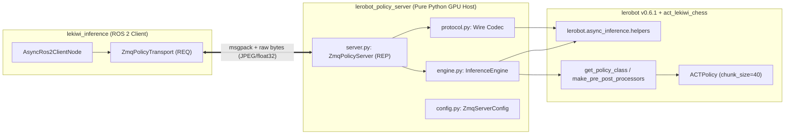

# LeRobot Policy Server (ZeroMQ) for LeKiwi Robot (LeRobot v0.6.1)

High-performance GPU/Host policy inference server for **LeKiwi ROS 2**, serving [HuggingFace LeRobot v0.6.1](https://github.com/huggingface/lerobot) policy predictions over **ZeroMQ (ZMQ)**.

This package adheres strictly to **Clean Code and SOLID principles** with a **Zero Backward-Compatibility** posture:
- 100% pure Python GPU host stack (isolated with `COLCON_IGNORE` to avoid contaminating ROS 2 workspace builds).
- Elimination of mock/fallback paths and legacy gRPC artifacts.
- Native integration with LeRobot v0.6.1 processors and policies (`ACTPolicy`, `SmolVLA`, `Diffusion`).
- Full support for multi-modal observations including compressed JPEG image streams (`wrist`, `side`, `overhead`), `observation.state` (6D), and `observation.environment_state` (10D) as trained in `act_lekiwi_chess`.

---

## 1. Architecture



---

## 2. Directory Structure

```text
lekiwi_ros2/lerobot_policy_server/
├── COLCON_IGNORE                          # Prevents ROS 2 colcon build from scanning this GPU package
├── pyproject.toml                         # Standard PEP 621 metadata (Python >=3.12, torch, cv2, pyzmq, msgpack)
├── README.md                              # Complete architectural & operational documentation
├── src/
│   └── lerobot_policy_server/
│       ├── __init__.py                    # Public API exports
│       ├── __main__.py                    # Enables `python -m lerobot_policy_server`
│       ├── py.typed                       # PEP 561 typing marker
│       ├── config.py                      # ZmqServerConfig & InferenceEngineConfig
│       ├── protocol.py                    # Binary wire codec matching lekiwi_inference transport
│       ├── engine.py                      # Pure LeRobot v0.6.1 inference pipeline
│       ├── server.py                      # Synchronous ZeroMQ REP server with background thread support
│       └── cli.py                         # CLI entry point (--host, --port, --fps, --log-level)
└── tests/
    ├── conftest.py                        # Fixtures matching act_lekiwi_chess (3 JPEG streams, 6D state, 10D env_state)
    ├── test_protocol.py                   # Two-way wire compatibility tests with lekiwi_inference
    ├── test_engine.py                     # Direct policy execution test with act_lekiwi_chess
    └── test_server.py                     # End-to-end integration tests over ZeroMQ sockets
```

---

## 3. Running the Server

### Option A: Using Pixi (Recommended)

From `lekiwi_ros2/`:

```bash
pixi run -e lerobot server
```

### Option B: Direct Python Execution

```bash
python -m lerobot_policy_server.cli --host 0.0.0.0 --port 8090 --fps 30 --log-level INFO
```

### Available CLI Options

| Flag | Default | Environment Variable | Description |
| :--- | :--- | :--- | :--- |
| `--host` | `0.0.0.0` | `POLICY_SERVER_HOST` | Host IP address to bind ZeroMQ REP socket |
| `--port` | `8090` | `POLICY_SERVER_PORT` | TCP port |
| `--fps` | `30` | `POLICY_SERVER_FPS` | Target inference frame rate |
| `--log-level` | `INFO` | `LOGLEVEL` | Logging verbosity (`DEBUG`, `INFO`, `WARNING`, `ERROR`) |

---

## 4. Wire Protocol Specification

Communication uses ZeroMQ `REQ` (Robot / Edge client) and `REP` (GPU host server).

### Message Types:

1. **`handshake`**:
   - Request: `{"type": "handshake"}`
   - Response: `{"status": "ok"}`
2. **`policy_config`**:
   - Request: `{"type": "policy_config", "data": <msgpack_serialized_RemotePolicyConfig>}`
   - Response: `{"status": "ok"}`
3. **`infer`**:
   - Request: `{"type": "infer", "data": <binary_timed_observation>}`
   - Response: `{"status": "ok", "actions": <binary_actions_chunk>}`
4. **`disconnect`**:
   - Request: `{"type": "disconnect"}`
   - Response: `{"status": "ok"}`

### Binary Observation Format:

```
[4 bytes: uint32-LE header length] + [msgpack metadata header] + [concatenated raw array / image bytes]
```
- JPEG images are transmitted with `dtype="bytes"` and `shape=[len(bytes)]` in `header["arrays"]`.
- The server automatically decodes JPEGs to RGB uint8 without distortion and converts states to PyTorch float32 tensors.
