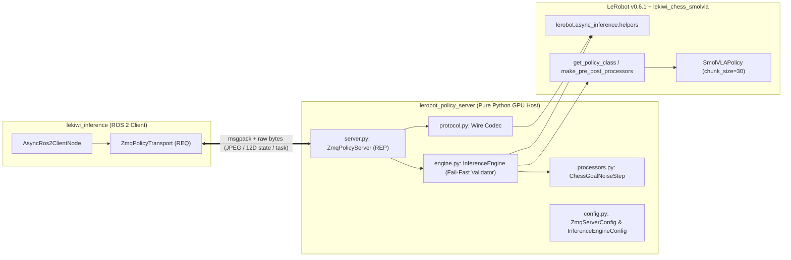

# LeRobot Policy Server (ZeroMQ) for LeKiwi Robot (SmolVLA / LeRobot v0.6.1)

High-performance GPU/Host policy inference server for **LeKiwi ROS 2**, serving [HuggingFace LeRobot v0.6.1](https://github.com/huggingface/lerobot) **SmolVLA** (Vision-Language-Action) policy predictions over **ZeroMQ (ZMQ)**.

This package adheres strictly to **Clean Code and SOLID principles** with a **Zero Backward-Compatibility** posture:
- 100% pure Python GPU host stack (isolated with `COLCON_IGNORE` to avoid contaminating ROS 2 workspace builds).
- Elimination of mock/fallback paths and complete removal of legacy ACT policy artifacts.
- Native integration with LeRobot v0.6.1 SmolVLA (`SmolVLAPolicy` fine-tuned from `lerobot/smolvla_base` with `SmolVLM2-500M-Video-Instruct`).
- **Fail-Fast Safety**: Missing or empty `task` instruction prompts are immediately rejected with error responses to prevent undefined robot behaviors.
- **Unified 12D Observation State**: Strict alignment with `chess_rosbag_to_lerobot` (6-DoF joint angles + 3D end-effector Cartesian coordinates + 3D dynamic relative delta to target).

---

## 1. Architecture



---

## 2. Directory Structure

```text
lekiwi_ros2/lerobot_policy_server/
├── config/
│   └── default.yaml                       # YAML Source of Truth for system configuration
├── pyproject.toml                         # Standard PEP 621 metadata (Python >=3.12, draccus, torch, etc.)
├── README.md                              # Complete architectural & operational documentation
├── src/
│   └── lerobot_policy_server/
│       ├── __init__.py                    # Public API exports
│       ├── __main__.py                    # Enables `python -m lerobot_policy_server`
│       ├── py.typed                       # PEP 561 typing marker
│       ├── config.py                      # Draccus dataclass schemas (PolicyServerConfig)
│       ├── configs/
│       │   └── default.yaml               # Bundled default YAML configuration asset
│       ├── protocol.py                    # Binary wire codec matching ZMQ transport
│       ├── processors.py                  # Custom LeRobot processor steps (ChessGoalNoiseStep)
│       ├── engine.py                      # Fail-Fast inference engine and SmolVLA tensor preparation
│       ├── server.py                      # Synchronous ZeroMQ REP server with background thread support
│       └── cli.py                         # Draccus CLI entry point (--config_path, nested overrides)
└── tests/
    ├── conftest.py                        # Fixtures matching lekiwi_chess_smolvla (3 JPEGs, 12D state, task)
    ├── test_config.py                     # Draccus parsing, YAML source of truth & CLI override tests
    ├── test_protocol.py                   # Two-way wire compatibility tests
    ├── test_engine.py                     # Direct SmolVLA execution & Fail-Fast unit tests
    └── test_server.py                     # End-to-end integration & error-reporting tests over ZMQ
```

---

## 3. Observation & State Specification

Per `chess_rosbag_to_lerobot` (single source of truth for physical data synthesis):

### 12D Unified `observation.state`
$$\mathbf{s} = \begin{bmatrix} \underbrace{q_1, \dots, q_6}_{\text{6D Joint States}}, & \underbrace{x_{\text{ee}}, y_{\text{ee}}, z_{\text{ee}}}_{\text{3D End-Effector Pose}}, & \underbrace{\Delta x, \Delta y, \Delta z}_{\text{3D Dynamic Relative Delta}} \end{bmatrix}^T \in \mathbb{R}^{12}$$

| Dimension | Key Name | Unit | Description |
| :--- | :--- | :--- | :--- |
| `[0]` | `arm_shoulder_pan.pos` | rad | Joint 1 position |
| `[1]` | `arm_shoulder_lift.pos` | rad | Joint 2 position |
| `[2]` | `arm_elbow_flex.pos` | rad | Joint 3 position |
| `[3]` | `arm_wrist_flex.pos` | rad | Joint 4 position |
| `[4]` | `arm_wrist_roll.pos` | rad | Joint 5 position |
| `[5]` | `arm_gripper.pos` | rad | Gripper joint position |
| `[6:9]` | `ee_x`, `ee_y`, `ee_z` | m | 3D TCP pose in `base_footprint` |
| `[9:12]` | `delta_x`, `delta_y`, `delta_z` | m | 3D Dynamic Relative Delta ($\mathbf{p}_{\text{target}} - \mathbf{p}_{\text{ee}}$) |

### Language Task Conditioning
- **`task`**: String prompt conditioning the SmolVLM2 language backbone (e.g. `"Move white pawn to target"`).
- **Rule**: Bắt buộc không rỗng. Nếu client gửi thiếu hoặc rỗng, Server lập tức từ chối và phản hồi lỗi.

---

## 4. Running the Server

### Option A: Using Default YAML Configuration

```bash
HF_HUB_OFFLINE=1 TRANSFORMERS_OFFLINE=1 \
python -m lerobot_policy_server.cli
```

### Option B: Using Custom YAML Configuration

```bash
python -m lerobot_policy_server.cli --config_path config/custom.yaml
```

### Option C: Overriding Parameters via Draccus CLI

```bash
python -m lerobot_policy_server.cli \
  --server.port 8095 \
  --engine.device cpu \
  --engine.preload true \
  --log_level DEBUG
```

### Option D: Pixi Environment

```bash
pixi run -e lerobot server
```

### Configuration Options (YAML & CLI)

| Nested Key | CLI Flag | Default | Description |
| :--- | :--- | :--- | :--- |
| `server.host` | `--server.host` | `0.0.0.0` | Host IP address to bind ZeroMQ REP socket |
| `server.port` | `--server.port` | `8090` | TCP port |
| `server.fps` | `--server.fps` | `30` | Server target loop FPS |
| `engine.fps` | `--engine.fps` | `30` | Policy inference target frame rate |
| `engine.policy_type` | `--engine.policy_type` | `smolvla` | LeRobot policy type (`smolvla`) |
| `engine.pretrained_name_or_path` | `--engine.pretrained_name_or_path` | `.../lekiwi_chess_smolvla` | Checkpoint path or HuggingFace repo ID |
| `engine.actions_per_chunk` | `--engine.actions_per_chunk` | `30` | Number of action steps per chunk horizon |
| `engine.device` | `--engine.device` | `cuda` | Target hardware device (`cuda` or `cpu`) |
| `engine.preload` | `--engine.preload` | `false` | Preload model weights at startup to eliminate latency |
| `log_level` | `--log_level` | `INFO` | Logging verbosity (`DEBUG`, `INFO`, `WARNING`, `ERROR`) |
| `--log-level` | `INFO` | `LOGLEVEL` | Logging verbosity (`DEBUG`, `INFO`, `WARNING`, `ERROR`) |
